# MicroLoan: Complete Technical Documentation

**Micro-Loan Management System** (brand name on screen: *MicroLoan*)
Software Engineering course project, NMIMS Hyderabad (B.Tech CS & Data Science)

> **Purpose of this file.** It is the single source document for building a technical PowerPoint presentation and the
> UML/DFD diagrams of this website. Everything in it was derived from the actual source files in this repository.
> Anything that could not be confirmed from the code is marked **Not Verified**, and anything that is not implemented
> is marked **Suggested** (never described as if it existed).

---

## Contents

| Part | Sections |
|---|---|
| **Understand the project** | 0 How to use this file, 1 Overview, 2 Technology stack, 3 Architecture, 4 Folder and file structure |
| **How it works** | 5 Frontend, 6 Backend, 7 Database, 8 Business rules and state machine |
| **Features and flows** | 9 Feature workflows (F1 to F17), 10 Complete user journey, 11 Data flow |
| **Quality** | 12 Security, 13 Error handling, 16 Testing and results, 17 Advantages, limitations, future work |
| **Diagrams** | 14 UML and system diagrams (14.1 to 14.16, Mermaid source), including swimlane diagrams (14.13), CRC cards (14.14) and the diagrams updated after the first audit (14.15) |
| **Presentation** | 15 Slide-by-slide plan (31 slides: the 27 requested plus 9a Requirements, 10a Wireframes and prototype, 17a Swimlane, 20a CRC cards; with speaker notes) |
| **Revision** | 18 Glossary, 19 Twenty viva questions, 20 Final checklist |
| **Appendices** | A Function index, B What exists, C Setup and run, D Seed data and logins, E Exporting diagrams, F Not Verified list |

---

## 0. How to use this document

### 0.1 Verification legend

| Tag | Meaning |
|---|---|
| **[Verified]** | Confirmed by reading the code or by running it. File and function names are given. |
| **[Not Verified]** | Could not be confirmed from the repository (for example a deployment that does not exist). |
| **[Suggested]** | A possible future improvement. It is **not** implemented. |

### 0.2 Snapshot of what was analysed

| Item | Value |
|---|---|
| Analysis date | 23 Oct 2026 |
| Source analysed | The project folder as committed on branch `main` (see `git log`). The `file:line` references were refreshed on 23 Oct 2026 against the code after the first-audit fixes (admin reassignment, POST logout, upload and decimal checks). Two untracked tooling items (`.agents/`, `skills-lock.json`) are not part of the application. |
| Code size | About 1,561 lines of Python, 1,740 lines of HTML templates, 386 lines of CSS, 99 lines of JavaScript |
| Python modules | 18 `.py` files, 20 HTML templates, 1 CSS file, 1 JS file |
| HTTP routes | 22 (plus Flask's built-in `static` route) |
| Database tables | 5 (`user`, `loan`, `repayment`, `document`, `loan_setting`) |
| Roles | 3 (`borrower`, `officer`, `admin`) |
| Line numbers | Written as `file.py:123`. They match the working tree on the analysis date and may shift after edits. |

### 0.3 Reading order for the presentation designer

1. Sections 1 to 4: what the project is and how it is organised.
2. Sections 5 to 8: how the pieces work (frontend, backend, database, rules).
3. Section 9: every feature, step by step (use this for the workflow slides).
4. Section 14: all diagrams, with Mermaid source and the slide each belongs on.
5. Section 15: the slide-by-slide plan, with speaker notes.
6. Sections 16 to 20: testing, limitations, glossary, viva questions, final checklist.
7. Appendices: complete route table, function index, seed data, commands.

### 0.4 Rendering the diagrams

All diagrams are written in **Mermaid** (render at https://mermaid.live, in VS Code with a Mermaid preview extension,
or on GitHub). Mermaid has no native DFD or use-case shapes, so those two diagram types are drawn with flowchart shapes
and **a notation table is given next to each** so they can be redrawn in standard notation in PowerPoint or draw.io.
No PlantUML is provided, because it could not be rendered and checked offline. All Mermaid blocks in this file were
rendered successfully in a browser before delivery (see section 16.4).

---

## 1. Project overview

### 1.1 What the website is

**[Verified]** MicroLoan is a server-rendered web application, written in Python with the Flask framework, in which:

- **Borrowers** register themselves, apply for a small loan (₹5,000 to ₹1,00,000 by default), upload one supporting
  document, follow the application's progress, and repay it in monthly installments.
- **Loan officers** review applications, approve or reject them (rejections need a written reason), and disburse approved
  loans. Disbursing automatically creates the repayment schedule.
- **Admins** manage users, create officer accounts, change the loan limits and interest rate, and view totals and
  reports with charts.

Repayments are **simulated**: a "Pay" button marks an installment as paid. No real money, payment gateway, credit
check or KYC is involved.

### 1.2 Problem statement

> The code contains no problem statement; the wording below is derived from the project's stated goals in
> `CLAUDE.md` section 1 and is meant for the presentation.

Small loans are often handled with paper forms or spreadsheets. That makes it hard to (a) check the same rules for
every applicant, (b) see what stage each application is at, (c) compute repayment schedules without arithmetic
mistakes, and (d) spot late payments. MicroLoan automates the whole life of a small loan in one system, with clear
roles and fixed rules.

### 1.3 Objectives

**[Verified]** from `CLAUDE.md` section 1 ("Goals in priority order") and the implemented behaviour:

1. Work end to end in a live demo: apply, review, approve, disburse, repay, close.
2. Keep the code simple enough for a second-year student to explain line by line.
3. Match the design diagrams (classes, states, flows) exactly.
4. Look clean and consistent (Bootstrap), not fancy.

### 1.4 Target users

| Role | How the account is created | Main job |
|---|---|---|
| Borrower | Self-registers at `/register` | Apply, track status, repay |
| Loan officer | Created by an admin at `/admin/users/new-officer` | Review, approve or reject, disburse |
| Admin | Created by `seed.py` only | Manage users, settings, view reports |

### 1.5 Key features (all implemented)

- Borrower registration; login and logout for all roles; each role is sent to its own dashboard.
- Loan application with a **live EMI preview** and one uploaded document (PDF, JPG or PNG, at most 2 MB).
- Business rules enforced by the server: amount and tenure limits, one active loan at a time, EMI at most 50% of
  income (the 50% is an admin setting), interest rate locked when the loan is applied for.
- Officer workflow with a fixed state machine and an "only the officer who picked it up can act on it" rule.
- Automatic EMI schedule at disbursal; installments must be paid in order; the loan moves to *Repaying* and then
  *Closed* automatically.
- Overdue detection (computed, not stored) with red badges.
- Admin user management, loan settings, dashboard totals, reports (pie chart, bar chart, overdue table).
- Seed script that loads demo users and a loan in almost every status.
- A yellow-and-blue user interface with a step tracker, progress bars and responsive layout.

### 1.6 Explicitly out of scope (from `CLAUDE.md` section 1)

Real payments, KYC or credit-bureau checks, SMS or email sending, password reset, OTP/2FA, a REST API or mobile app,
a React front end, cloud deployment, partial payments, prepayment, loan restructuring, multiple currencies.

### 1.7 Existing system and its limitations

**[Not Verified]** The repository contains no analysis of a "previous system". For the slide, use this clearly
labelled framing and confirm it with the project team:

| Typical manual approach | Limitation |
|---|---|
| Paper forms, spreadsheets, calculator | Rules applied inconsistently; EMI arithmetic errors |
| No shared status | Borrowers cannot see the stage of their application |
| Manual due-date tracking | Late installments are noticed late |
| No audit of who decided what | Approvals and rejections are not recorded with reasons |

### 1.8 How the project was built

**[Verified]** Eight build phases, one commit each (`git log`): skeleton, authentication, seed data, apply, officer
workflow, repayments, admin and reports, polish; then a final audit (Phase 9) written into `PROGRESS.md`. The
`CLAUDE.md` file is the design blueprint; `PROGRESS.md` is the build log with the plan, checks and decisions of each
phase.
A later session committed the yellow-and-blue redesign, fixed the issues of the audit (section 17.4) and added the `docs/`
folder with the SRS, diagrams, CRC cards, wireframes and prototype screenshots.

---

## 2. Technology stack

**[Verified]** from `requirements.txt` and `pip list` in `venv/`.

### 2.1 Languages and runtime

| Layer | Technology | Version | Where used |
|---|---|---|---|
| Server language | Python | 3.13.5 | All of `app/`, `seed.py`, `config.py`, `run.py` |
| Markup | HTML5 with Jinja2 templates | Jinja2 3.1.6 | `app/templates/` |
| Styling | CSS3 on top of Bootstrap 5 | Bootstrap 5.3.3 (CDN) | `app/static/css/style.css` |
| Browser scripting | JavaScript (plain, no framework) | n/a | `app/static/js/main.js`, inline chart script |

### 2.2 Python libraries (the only four direct dependencies)

| Library | Installed version | Role in this project |
|---|---|---|
| Flask | 3.1.3 | Web framework: routing, blueprints, request/response, sessions, templates |
| Flask-SQLAlchemy | 3.1.1 | Connects Flask to the database through SQLAlchemy models |
| Flask-Login | 0.6.3 | Keeps the user logged in across requests (session cookie) |
| python-dotenv | 1.2.4 | Reads `SECRET_KEY` from the `.env` file |

Installed automatically as dependencies of the above: SQLAlchemy 2.1.6 (ORM), Werkzeug 3.1.9 (password hashing,
file-name cleaning, development server), Jinja2 3.1.6, itsdangerous 2.2.0 (signs the session cookie),
MarkupSafe 3.0.4, Click 8.5.0, Blinker 1.9.0.

### 2.3 Front-end libraries (loaded from a CDN in `base.html`, not installed)

| Library | Version | Used for |
|---|---|---|
| Bootstrap | 5.3.3 | Grid, forms, buttons, navbar collapse, alerts |
| Bootstrap Icons | 1.11.3 | Icons |
| Chart.js | 4.4.4 | Pie and bar charts (admin reports page only) |

**Consequence:** the pages need an internet connection to show their styling and charts. **[Verified]** (`base.html`,
`admin/reports.html`).

### 2.4 Database and storage

| Item | Technology | Location |
|---|---|---|
| Database | SQLite (single file) | `instance/microloan.db` (created automatically; ignored by git) |
| Uploaded documents | Files on disk | `uploads/<uuid>.<ext>` (ignored by git; not under `static/`) |

### 2.5 Development tools

Git (the commits on `main`, one per build phase and then one per later change set), VS Code, PowerShell, a Python virtual environment `venv/`. **[Verified]**

### 2.6 What is NOT used

No REST/JSON API, no JavaScript framework, no WTForms/Flask-WTF (CSRF is hand-written), no Alembic/Flask-Migrate
(tables are created by `db.create_all()`), no Celery or scheduler, no external web services, no email or SMS provider,
no Docker, no automated test framework in the repository. **[Verified]**

---

## 3. Project architecture

### 3.1 Architecture style

**[Verified]** A **server-rendered monolith** with a layered structure that resembles MVC:

| Layer | Role | Code |
|---|---|---|
| View | HTML pages built from Jinja2 templates | `app/templates/`, `app/static/` |
| Controller | HTTP routes. Thin: read the request, call one service function, choose a response | `app/routes/*.py` |
| Service (business logic) | All rules and all status changes live in one place | `app/services/loan_service.py`, `app/services/emi.py` |
| Model | Database tables as Python classes | `app/models.py` |
| Utilities | Validation, role decorator, number and date formatting | `app/utils/*.py` |
| Data | SQLite file and the uploads folder | `instance/`, `uploads/` |

Cross-cutting concerns: authentication (Flask-Login), role checks (`@role_required`), CSRF check
(`before_request`), error pages (`errorhandler`).

### 3.2 How the front end and back end communicate

**[Verified]** There is **no separate API**. The browser sends ordinary HTTP requests and the server answers with a
complete HTML page, a redirect, or (for documents) a file.

- `GET` requests show pages.
- `POST` requests come from HTML `<form>` elements and carry a hidden `csrf_token`.
- After a successful `POST` the server redirects to a `GET` page (the *Post/Redirect/Get* pattern), so refreshing the
  page does not repeat the action.
- Messages to the user travel in Flask's `flash()` and are shown by `base.html`.
- JavaScript never calls the server: it only previews the EMI, shows a "busy" state on buttons, and draws charts
  from JSON that the server placed in the page with `|tojson`.

### 3.3 How the code connects to the database

`app/__init__.py:17` (`create_app`) creates the Flask app, calls `db.init_app(app)` (Flask-SQLAlchemy), registers the
five blueprints, and inside an application context runs `db.create_all()` and inserts the single `LoanSetting` row
(id 1) if it is missing. Models in `app/models.py` map to tables. Services use `db.session` (and `Model.query`) to read
and write. **Every service function that writes calls `db.session.commit()` once inside `try/except` with
`db.session.rollback()`.**

### 3.4 Component relationships (summary)

```
Browser  --HTTP-->  Flask app (create_app)
                      |-- before_request: check_csrf  (POST only)
                      |-- Blueprints: main, auth, borrower, officer, admin   (controllers)
                      |      \-- @role_required / @login_required
                      |-- Services: loan_service, emi                         (business rules)
                      |-- Models: User, Loan, Repayment, Document, LoanSetting
                      |-- Flask-SQLAlchemy --> SQLite file  instance/microloan.db
                      \-- File system: uploads/                               (documents)
```

### 3.5 Life of one request

**[Verified]** For an example request `POST /borrower/loans/2/pay`:

1. Browser sends the form with `csrf_token` and `repayment_id`, plus the signed session cookie.
2. Flask matches the URL to `borrower.pay` (`app/routes/borrower.py:72`).
3. `before_request` hook `check_csrf` (`app/__init__.py:71`) compares the form token with the session token.
   A mismatch flashes a warning and redirects without running the view.
4. Flask-Login's `load_user` (`app/models.py:132`) reads the user id from the cookie, loads the `User`, and returns
   nothing if the account is deactivated.
5. The `@role_required("borrower")` wrapper (`app/utils/decorators.py:10`) checks login and role (redirect to login, or 403).
6. The view loads the loan with ownership check `get_own_loan_or_404` (`borrower.py:15`).
7. It calls `loan_service.pay_installment` (`loan_service.py:363`), which enforces the rules, updates rows, and commits.
8. The view flashes a message and returns a redirect to the loan page.
9. The browser follows the redirect with `GET /borrower/loans/2`; the view renders `borrower/loan_detail.html`
   through `base.html`; Jinja filters `inr` and `date` format money and dates; the HTML is returned.

---

## 4. Folder and file structure

**[Verified]** from `git ls-files` and the file system.

```
micro-loan-system/
├── CLAUDE.md                 Project blueprint (rules, data model, pages, build phases)
├── PROGRESS.md               Build log: plan, checks and decisions for every phase
├── README.md                 Setup, run, seed, demo logins, demo script, folder tree
├── requirements.txt          The four Python dependencies
├── .env.example              Template for the .env file (SECRET_KEY=change-me)
├── .gitignore                Ignores venv/, instance/, uploads/, .env, __pycache__/
├── run.py                    Entry point: creates the app and runs the dev server
├── seed.py                   Resets the database and loads demo users and loans
├── config.py                 Config class: SECRET_KEY, database URI, upload folder, size limit, session cookie flags
├── docs/                     SE documents: SRS, diagrams (PNG and SVG), CRC cards, wireframes, prototype screenshots
├── app/
│   ├── __init__.py           create_app(): wiring, CSRF hook, error handlers, filters
│   ├── models.py             The five database models and their methods
│   ├── routes/
│   │   ├── main.py           Landing page, protected document viewer
│   │   ├── auth.py           Register, login, logout
│   │   ├── borrower.py       Borrower dashboard, apply, my loans, loan details, pay, cancel
│   │   ├── officer.py        Officer dashboard, applications list/detail, review actions
│   │   └── admin.py          Admin dashboard, users, create officer, settings, reports
│   ├── services/
│   │   ├── loan_service.py   State machine and ALL business rules
│   │   └── emi.py            EMI formula, affordability, month arithmetic, schedule builder
│   ├── utils/
│   │   ├── decorators.py     @role_required and dashboard_url
│   │   ├── validators.py     Form validation and the CSRF token helpers
│   │   └── formatters.py     Jinja filters: inr, inr_short, date
│   ├── templates/            20 Jinja2 templates (see section 5.1)
│   └── static/
│       ├── css/style.css     Design tokens and the Bootstrap re-skin
│       └── js/main.js        EMI preview, busy-button state
├── instance/                 microloan.db (SQLite)        [created at run time, not in git]
├── uploads/                  Uploaded loan documents      [created at run time, not in git]
└── venv/                     Python virtual environment   [not in git]
```

### 4.1 Size of each source file

| File | Lines | Purpose |
|---|---:|---|
| `app/services/loan_service.py` | 420 | Business rules, state machine, reports queries |
| `app/templates/*` (20 files) | 1,706 | All pages |
| `app/static/css/style.css` | 386 | Theme |
| `app/models.py` | 136 | Tables |
| `seed.py` | 142 | Demo data |
| `app/utils/validators.py` | 129 | Validation and CSRF |
| `app/__init__.py` | 103 | App factory |
| `app/routes/admin.py` | 99 | Admin controllers |
| `app/static/js/main.js` | 99 | Browser helpers |
| `app/routes/borrower.py` | 95 | Borrower controllers |
| `app/routes/officer.py` | 69 | Officer controllers |
| `app/services/emi.py` | 62 | EMI maths |
| `app/routes/auth.py` | 57 | Authentication controllers |
| `app/utils/formatters.py` | 31 | Formatting filters |
| `app/routes/main.py` | 30 | Landing page, documents |
| `app/utils/decorators.py` | 28 | Role check |
| `config.py` | 24 | Settings |

### 4.2 Folders created while the app runs

`instance/` and `uploads/` are created by `create_app()` (`os.makedirs`, `app/__init__.py:23-24`). Both are excluded from
git, so a fresh clone has no database until the app is started (and `seed.py` has been run for demo data).

---

## 5. Frontend

**[Verified]** The front end is made of Jinja2 templates, one CSS file and one small JavaScript file. There is no
single-page-application framework: every page is rendered on the server.

### 5.1 Template inventory

| Template | Shown by (route) | Extends | Shared macros it uses | Forms | Purpose |
|---|---|---|---|---:|---|
| `base.html` | (parent of all) | none | defines `nav_item` | 1 (the Logout form, POST) | Page frame: utility strip, header and role-based menu, flash alerts, footer, script tags. Blocks: `title`, `page`, `content`, `scripts` |
| `macros.html` | (imported) | none | defines 9 macros (5.3) | 0 | Reusable pieces |
| `main/index.html` | `/` | base (`page` block) | none | 0 | Landing page: hero, example EMI, facts, steps, features, lifecycle, call to action |
| `auth/login.html` | `/login` | base (`page`) | csrf_field, input_field | 1 | Split-screen login |
| `auth/register.html` | `/register` | base (`page`) | csrf_field, input_field | 1 | Split-screen borrower sign-up |
| `borrower/dashboard.html` | `/borrower/dashboard` | base | apply_button, empty_state, progress_bar, status_badge | 0 | Active loan card, next installment, overdue alert, recent payments |
| `borrower/apply.html` | `/borrower/apply` | base | breadcrumb, csrf_field, input_field | 1 | Application form and live EMI preview |
| `borrower/loans.html` | `/borrower/loans` | base | apply_button, breadcrumb, empty_state, status_badge | 0 | Table of the borrower's loans |
| `borrower/loan_detail.html` | `/borrower/loans/<id>` | base | breadcrumb, csrf_field, loan_stepper, progress_bar, schedule_table, status_badge | 1 (cancel) | Step tracker, facts, repayment summary, schedule with Pay button |
| `officer/dashboard.html` | `/officer/dashboard` | base | empty_state, status_badge | 0 | Three counters and "my pending work" |
| `officer/applications.html` | `/officer/applications` | base | breadcrumb, empty_state, status_badge | 1 (search, GET) | Filter tabs, search, table |
| `officer/application_detail.html` | `/officer/applications/<id>` | base | breadcrumb, csrf_field, schedule_table, status_badge | 4 (pick up, decision, disburse; reassign for the admin) | Facts, affordability meter, decision card, status history |
| `admin/dashboard.html` | `/admin/dashboard` | base | status_badge | 0 | Totals and shortcuts |
| `admin/users.html` | `/admin/users` | base | breadcrumb, csrf_field, empty_state | 2 | Role tabs, search, activate/deactivate |
| `admin/new_officer.html` | `/admin/users/new-officer` | base | breadcrumb, csrf_field, input_field | 1 | Create officer |
| `admin/settings.html` | `/admin/settings` | base | breadcrumb, csrf_field, input_field | 1 | Edit loan limits |
| `admin/reports.html` | `/admin/reports` | base (+ `scripts` block) | breadcrumb, empty_state, status_badge | 0 | Pie chart, bar chart, overdue table |
| `errors/403.html`, `404.html`, `500.html` | error handlers | base | none | 0 | Friendly error pages |

(`forms` counts `<form>` elements in the file; `macros.html` itself contains the form inside `schedule_table`.)

### 5.2 The page frame (`app/templates/base.html`)

1. **Utility strip** at the top: "Demo environment, payments are simulated" on the left; on the right either
   "Signed in as <name>" or "New here? Register in 2 minutes".
2. **Header** with the logo, the role-based menu (5.5) and either a user chip with a Logout button or Login/Register.
   The current page's menu link is underlined in yellow (`aria-current="page"`).
3. **Flash messages** from `flash()` become Bootstrap alerts with an icon (success, danger, warning, info).
4. **Page block**: by default a `<main class="container">` wrapping ``. The landing page and login and
   register pages override the whole `page` block so they can run edge to edge.
5. **Footer**: a full multi-column footer on the landing page, a slim one elsewhere.
6. **Scripts**: Bootstrap bundle, `main.js` on every page, then `` (Chart.js on the reports page).

### 5.3 Shared macros (`app/templates/macros.html`)

| Macro | What it renders |
|---|---|
| `csrf_field()` | Hidden input `csrf_token` (value from the global `csrf_token()` function) |
| `input_field(name, label, values, errors, type, required, help, prefix, **attrs)` | Label with required star, input that keeps the typed value, optional ₹ prefix, field-level error text |
| `status_badge(status)` | Coloured pill. Mapping below |
| `breadcrumb(items)` | Breadcrumb trail |
| `empty_state(icon, message, button_label, button_url, button_style)` | Friendly "nothing here" box with one button |
| `progress_bar(done, total, label)` | "3 of 6" progress bar with a yellow tip |
| `apply_button(has_active_loan)` | The "Apply for loan" action of the dashboard and My loans: a disabled button with the helper text "Available again once your current loan is closed." while a loan is active, an enabled yellow link otherwise |
| `loan_stepper(loan)` | Step tracker: Applied, Under Review, Approved, Disbursed, Repaying, Closed (shorter for Rejected and Cancelled) |
| `schedule_table(loan, pay_url)` | EMI schedule; overdue rows red; the **Pay** button only on the earliest Pending row |

**Status badge colours** (`CLAUDE.md` section 9, implemented in `status_badge`):

| Status | Bootstrap colour | Status | Bootstrap colour |
|---|---|---|---|
| Applied | secondary (grey) | Closed | success (green) |
| Under Review | info (cyan) | Rejected | danger (red) |
| Approved | primary (blue) | Cancelled | dark |
| Disbursed | warning (yellow) | Overdue | danger, **solid** (the loudest badge) |
| Repaying | warning (yellow) | Paid / Pending | success / secondary |

### 5.4 Jinja filters and globals (registered in `app/__init__.py`)

| Name | Defined in | Example |
|---|---|---|
| `inr` | `app/utils/formatters.py:4` | `100000` becomes `₹1,00,000.00` (Indian digit grouping) |
| `inr_short` | `formatters.py:21` | `5000` becomes `₹5,000` (used in headlines) |
| `date` | `formatters.py:27` | A date becomes `22 Oct 2026` |
| global `csrf_token()` | `validators.py:20` (`get_csrf_token`) | Returns the session's CSRF token |

### 5.5 Navigation by role

| Role | Menu items (at most five, by design) |
|---|---|
| Visitor | (landing page only) How it works, Why MicroLoan, Your loan step by step; buttons Login, Register |
| Borrower | Dashboard, Apply for loan, My loans |
| Officer | Dashboard, Applications |
| Admin | Dashboard, Users, Applications, Settings, Reports |

### 5.6 Forms, fields and validation

All POST forms contain `csrf_field()`. Forms use `novalidate`, so the **server's** field-level messages are what the
user sees; the HTML attributes (`required`, `type`, `maxlength`, `pattern`, `min`, `max`) only help the browser.

| Form | Route | Fields | Server-side validation |
|---|---|---|---|
| Register | `POST /register` | name, email, phone, monthly_income, password, confirm_password | `validate_user_form` (`validators.py:109`): name required and at most 100; email pattern, at most 120, **unique**; phone exactly 10 digits; income a number above 0; password at least 8 characters with a letter and a digit; passwords match |
| Login | `POST /login` | email, password | Email lower-cased; user must exist, password must match, account must be active |
| Apply for loan | `POST /borrower/apply` (multipart) | amount, tenure_months, purpose, document | `check_application` (`loan_service.py:158`): no active loan; amount within limits; tenure within limits and whole; purpose required and at most 200; document present, type, size; EMI within affordability limit |
| Review decision | `POST /officer/applications/<id>/approve` or `/reject` | remarks (textarea, at most 300) | Reject requires remarks; both limit length |
| Pick up / Disburse | `POST .../pickup`, `.../disburse` | none | State machine and ownership rules |
| Reassign (admin) | `POST /officer/applications/<id>/reassign` | officer_id (dropdown) | `reassign_loan`: admin only; loan Under Review or Approved; new officer active, an officer, and not the current one |
| Pay | `POST /borrower/loans/<id>/pay` | repayment_id (hidden) | Must be the earliest Pending installment |
| Cancel | `POST /borrower/loans/<id>/cancel` | none | Only the owner, only while Applied |
| Create officer | `POST /admin/users/new-officer` | name, email, phone, password, confirm_password | Same as register, without income |
| Loan settings | `POST /admin/settings` | interest_rate, min_amount, max_amount, min_tenure, max_tenure, max_emi_to_income | `validate_settings_form` (`validators.py:67`): rate 0 to 36; amounts above 0 and max above min; tenures whole, at least 1, max above min; EMI limit 1 to 100 |
| Activate/deactivate | `POST /admin/users/<id>/toggle` | none | Cannot deactivate yourself |
| Search and filter | `GET /officer/applications`, `GET /admin/users` | q, status or role | Unknown status or role values are ignored |

**Inputs keep their values on error:** the route passes `values` and `errors` back to the template; `input_field`
prints `value` and the error under the field. (Passwords are never echoed back.)

### 5.7 Event handling in the browser

| Event | Code | What happens |
|---|---|---|
| `input` on Amount and Tenure fields | `main.js` (inside `DOMContentLoaded`, apply page only) | Recalculates the EMI, total, interest and EMI limit and shows a message: within the limit, over the limit with the largest affordable amount, or outside the amount/tenure range |
| `submit` on any form | `main.js:24` | Adds a spinner and `is-busy` to the clicked button (ignores second clicks). Skipped if a `confirm()` was cancelled. The button is not disabled, so its value still posts |
| `pageshow` | `main.js:35` | Clears the busy state if the page comes back from the browser's back/forward cache |
| `onsubmit="return confirm(...)"` | Inline in templates | Confirmation dialog before: cancel application, pay installment, disburse, activate/deactivate user. `onclick="return confirm(...)"` guards **Reject** |
| Bootstrap JS | CDN | Navbar collapse on phones, dismissing alerts |
| Chart.js | inline script in `admin/reports.html` | Draws the pie chart and the bar chart |

### 5.8 Live EMI preview (the only real client-side logic)

`app/static/js/main.js` re-implements `calculateEmi` and `maxAffordableAmount` with the same formula as
`app/services/emi.py`. It reads the limits from `data-*` attributes on `<form id="apply-form">`
(`data-rate`, `data-max-pct`, `data-income`, `data-min-amount`, `data-max-amount`, `data-min-tenure`,
`data-max-tenure`), so it always uses the current admin settings. The **server repeats every check**; the preview is only
a convenience. During the build the JavaScript result for ₹50,000, 12 months, 12% was checked against Python (both
₹4,442.44) with Node (recorded in `PROGRESS.md`, Phase 4).

### 5.9 Look and feel

Yellow-and-blue theme on Bootstrap 5; design tokens at the top of `app/static/css/style.css`; rules in
`CLAUDE.md` section 9a. Key ideas: blue carries structure, **yellow marks the one next action per page**, buttons are at
least 44 px tall, system fonts only. On phones the step tracker runs top to bottom and each schedule row becomes a
two-line card so the Pay button never leaves the screen.

---

## 6. Backend

### 6.1 Entry points and configuration

| File | Role |
|---|---|
| `run.py` | `app = create_app()`; when run directly, `app.run(debug=True)` starts the Flask development server on `http://127.0.0.1:5000` |
| `app/__init__.py:17` `create_app` | Builds the app (see 3.3) |
| `config.py:10` `Config` | `SECRET_KEY` (from `.env`, with a development default), SQLite URI `instance/microloan.db`, `UPLOAD_FOLDER`, `MAX_CONTENT_LENGTH` = 3 MB |
| `seed.py:122` `main` | Resets the database and loads demo data (asks y/n first) |

### 6.2 Blueprints

| Blueprint | URL prefix | File | Routes |
|---|---|---|---:|
| `main` | none | `app/routes/main.py` | 2 |
| `auth` | none | `app/routes/auth.py` | 3 |
| `borrower` | `/borrower` | `app/routes/borrower.py` | 6 |
| `officer` | `/officer` | `app/routes/officer.py` | 4 |
| `admin` | `/admin` | `app/routes/admin.py` | 6 |

### 6.3 Complete route table (22 routes)

"Access" is enforced by the decorator on the view. `role(...)` means `@role_required(...)`.

| # | URL | Methods | View (file:line) | Access | Service call | Result |
|--:|---|---|---|---|---|---|
| 1 | `/` | GET | `main.index` (`main.py:14`) | public | `get_settings`, `sample_loan` | HTML landing page |
| 2 | `/documents/<id>` | GET | `main.view_document` (`main.py:22`) | role(borrower, officer, admin); a borrower must own the loan, else 404 | none (reads `Document`) | The file from `uploads/` |
| 3 | `/register` | GET, POST | `auth.register` (`auth.py:14`) | public (logged-in users are redirected) | `create_user` | Form, or redirect to borrower dashboard |
| 4 | `/login` | GET, POST | `auth.login` (`auth.py:32`) | public (logged-in users are redirected) | none (queries `User`) | Form, or redirect to the role's dashboard |
| 5 | `/logout` | POST | `auth.logout` (`auth.py:54`) | login required; CSRF token (a GET gives 405) | none | Redirect to `/` |
| 6 | `/borrower/dashboard` | GET | `borrower.dashboard` (`borrower.py:25`) | role(borrower) | `borrower_summary` | HTML |
| 7 | `/borrower/apply` | GET, POST | `borrower.apply` (`borrower.py:33`) | role(borrower) | `get_settings`, `apply_for_loan` | Form, or redirect to the new loan |
| 8 | `/borrower/loans` | GET | `borrower.loans` (`borrower.py:56`) | role(borrower) | none (queries `Loan`) | HTML |
| 9 | `/borrower/loans/<id>` | GET | `borrower.loan_detail` (`borrower.py:64`) | role(borrower), owner only (else 404) | none | HTML |
| 10 | `/borrower/loans/<id>/pay` | POST | `borrower.pay` (`borrower.py:72`) | role(borrower), owner only | `pay_installment` | Redirect to the loan page |
| 11 | `/borrower/loans/<id>/cancel` | POST | `borrower.cancel` (`borrower.py:87`) | role(borrower), owner only | `cancel_loan` | Redirect to the loan page |
| 12 | `/officer/dashboard` | GET | `officer.dashboard` (`officer.py:20`) | role(officer) | `officer_summary` | HTML |
| 13 | `/officer/applications` | GET | `officer.applications` (`officer.py:28`) | role(officer, admin) | `search_loans` | HTML |
| 14 | `/officer/applications/<id>` | GET | `officer.application_detail` (`officer.py:41`) | role(officer, admin) | `get_settings` | HTML (admin sees it read-only) |
| 15 | `/officer/applications/<id>/<action>` | POST | `officer.application_action` (`officer.py:69`) | role(officer) only | `pick_up_loan`, `approve_loan`, `reject_loan`, `disburse_loan` | Redirect to the application page; unknown action gives 404 |
| 16 | `/officer/applications/<id>/reassign` | POST | `officer.reassign_application` (`officer.py:53`) | role(admin) only | `reassign_loan` | Redirect to the application page (status unchanged) |
| 17 | `/admin/dashboard` | GET | `admin.dashboard` (`admin.py:26`) | role(admin) | `admin_totals` | HTML |
| 18 | `/admin/users` | GET | `admin.users` (`admin.py:33`) | role(admin) | `search_users` | HTML |
| 19 | `/admin/users/new-officer` | GET, POST | `admin.new_officer` (`admin.py:44`) | role(admin) | `create_user` | Form, or redirect to the officer list |
| 20 | `/admin/users/<id>/toggle` | POST | `admin.toggle_user` (`admin.py:59`) | role(admin) | `toggle_user_active` | Redirect to the user list |
| 21 | `/admin/settings` | GET, POST | `admin.settings` (`admin.py:79`) | role(admin) | `get_settings`, `update_settings` | Form, or redirect to itself |
| 22 | `/admin/reports` | GET | `admin.reports` (`admin.py:97`) | role(admin) | `admin_totals`, `disbursed_per_month`, `overdue_installments` | HTML with chart data |

**Note on "API":** none of these routes returns JSON. The words "API" in the presentation should be read as
"HTTP routes". **[Verified]**

### 6.4 Services (the business logic layer)

`app/services/loan_service.py` (all rules and status changes) and `app/services/emi.py` (arithmetic).

| Function | Line | Purpose |
|---|---:|---|
| `LoanError` | 33 | Exception whose message is shown to the user |
| `change_status(loan, new_status, actor)` | 39 | **The state machine.** Checks the transition table, the actor's role, borrower ownership, and officer ownership; then sets `loan.status` |
| `get_settings()` | 59 | Returns the single `LoanSetting` row (id 1) |
| `sample_loan(settings)` | 64 | Example loan for the landing page, from the current settings |
| `get_active_loan(borrower)` | 74 | The borrower's loan in an active status, or none |
| `create_user(values, password, role)` | 82 | Creates a borrower or officer (hashes the password; one commit with rollback) |
| `check_document(file)` | 104 | File presence, extension, non-empty, at most 2 MB |
| `check_affordability(...)` | 121 | EMI against income limit; builds the "you can borrow at most" message |
| `check_application(...)` | 135 | Runs rules 1 to 4 and the document check; returns an error dictionary |
| `apply_for_loan(...)` | 169 | Validates, creates `Loan` and `Document`, saves the file, commits (removes the file if the commit fails) |
| `cancel_loan(loan, borrower)` | 205 | Applied to Cancelled |
| `search_loans(status, text)` | 217 | Officer list: status filter; text is a loan id (`LN-0007`, `ln7`, `7`) or part of the borrower's name |
| `officer_summary(officer)` | 232 | Counts and "my pending work" |
| `pick_up_loan(loan, officer)` | 245 | Applied to Under Review; sets `officer_id` |
| `approve_loan(loan, officer, remarks)` | 256 | Under Review to Approved; sets `reviewed_on`, optional remarks |
| `reject_loan(loan, officer, remarks)` | 270 | Under Review to Rejected; remarks required; sets `reviewed_on` |
| `disburse_loan(loan, officer)` | 286 | Approved to Disbursed; sets `disbursed_on`; creates all `Repayment` rows; one commit |
| `pay_installment(loan, borrower, repayment_id)` | 302 | Pays the earliest Pending row; moves to Repaying, then Closed |
| `borrower_summary(borrower)` | 327 | Dashboard data: active loan, next due, overdue count, five recent payments |
| `search_users(role, text)` | 343 | Admin list filter |
| `toggle_user_active(user, admin)` | 354 | Flip `is_active`; not for yourself |
| `update_settings(numbers)` | 366 | Save the six settings and `updated_at` |
| `overdue_installments()` | 382 | All Pending rows with a past due date |
| `admin_totals()` | 388 | Users by role, loans by status, money totals, overdue count |
| `disbursed_per_month(months=6)` | 408 | Amount disbursed per month for the bar chart |

`app/services/emi.py`: `calculate_emi` (line 7), `max_affordable_amount` (16), `add_months` (27), `build_schedule` (36).

### 6.5 Middleware, hooks and decorators

| Mechanism | Where | Behaviour |
|---|---|---|
| CSRF check | `check_csrf` in `app/__init__.py:71` (`@app.before_request`) | For every `POST`: the form's `csrf_token` must equal the session token (`secrets.compare_digest`). Otherwise: flash warning, redirect back to the form page (same host only) or to `/` |
| Role check | `role_required(*roles)` in `app/utils/decorators.py:10` | Not logged in: `login_manager.unauthorized()` (redirect to `/login` with a warning). Wrong role: `abort(403)` |
| Login required | Flask-Login `@login_required` on `/logout` | Redirect to login |
| User loader | `load_user` in `app/models.py:132` | Loads the user for each request from the session; returns nothing for a deactivated user (so they are logged out) |
| Error handlers | `register_error_handlers` in `app/__init__.py:80` | 403, 404, 413 (too large), 500 (see section 13) |
| Template globals and filters | `create_app` | `inr`, `inr_short`, `date`, `csrf_token()` |

### 6.6 Authentication and authorisation

- **Authentication:** `auth.login` finds the user by lower-cased email and checks the password with
  `User.check_password` (Werkzeug `check_password_hash`). The same message "Invalid email or password." is shown for an
  unknown email and a wrong password. Deactivated accounts get a separate clear message. On success `login_user(user)`
  stores the user id in the signed session cookie.
- **Where the user goes after login:** `dashboard_url(user)` returns `url_for(f"{user.role}.dashboard")`. The `?next=`
  parameter is deliberately ignored.
- **Authorisation:** three layers. (1) `@role_required` per route; (2) ownership checks (`get_own_loan_or_404`, and
  the owner check in `view_document`) which answer **404** so another borrower's loan is not even revealed; (3) the state
  machine in `change_status`, which checks the actor again, so a typed URL cannot bypass the user interface.
- **Permission matrix:** borrower: apply, cancel own, view own, pay. Officer: view all, pick up, approve/reject/disburse
  **own** reviews, view documents. Admin: view all applications **read-only**, manage users and settings, reports.

### 6.7 Utilities

| Module | Contents |
|---|---|
| `app/utils/validators.py` | `get_csrf_token`, `csrf_token_is_valid`, `to_float` (rejects `nan` and `inf`), `to_int`, `validate_user_form`, `validate_settings_form`, `SETTING_FIELDS` |
| `app/utils/formatters.py` | `inr`, `inr_short`, `format_date` |
| `app/utils/decorators.py` | `role_required`, `dashboard_url` |

### 6.8 Seed script (`seed.py`)

`main()` asks for `y/n`, then in one transaction: `reset_database` (`drop_all`, `create_all`, one `LoanSetting` row),
`seed_users` (7 users), `seed_loans` (7 loans, with installments for the Closed and Repaying loans), commit; rolls back on
error. Seed dates are **relative to the day it is run** (see Appendix D).

---

## 7. Database

### 7.1 Overview

| Item | Value |
|---|---|
| Type | SQLite, a single file: `instance/microloan.db` |
| Access | SQLAlchemy ORM through Flask-SQLAlchemy (`db.session`, `Model.query`) |
| Creation | `db.create_all()` at start-up (`create_app`). **No migration tool.** Changing a model needs a manual reset (`python seed.py` drops and recreates everything) |
| Money type | `FLOAT`, rounded to 2 decimals in code **[Verified]** (see limitations) |
| Date/time | Naive local time (`datetime.now`, `date.today`); no time zones |

### 7.2 Tables

**`user`** (model `User`, `app/models.py:13`)

| Column | Type | Constraints | Notes |
|---|---|---|---|
| id | INTEGER | primary key | |
| name | VARCHAR(100) | not null | |
| email | VARCHAR(120) | not null, **unique** | stored lower-case |
| phone | VARCHAR(10) | nullable | 10 digits (checked in code) |
| password_hash | VARCHAR(256) | not null | Werkzeug scrypt hash (about 162 characters) |
| role | VARCHAR(20) | not null, default `borrower` | `borrower`, `officer`, `admin` |
| monthly_income | FLOAT | nullable | required for borrowers (in code) |
| is_active | BOOLEAN | default true | false means cannot log in |
| created_at | DATETIME | default now | |

Methods: `set_password`, `check_password`, `has_active_loan`.

**`loan`** (model `Loan`, `models.py:43`)

| Column | Type | Constraints | Notes |
|---|---|---|---|
| id | INTEGER | primary key | shown to users as `LN-0001` (`display_id()`) |
| borrower_id | INTEGER | not null, FK to `user.id` | the applicant |
| officer_id | INTEGER | nullable, FK to `user.id` | set when an officer picks it up |
| amount | FLOAT | not null | principal in ₹ |
| tenure_months | INTEGER | not null | |
| interest_rate | FLOAT | not null | annual %, **copied from settings at apply time** |
| emi_amount | FLOAT | not null | calculated at apply time |
| purpose | VARCHAR(200) | not null | |
| status | VARCHAR(20) | not null, default `Applied` | see 8.2 |
| remarks | VARCHAR(300) | nullable | officer's note (required on reject) |
| applied_on | DATETIME | default now | |
| reviewed_on | DATETIME | nullable | set on approve or reject |
| disbursed_on | DATE | nullable | |
| closed_on | DATE | nullable | |

Methods: `total_payable` (EMI times months), `amount_paid`, `outstanding`, `next_due_installment`, `display_id`.

**`repayment`** (model `Repayment`, `models.py:92`): one row per installment

| Column | Type | Constraints | Notes |
|---|---|---|---|
| id | INTEGER | primary key | |
| loan_id | INTEGER | not null, FK to `loan.id` | |
| installment_no | INTEGER | not null | 1 to n |
| due_date | DATE | not null | disbursal date plus *i* months |
| amount | FLOAT | not null | EMI; the last one absorbs rounding |
| status | VARCHAR(20) | not null, default `Pending` | `Pending` or `Paid` |
| paid_on | DATE | nullable | |

Method: `is_overdue()` (Pending **and** due date before today; computed, not stored).

**`document`** (model `Document`, `models.py:108`)

| Column | Type | Constraints | Notes |
|---|---|---|---|
| id | INTEGER | primary key | |
| loan_id | INTEGER | not null, FK to `loan.id` | |
| original_name | VARCHAR(200) | not null | cleaned with `secure_filename` |
| stored_name | VARCHAR(200) | not null | `uuid4().hex` plus extension, file lives in `uploads/` |
| uploaded_on | DATETIME | default now | |

**`loan_setting`** (model `LoanSetting`, `models.py:118`): a single row with `id = 1`

| Column | Default | Meaning |
|---|---|---|
| interest_rate | 12.0 | % per year for **new** applications |
| min_amount / max_amount | 5000 / 100000 | loan amount limits (₹) |
| min_tenure / max_tenure | 3 / 24 | months |
| max_emi_to_income | 50 | EMI limit as % of monthly income |
| updated_at | now | |

### 7.3 Keys and relationships

| Relationship | Cardinality | Implementation |
|---|---|---|
| `user` (borrower) to `loan` | one to many (0..*) | `loan.borrower_id`, ORM `User.loans` / `Loan.borrower` |
| `user` (officer) to `loan` | one to many (0..*), optional on the loan side | `loan.officer_id`, ORM `User.reviewed_loans` / `Loan.officer` |
| `loan` to `repayment` | one to many (0..*) | `repayment.loan_id`, ORM `Loan.repayments` (ordered by `installment_no`) |
| `loan` to `document` | one to zero-or-one | `document.loan_id`, ORM `Loan.document` (`uselist=False`) |
| `loan_setting` | no relationship | one global row |

**Points to state accurately in the presentation:**

- The "one document per loan" rule is enforced by the application (`uselist=False` and the apply flow), **not** by a unique
  constraint in the database.
- ORM cascade `all, delete-orphan` is set from `Loan` to `Repayment` and `Document`, but **no feature deletes a loan**; the
  only deletion of data is `seed.py` (`drop_all`).
- SQLite does not enforce foreign keys unless `PRAGMA foreign_keys=ON` is executed. A search of the code found **no**
  such statement, so referential integrity relies on the application. **[Verified by search]**
- The only database index beyond primary keys is the unique index on `user.email`. **[Verified]**
- There are no check constraints; all validation is in Python.

### 7.4 CRUD operations by table

| Table | Create | Read | Update | Delete |
|---|---|---|---|---|
| `user` | `create_user` (register, admin create officer); `seed_users` | login query; `load_user`; `search_users`; `admin_totals` | `toggle_user_active` (`is_active`) | none (only `seed.reset_database`) |
| `loan` | `apply_for_loan` | borrower pages; `search_loans`; `get_active_loan`; summaries; reports | `cancel_loan`, `pick_up_loan`, `approve_loan`, `reject_loan`, `disburse_loan`, `pay_installment` (status and dates) | none |
| `repayment` | `disburse_loan` (all rows at once) | `Loan.repayments`; `borrower_summary`; `admin_totals`; `overdue_installments` | `pay_installment` (`status`, `paid_on`) | none |
| `document` | `apply_for_loan` | `view_document`; `Loan.document` | none | none (the file is removed only if the apply commit fails) |
| `loan_setting` | `create_app` (row 1 if missing); `seed.reset_database` | `get_settings` | `update_settings` | none |

### 7.5 Demo data

`seed.py` creates 7 users, 7 loans, 10 installments (4 for the Closed loan, 6 for the Repaying loan) and the default
settings row. When this document was prepared, the live demo database held 8 users, 8 loans, 10 repayments and 1
document, which is consistent with one extra borrower account and one application having been created through the website after seeding (inferred from the counts).

---

## 8. Business rules and the loan state machine

### 8.1 Business rules (R1 to R11)

| # | Rule | Enforced in |
|--:|---|---|
| R1 | Amount between `min_amount` and `max_amount` | `check_application` (`loan_service.py:169`) |
| R2 | Tenure a whole number of months between `min_tenure` and `max_tenure` | `check_application` (`loan_service.py:174`), `to_int` |
| R3 | One active loan at a time (Applied, Under Review, Approved, Disbursed, Repaying) | `User.has_active_loan` (`models.py:38`), `check_application` (`loan_service.py:160`) |
| R4 | EMI must be at most `max_emi_to_income` % of monthly income; the message shows the largest affordable amount | `check_affordability` (`loan_service.py:144`) |
| R5 | EMI by the reducing-balance formula, rounded to paise; last installment adjusted so the total equals EMI times n | `calculate_emi`, `build_schedule` (`emi.py:7`, `emi.py:36`) |
| R6 | Interest rate is locked when applying; later settings changes affect only new loans | `apply_for_loan` copies `settings.interest_rate` (`loan_service.py:205`) |
| R7 | Schedule created only at disbursal; installment *i* due on disbursal date plus *i* months (month-end safe) | `disburse_loan` (`loan_service.py:311`), `add_months` (`emi.py:27`) |
| R8 | Only the earliest Pending installment can be paid | `pay_installment` (`loan_service.py:370`) |
| R9 | Overdue = Pending and past due date; computed; no late fee | `Repayment.is_overdue` (`models.py:103`) |
| R10 | One document per application; PDF, JPG or PNG; at most 2 MB; the first bytes must match the type; renamed with a uuid | `check_document` (`loan_service.py:110`), `apply_for_loan` |
| R11 | After pick-up, only the assigned officer can approve, reject or disburse; an admin can reassign an Under Review or Approved loan to another active officer (status unchanged) | `change_status` (`loan_service.py:52-54`), `reassign_loan` (`loan_service.py:343`) |

### 8.2 The loan state machine

`ALLOWED_TRANSITIONS` (`loan_service.py:24`) is a dictionary whose keys are `(from status, to status)` and whose value is
the **role** allowed to make that change. Any pair that is not in the dictionary is rejected with a clear `LoanError`.

| From | To | Who | Extra checks in `change_status` | Side effects (set by the calling service function) |
|---|---|---|---|---|
| Applied | Cancelled | owning borrower | borrower id must match | none |
| Applied | Under Review | any officer | none | `officer_id` set (`pick_up_loan`) |
| Under Review | Approved | the assigned officer | `loan.officer_id == actor.id` | `reviewed_on` = now, `remarks` (`approve_loan`) |
| Under Review | Rejected | the assigned officer | same | `reviewed_on` = now, `remarks` required (`reject_loan`) |
| Approved | Disbursed | the assigned officer | same | `disbursed_on` = today; n `Repayment` rows created (`disburse_loan`) |
| Disbursed | Repaying | system | actor is the string `"system"` | on the first payment (`pay_installment`) |
| Repaying | Closed | system | actor is `"system"` | `closed_on` = today, when no installment is Pending (`pay_installment`) |

Final states: **Closed, Rejected, Cancelled**. All other combinations (for example Applied to Approved, or Approved to
Cancelled) are impossible. During the audit, all 384 combinations of (from status, to status, actor) were tried and
exactly these 7 transitions (8 actor cases) were accepted.

`change_status` itself only assigns `loan.status`; the caller sets dates and ids and performs the single commit. This is
why every transition goes through one function and one commit.

**Reassignment is not a transition.** `reassign_loan(loan, new_officer, admin)` (`loan_service.py:343`) lets an admin move an
*Under Review* or *Approved* loan to another active officer. Only `officer_id` changes, the status stays, and the change is one
commit with rollback. Rule R11 then applies to the new officer (the old one is refused). Deactivating an officer who still holds
such loans shows a warning with the count.

### 8.3 EMI mathematics

For principal *P*, annual rate *a* %, months *n*: monthly rate `r = a / 12 / 100`.

- If `r = 0`: `EMI = P / n`.
- Otherwise: `EMI = P × r × (1 + r)^n / ((1 + r)^n − 1)`, rounded to 2 decimals.
- Total payable `= EMI × n`. The last installment is `total − EMI × (n − 1)`, so the schedule always adds up exactly.

Worked examples (verified by running the code):

| Loan | EMI | Total payable | Interest |
|---|---:|---:|---:|
| ₹50,000, 12 months, 12% | ₹4,442.44 | ₹53,309.28 | ₹3,309.28 |
| ₹30,000, 6 months, 12% | ₹5,176.45 | ₹31,058.70 | ₹1,058.70 |

Due dates: `add_months` keeps the day, or uses the last day of a shorter month: 31 Jan plus 1 month gives 28 Feb
(29 Feb in a leap year).

### 8.4 Affordability

`max_emi = monthly_income × max_emi_to_income / 100`. If the EMI is higher, the application is refused and the message
names the largest principal whose EMI fits: `P = max_emi × ((1+r)^n − 1) / (r × (1+r)^n)`, rounded **down** to whole
rupees and capped at `max_amount` (`max_affordable_amount`, `emi.py:16`). Example: income ₹5,000 (limit ₹2,500 a month)
at 12% for 12 months gives ₹28,137.

### 8.5 Overdue

There is no stored "overdue" flag and no background job. Every time a page needs it, `Repayment.is_overdue()` compares the
due date with today's date. It feeds the red badge, the dashboard alert, the admin total and the overdue report.

---

## 9. Feature workflows (how each feature works inside)

Each feature lists: purpose, what the user does, the front-end parts, the back-end functions, the database operations,
the data exchanged, the result, and the source files. All entries are **[Verified]** against the code.

### F1. Landing page

| Item | Detail |
|---|---|
| Purpose | Explain the service to visitors, and show the live loan limits and a worked EMI example |
| User steps | Open `/`. Click **Apply for a loan** (to register), **Login**, or scroll through the sections |
| Front end | `main/index.html` (overrides the `page` block): hero, example card, facts strip, three steps, four feature tiles, lifecycle chips, call-to-action band, footer |
| Back end | `main.index` (`main.py:14`) calls `get_settings()` and `sample_loan(settings)` (`loan_service.py:66`) |
| Database | `SELECT` the `loan_setting` row. No writes |
| Data exchanged | Server to browser: HTML with limits (amount range, tenure range, rate, EMI limit) and an example EMI computed from them |
| Result | A page whose numbers always match the admin's current settings. If the admin changes the rate to 14%, the example becomes ₹4,489.36 |
| Files | `app/routes/main.py`, `app/templates/main/index.html`, `app/services/loan_service.py`, `app/services/emi.py` |

### F2. Borrower registration

| Item | Detail |
|---|---|
| Purpose | Let a new borrower create an account. Nobody can choose their own role |
| User steps | Open `/register`, fill name, email, phone, monthly income, password, confirm password, press **Create account** |
| Front end | `auth/register.html`, macros `input_field` and `csrf_field` |
| Back end | `auth.register` (`auth.py:14`): redirect away if already logged in; on POST `validate_user_form(request.form, with_income=True)` (`validators.py:109`); if no errors `loan_service.create_user(values, password, role="borrower")` (`loan_service.py:84`), then `login_user(user)`, flash, redirect to the borrower dashboard |
| Database | `SELECT user WHERE email = ?` (uniqueness check); `INSERT user` with the password stored as a scrypt hash; `COMMIT` (rollback on error) |
| Data exchanged | Browser to server: form fields plus `csrf_token`. Server to browser: on error, the same form (HTTP 200) with kept values and a message under each wrong field; on success, redirect (HTTP 302) |
| Result | A logged-in borrower on the dashboard. The role is hard-coded as `"borrower"` in the route, so a `role` field in a forged request is ignored |
| Files | `auth.py`, `validators.py`, `loan_service.py`, `models.py` (`User.set_password`) |

### F3. Login

| Item | Detail |
|---|---|
| Purpose | Authenticate any of the three roles |
| User steps | Open `/login`, enter email and password, press **Login** |
| Front end | `auth/login.html` |
| Back end | `auth.login` (`auth.py:32`): lower-case the email; load the user; `check_password`; reject deactivated accounts; `login_user(user)`; redirect to `dashboard_url(user)` |
| Database | `SELECT user WHERE email = ?`. No writes |
| Data exchanged | Email, password, `csrf_token` to the server. Session cookie (signed) back to the browser |
| Result | Borrower goes to `/borrower/dashboard`, officer to `/officer/dashboard`, admin to `/admin/dashboard`. Wrong credentials show "Invalid email or password." (same text for unknown email and wrong password). A deactivated account sees a different, clear message |
| Files | `auth.py`, `decorators.py` (`dashboard_url`), `models.py` (`User.check_password`, `load_user`) |

### F4. Logout

`POST /logout` (`auth.logout`, `auth.py:54`, `@login_required`): `logout_user()`, flash "You have been logged out.",
redirect to `/`. It is POST only and carries the CSRF token (the navbar Logout button is a small form), so a link or image
cannot log someone out; a plain GET gives 405. No database access.

### F5. Role-based dashboards

| Dashboard | Route and function | Data function | Content |
|---|---|---|---|
| Borrower | `/borrower/dashboard`, `borrower.dashboard` | `borrower_summary` (`loan_service.py:388`) | Active loan card, next installment, overdue alert, progress bar, last five payments, Apply button (disabled while a loan is active) |
| Officer | `/officer/dashboard`, `officer.dashboard` | `officer_summary` (`loan_service.py:257`) | Counts: New (Applied), Under my review, Approved awaiting disbursal; table of "my pending work" |
| Admin | `/admin/dashboard`, `admin.dashboard` | `admin_totals` (`loan_service.py:449`) | Users by role, loans by status, ₹ disbursed, ₹ collected, ₹ outstanding, overdue count |

Database: read-only `SELECT`s on `loan`, `repayment` and `user`.

### F6. Apply for a loan (with live EMI preview)

| Item | Detail |
|---|---|
| Purpose | Create a loan application that obeys rules R1 to R4, R6 and R10 |
| User steps | Open **Apply for loan**. Type an amount and a tenure (the preview updates at once). Write a purpose. Choose a document. Press **Submit application** |
| Front end | `borrower/apply.html`; `main.js` preview (reads `data-*` limits from the form); `input_field` with the ₹ prefix; if the borrower already has an active loan the form is replaced by a warning |
| Back end | `borrower.apply` (`borrower.py:33`) converts text with `to_float` and `to_int`, then calls `apply_for_loan` (`loan_service.py:194`). That function loads settings, calls `check_application` (`:135`, which uses `check_document` `:104` and `check_affordability` `:121`), and if there are no errors builds the `Loan` (status Applied, rate copied from settings, EMI from `calculate_emi`), saves the file as `uploads/<uuid>.<ext>`, adds a `Document`, commits once. If the commit fails it rolls back **and deletes the file just written** |
| Database | `SELECT loan_setting`; `SELECT loan` rows of the borrower (active-loan check); `INSERT loan`; `INSERT document`; `COMMIT` |
| Files on disk | One new file in `uploads/` |
| Data exchanged | Multipart form: `amount`, `tenure_months`, `purpose`, `document`, `csrf_token`. Response: redirect to `/borrower/loans/<id>` with a success message; or the same page (HTTP 200) with an error under each wrong field (dictionary keys: `amount`, `tenure_months`, `purpose`, `document`, `form`) |
| Result | A loan in status **Applied** with a locked rate and EMI. A request larger than 3 MB is stopped by Flask (HTTP 413) and handled by `too_large`, which flashes a message and returns to the form |
| Files | `borrower.py`, `loan_service.py`, `emi.py`, `validators.py` (`to_float`, `to_int`), `apply.html`, `main.js` |

### F7. My loans and loan details

| Item | Detail |
|---|---|
| Purpose | Let a borrower follow their applications |
| User steps | Open **My loans**, then **View** on a row |
| Front end | `borrower/loans.html` (table, empty state); `borrower/loan_detail.html` (breadcrumb, step tracker, officer remarks, facts, repayment summary, progress bar, schedule). A fully repaid loan shows a success banner |
| Back end | `borrower.loans` (`borrower.py:56`), `borrower.loan_detail` (`:64`) using `get_own_loan_or_404` (`:15`): a loan that belongs to someone else gives **404** |
| Database | `SELECT loan WHERE borrower_id = ?` (newest first); `SELECT repayment` through `Loan.repayments` |
| Result | Status badge and tracker, amounts, officer name and remarks, dates, and (after disbursal) the schedule |
| Files | `borrower.py`, `loans.html`, `loan_detail.html`, `macros.html` |

### F8. Cancel an application

`POST /borrower/loans/<id>/cancel` (`borrower.cancel`, `borrower.py:87`) after a browser `confirm()` dialog:
`get_own_loan_or_404`, then `cancel_loan` (`loan_service.py:230`) which calls `change_status(loan, "Cancelled", borrower)`
and commits. Allowed only for the owner and only while the status is **Applied**; otherwise a `LoanError` message is
flashed. Database: `UPDATE loan SET status`.

### F9. Officer application queue

| Item | Detail |
|---|---|
| Purpose | Find applications to work on |
| User steps | Open **Applications**; click a status tab; type a borrower name or a loan id (`LN-0007`, `ln7` or `7`) and search |
| Back end | `officer.applications` (`officer.py:28`): validates the `status` value against `STATUS_TABS`; calls `search_loans(status, text)` (`loan_service.py:242`). A text that looks like an id matches that loan; any other text is a case-insensitive part of the borrower's name |
| Database | `SELECT loan JOIN user` with filters, newest first. No pagination (all matches) |
| Access | Officers **and admins** (the admin view is read-only) |
| Files | `officer.py`, `loan_service.py`, `officer/applications.html` |

### F10. Officer review: pick up, approve, reject

| Item | Detail |
|---|---|
| Purpose | Move an application through review under the state machine, with rule R11 |
| User steps | Open an application. **Pick up for review** (Applied to Under Review). Then write optional remarks and press **Approve**, or write remarks (required) and press **Reject** after a confirm dialog |
| Front end | `officer/application_detail.html` shows only the buttons that are valid for the current status and for this officer. Other officers see "Assigned to <name>. Only they can act." Admins see a read-only banner |
| Back end | One POST route for all four actions: `officer.application_action` (`officer.py:69`) accepts `pickup`, `approve`, `reject`, `disburse` and gives 404 for anything else. It calls `pick_up_loan` (`:245`), `approve_loan` (`:256`) or `reject_loan` (`:270`); each calls `change_status` (`:39`) and commits once. **The server enforces the same rules as the screen**, so typing a URL cannot bypass them |
| Database | `UPDATE loan` (`status`, `officer_id` on pick-up; `reviewed_on` and `remarks` on decision) |
| Data exchanged | Optional `remarks` plus `csrf_token`. Redirect back to the application page with a flash message, or a red message if a rule is broken (for example "Please enter remarks explaining why the application is rejected.") |
| Result | Status changes exactly as in the transition table; the borrower sees the new status and remarks on their loan page |
| Files | `officer.py`, `loan_service.py`, `application_detail.html`, `macros.html` |

### F11. Disbursal and schedule generation

| Item | Detail |
|---|---|
| Purpose | Pay out an approved loan and create its repayment schedule |
| User steps | The assigned officer opens an Approved application and presses **Disburse ₹X** (confirm dialog) |
| Back end | `disburse_loan` (`loan_service.py:311`): `change_status(loan, "Disbursed", officer)`; `disbursed_on = today`; `build_schedule(loan, disbursed_on)` (`emi.py:36`) returns one row per month; a `Repayment` is appended for each; **one commit** saves the status and every installment together |
| Database | `UPDATE loan` (status, `disbursed_on`); `INSERT repayment` x n (all `Pending`) |
| Result | A 12-month loan gets 12 rows, due on the disbursal day of each following month (month-end safe); the schedule total equals EMI times n to the paisa. The page shows the schedule |
| Files | `loan_service.py`, `emi.py`, `application_detail.html`, `schedule_table` macro |

### F12. Repayment (simulated payment)

| Item | Detail |
|---|---|
| Purpose | Let the borrower pay installments in order, and close the loan automatically |
| User steps | On the loan page press **Pay** on the highlighted row, confirm the dialog |
| Front end | `schedule_table` renders the Pay button **only** on the earliest Pending row, with a hidden `repayment_id` |
| Back end | `borrower.pay` (`borrower.py:72`) calls `pay_installment` (`loan_service.py:363`): checks ownership, status (Disbursed or Repaying), and that `repayment_id` equals the earliest Pending row (rule R8); marks it Paid with today's date; on the first payment `change_status(loan, "Repaying", "system")`; if no installment is Pending, `change_status(loan, "Closed", "system")` and `closed_on = today`; **one commit** |
| Database | `UPDATE repayment` (`status`, `paid_on`); `UPDATE loan` (`status`, and `closed_on` at the end) |
| Result | Success message; after the last payment "Your loan is now closed!" and a success banner; the borrower can apply again |
| Protection | Paying installment 3 before 2, paying twice, or paying someone else's loan is refused by the server |
| Files | `borrower.py`, `loan_service.py`, `macros.html`, `loan_detail.html` |

### F13. Overdue detection

`Repayment.is_overdue()` (`models.py:103`) returns true when `status == "Pending"` and `due_date < today`. It is evaluated
whenever a page is built: red solid **Overdue** badge and red row in schedules, the alert on the borrower dashboard
(`borrower_summary.overdue_count`), the admin total (`admin_totals`), and the admin report (`overdue_installments`,
`loan_service.py:443`). There is no stored flag, no scheduler and no late fee.

### F14. Document upload and protected viewing

| Item | Detail |
|---|---|
| Upload | Part of F6. Checks: file chosen; extension in `.pdf .jpg .jpeg .png`; not empty; at most 2 MB (`MAX_DOCUMENT_BYTES`). The stored name is `uuid4().hex` plus the extension; the display name is cleaned with `secure_filename` |
| Storage | `uploads/` folder, **outside** `static/`, so there is no public URL |
| Viewing | `GET /documents/<id>` (`main.view_document`, `main.py:22`), allowed for borrowers, officers and admins. A borrower who is not the owner gets 404. The file is sent with `send_from_directory(UPLOAD_FOLDER, stored_name, download_name=original_name)` |
| Not done | The file content is not inspected (type is judged by the extension only) **[Verified]** |

### F15. Admin: users and officers

| Function | Route | Back end | Database |
|---|---|---|---|
| List, filter by role, search name or email | `GET /admin/users` | `search_users` (`loan_service.py:404`) | `SELECT user` with filters |
| Create an officer | `POST /admin/users/new-officer` | `validate_user_form(with_income=False)` then `create_user(..., role="officer")` | `INSERT user` (income is empty) |
| Activate or deactivate | `POST /admin/users/<id>/toggle` | `toggle_user_active` (`:354`): flips `is_active`; refuses for yourself | `UPDATE user SET is_active` |

A deactivated user cannot log in, and an already open session ends on the next request (`load_user` returns nothing).

### F16. Admin: loan settings

`admin.settings` (`admin.py:79`). GET shows current values (numbers printed without trailing `.0`). POST runs
`validate_settings_form` (rate 0 to 36; amounts above 0 and max above min; tenures whole, at least 1, max above min;
EMI limit 1 to 100) and `update_settings` (`loan_service.py:427`) which writes all six fields and `updated_at`.
**Existing loans keep the rate they were created with; only new applications, the apply page and the landing page use
the new values.**

### F17. Admin: reports

`admin.reports` (`admin.py:97`) builds three things: the status counts (pie chart; colours from `STATUS_COLORS`), the
amount disbursed in each of the last six months (`disbursed_per_month`, `loan_service.py:479`), and the overdue
installments table (`overdue_installments`). The two chart datasets are placed in the page with `|tojson` and drawn by
Chart.js from the CDN. Each chart has a "View as table" fallback. The pie keeps a counted legend beside it.

---

## 10. The complete user journey

### 10.1 One loan from start to finish (the demo script)

| Step | Who | Page or route | What the system does | Database change | Loan status after |
|--:|---|---|---|---|---|
| 1 | Visitor | `/` | Shows landing page with live limits | none | n/a |
| 2 | Visitor | `/register` (POST) | Validates, hashes password, creates a borrower, logs in | INSERT `user` | n/a |
| 3 | Borrower | `/borrower/apply` (POST) | Applies rules R1 to R4, R10, computes EMI (₹50,000, 12 months, 12% gives ₹4,442.44), saves document | INSERT `loan`, INSERT `document`, file saved | **Applied** |
| 4 | Borrower | `/borrower/apply` again | Refused: "You already have an active loan" (R3) | none | Applied |
| 5 | Officer | `/officer/applications/<id>/pickup` | Sets the assigned officer | UPDATE `loan` | **Under Review** |
| 6 | Officer | `.../approve` | Records review time and remarks | UPDATE `loan` | **Approved** |
| 7 | Officer | `.../disburse` | Creates 12 installments, sets disbursal date | UPDATE `loan`, INSERT `repayment` x 12 | **Disbursed** |
| 8 | Borrower | `/borrower/loans/<id>/pay` (installment 1) | Marks installment 1 Paid | UPDATE `repayment`, UPDATE `loan` | **Repaying** |
| 9 | Admin | `/admin/settings` (rate 14%) | Saves new settings (this loan stays at 12%) | UPDATE `loan_setting` | Repaying |
| 10 | Admin | `/admin/reports` | Shows the loan in the status pie and the month bar | none | Repaying |
| 11 | Borrower | pays installments 2 to 12 | After the last payment the loan closes by itself | UPDATE `repayment`, UPDATE `loan` (`closed_on`) | **Closed** |
| 12 | Borrower | `/borrower/apply` | Allowed again | none | n/a |

### 10.2 A visitor's journey in words

1. Open the homepage and read the example EMI and limits. 2. Register (or log in). 3. Land on the dashboard, which says
there is no active loan. 4. Open **Apply for loan**, type ₹50,000 and 12 months and watch the preview. 5. Submit with a
document; see the new loan with status *Applied* and the step tracker. 6. Wait for an officer; the tracker and remarks
update. 7. After disbursal, see the schedule and pay each installment. 8. After the last payment see the "Loan fully
repaid" banner and apply again if needed.

---

## 11. Data flow

### 11.1 Data stores

| Id | Store | Physical form |
|---|---|---|
| D1 | Users | table `user` |
| D2 | Loans | table `loan` |
| D3 | Repayments | table `repayment` |
| D4 | Documents | table `document` plus files in `uploads/` |
| D5 | Settings | table `loan_setting` (one row) |

### 11.2 Main flows in plain language

- **Read path** (viewing a page): browser sends `GET` with the session cookie; Flask loads the user; the route asks a
  service or queries the models; SQLAlchemy runs `SELECT` on SQLite; the template renders HTML; the browser shows it.
- **Write path** (a form): browser sends `POST` with `csrf_token`; `check_csrf` verifies it; the view validates input; a
  service applies business rules, changes model objects and commits once; the view flashes a message and redirects to
  a `GET` page (Post/Redirect/Get).
- **Session:** after login Flask-Login keeps the user id in a signed cookie (signed with `SECRET_KEY` by itsdangerous).
  The same cookie holds the CSRF token and pending flash messages.
- **Files:** a document travels with the apply form (multipart), is written to `uploads/` by `apply_for_loan`, and
  later streams back only through `/documents/<id>`.
- **Chart data:** the server converts dictionaries to JSON in the HTML (`|tojson`); Chart.js reads that JSON in the
  browser. No separate request is made.

### 11.3 Flows between the actors and the system

| From | To | Data |
|---|---|---|
| Borrower | System | Registration details; login credentials; loan application (amount, tenure, purpose, document); cancel request; payment request |
| System | Borrower | Loan status and remarks; EMI quote and schedule; confirmations and error messages; dashboard summaries |
| Officer | System | Login; pick-up, approve (optional remarks), reject (remarks), disburse commands |
| System | Officer | Application queue and details; documents; schedules |
| Admin | System | Login; officer details; activate/deactivate requests; loan settings |
| System | Admin | User list; totals; reports and charts; read-only application views |

---

## 12. Security

| Area | Mechanism | Where | Limit or note |
|---|---|---|---|
| Password storage | Salted **scrypt** hash from Werkzeug (`scrypt:32768:8:1`, about 162 characters). The plain password is never stored, logged or shown | `User.set_password` / `check_password` (`models.py:30,34`) | Verified by generating a hash in the project's environment |
| Password policy | At least 8 characters with a letter and a digit | `validate_user_form` (`validators.py:139-142`) | No lockout or rate limit **[Verified: none in code]** |
| Authentication | Flask-Login session cookie; deactivated users cannot log in and are logged out on the next request | `auth.login`, `load_user` | |
| Authorisation | `@role_required` on every protected route; 403 for a wrong role; unauthenticated visitors are redirected to login | `decorators.py:10` | |
| Ownership | A borrower can only open their own loans and documents; other ids return **404** | `get_own_loan_or_404`, `view_document` | |
| State-machine enforcement | The server re-checks actor and ownership in `change_status`, so URL tampering cannot skip rules | `loan_service.py:41` | |
| CSRF | One random token per session (`secrets.token_hex(16)`), embedded in every POST form, checked for every POST in a `before_request` hook with a constant-time comparison | `validators.py:20,23`, `__init__.py:71` | Hand-written (no library). During the audit, token-less POSTs to every POST route in all three roles changed nothing in the database |
| XSS | Jinja2 auto-escaping on all output; chart data inserted with `|tojson` | all templates | Tested: a `<script>` tag in the purpose field is shown as text |
| SQL injection | SQLAlchemy ORM with bound parameters; search uses `ilike` with a bound value | `loan_service.py` | No raw SQL anywhere **[Verified by reading]** |
| File uploads | Extension whitelist, size limit (2 MB, plus a 3 MB request cap), the first bytes must match PDF / PNG / JPEG, uuid file name, stored outside `static/`, served only through a protected route | `check_document`, `apply_for_loan`, `main.view_document` | Content is not scanned; a text file renamed `.pdf` would be accepted |
| Open redirects | Login ignores `?next=`; a failed CSRF check redirects only to a URL on the same host | `auth.login`, `check_csrf` | |
| Secrets | `SECRET_KEY` read from `.env` (ignored by git); a development default exists if `.env` is missing | `config.py:14` | Set a real value in `.env` before any real use |
| Session cookie flags | `SESSION_COOKIE_SAMESITE = "Lax"` and `SESSION_COOKIE_HTTPONLY = True`; `Secure` off (plain HTTP locally) | `config.py` | `Secure` would be turned on with HTTPS **[Not Verified for any deployment]** |
| Transport | Plain HTTP on `127.0.0.1` | `run.py` | No HTTPS configuration **[Not Verified for any deployment]** |
| Debug mode | `app.run(debug=True)` | `run.py:8` | For local use only |

---

## 13. Error handling

| Situation | Mechanism | What the user sees | Where |
|---|---|---|---|
| Invalid form input (register, apply, settings, create officer) | Validators return an `errors` dictionary; the page is re-rendered (HTTP 200) with the typed values kept | A red message under each wrong field | `validators.py`, `check_application`, `input_field` macro |
| A business rule is broken (wrong status, not your loan, out of order payment, reject without remarks) | The service raises `LoanError` with a clear message; the route catches it | A red alert at the top of the page; nothing is saved | `loan_service.py`, routes |
| Not logged in | `login_manager.unauthorized()` | Redirect to `/login` with "Please log in to continue." | `decorators.py`, `__init__.py:12-14` |
| Wrong role | `abort(403)` | The styled 403 page | `decorators.py:20`, handler `__init__.py:83` |
| Missing record, or another borrower's record | `db.get_or_404` and `abort(404)` | The styled 404 page | routes, handler `__init__.py:88` |
| Unknown officer action in the URL | `abort(404)` | 404 page | `officer.py:87` |
| Missing or wrong CSRF token | `check_csrf` | Warning "Your form expired or was invalid. Please try again." and a redirect back | `__init__.py:71` |
| Upload larger than 3 MB | HTTP 413 handled by `too_large` | Red message "The file is too large. The maximum size is 2 MB." and back to the form | `__init__.py:93` |
| Database error during a write | Every service write is in `try/except` with `db.session.rollback()`, then the error is re-raised | A 500 page | `loan_service.py` (all write functions) |
| Failure while saving an application | Rollback and the just-written file is deleted | A 500 page; no half-created loan | `apply_for_loan` (`:197-201`) |
| Any unexpected exception | 500 handler also rolls back the session | The styled 500 page | `__init__.py:99` |
| Deactivated account | Checked at login and in `load_user` | Clear message at login, or sent to login on the next request | `auth.login`, `models.py:132` |

**Design property:** a status change and its related rows are saved in **one commit** (disbursal with all installments;
payment with the status change). If anything fails, nothing is saved (NFR9 in `CLAUDE.md`).

---

## 14. UML and system diagrams

All diagrams are derived from the code described in sections 3 to 13. Mermaid source is given so that each one can
be edited and rendered. Names in the diagrams (functions, tables, routes) are the real names in the project.
The maintained set, as PNG and SVG, is in the `docs/` folder (see `docs/README.md`).

### 14.0 Notes on notation

- **DFD (Yourdon and DeMarco style).** External entity = rectangle. Process = circle with a number. Data store = open
  rectangle with an id (D1 to D5). Data flow = labelled arrow. Mermaid has no open rectangle, so stores are drawn as
  cylinders; when redrawing in PowerPoint, use the standard open-ended store shape.
- **Use case diagrams.** Mermaid has no UML use-case shapes. Actors are drawn as rounded boxes and use cases as ovals
  inside a "system boundary" box, one diagram per actor so each stays readable. Dotted arrows labelled *include* or
  *extend* follow UML meaning. Redraw with stick figures if the presentation requires strict UML.
- **Activity diagrams** are drawn as flowcharts: rounded start/end, rectangles for actions, diamonds for decisions.
- **DFD consistency rules used here:** Level 0 shows one process and the same three external entities as Levels 1 and 2;
  every Level 1 flow to or from an entity is part of a Level 0 flow; Level 1 is drawn on two sheets that share one flow
  list (14.5); Level 2 diagrams refine exactly one Level 1 process and keep the same data stores and flows entering and
  leaving it.
- **Names that differ slightly from `CLAUDE.md` section 14:** Process 1 is "Manage Accounts and Settings" (the code handles
  loan settings in the same admin module), and Process 2 is "Apply for or Cancel Loan" (the borrower's cancel action is
  in the same module). The other four processes use the blueprint names.

---

### 14.1 System architecture diagram

**Purpose:** show the whole system at a glance and the path of a request. **Slide:** 8 (System Architecture).

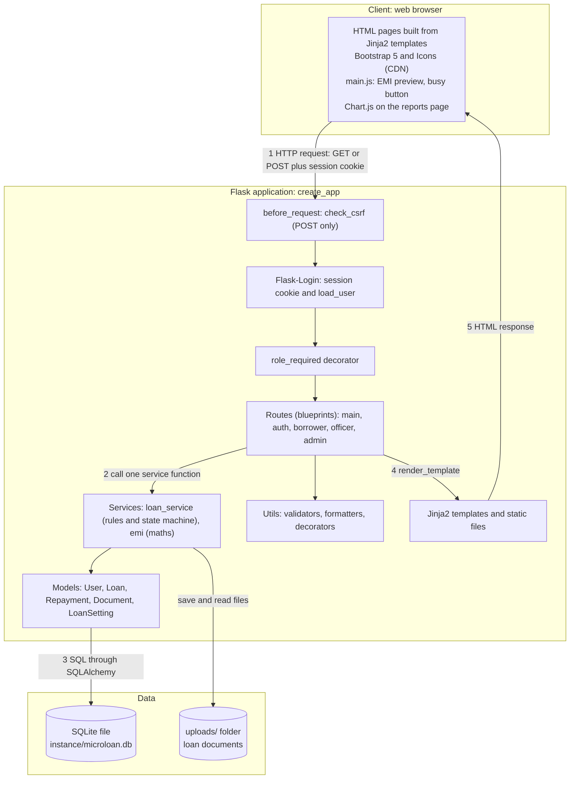

**Elements:** browser, Flask app (hook, login, role check, routes, services, utils, models, templates), SQLite file,
uploads folder. **Relationships:** numbered 1 to 5 in request order. **Explanation:** a request passes the CSRF hook (if it
is a POST), the user is identified, the role is checked, the route calls a service, the service uses models to reach the
database, and a template turns the result into HTML. Routes never change loan status directly.

---

### 14.2 Component diagram

**Purpose:** show the parts of the software and what each depends on. **Slide:** 20 (Class / Component Diagram).

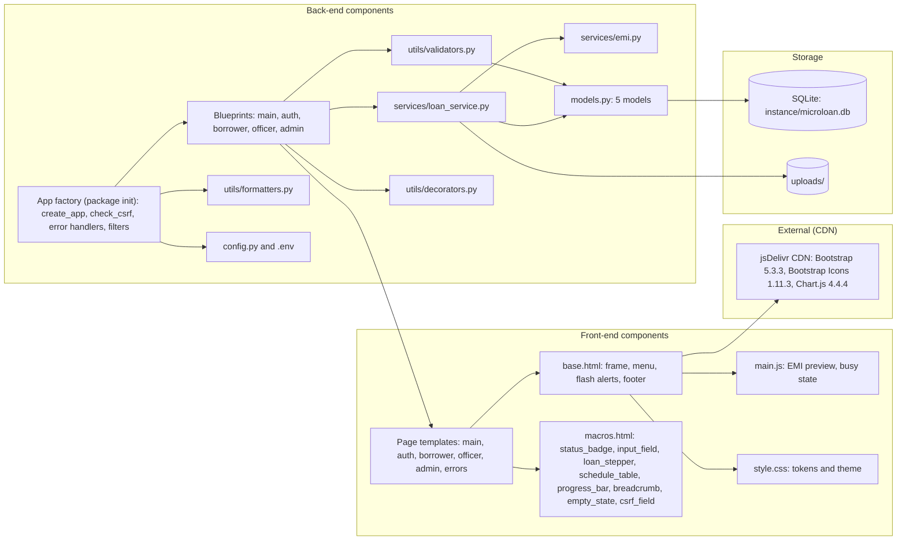

**Explanation:** the front end is templates plus two static files plus CDN libraries; the back end is the app factory,
five controllers (blueprints), the service layer, utilities and models; storage is one SQLite file and one folder.
`loan_service` is the only place with business rules.

---

### 14.3 Deployment diagram

**Purpose:** show where the software runs. **Slide:** 8 or 21. **Important:** the project runs **locally only**.
Cloud deployment is out of scope (`CLAUDE.md` section 1). A production setup is **Not Verified** because none exists.

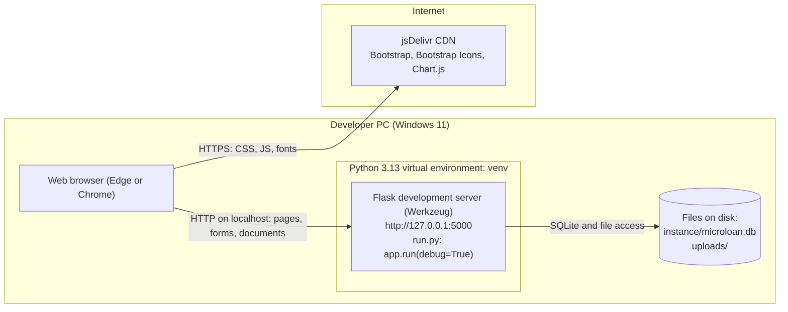

**Explanation:** the browser and the server are on the same computer. The pages need internet only to fetch the CDN files.
There is no reverse proxy, no HTTPS on the application, and no separate database server.

---

### 14.4 Data flow diagram, Level 0 (context)

**Purpose:** show the system as one process and every outside party. **Slide:** 12.

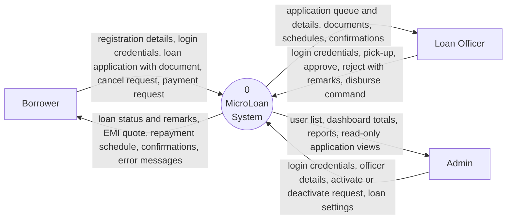

**Elements:** three external entities, one process. **Note:** the CDN is a delivery dependency of the browser, not a
party exchanging business data, so it is not an entity here.

---

### 14.5 Data flow diagram, Level 1

**Purpose:** break the system into its six processes and five data stores. **Slide:** 13.

Level 1 is drawn on **two sheets** (large DFDs are normally drawn on several pages, and a single sheet with all 30 flows
is unreadable). Stores are repeated on the sheets where they are used. How to read the arrows:

- A **double-headed arrow between an external entity and a process** is two flows: the request going in and the response coming out. The label reads "in / out".
- A **single arrow between a process and a data store** shows the direction of the data: process to store is a **write**, store to process is a **read**.

**Sheet 1: processes 1, 2, 3 (accounts and settings, apply or cancel, review)**

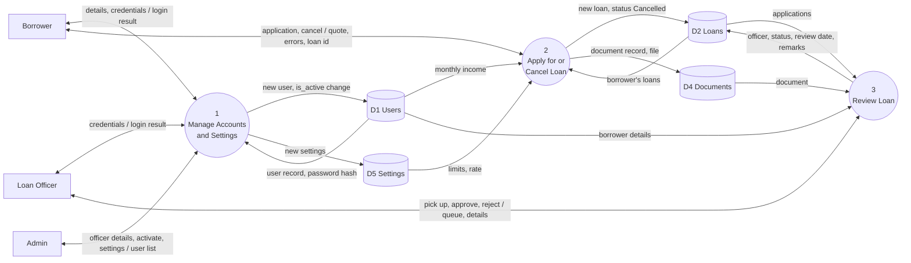

**Sheet 2: processes 4, 5, 6 (disburse and schedule, repayment, reports)**

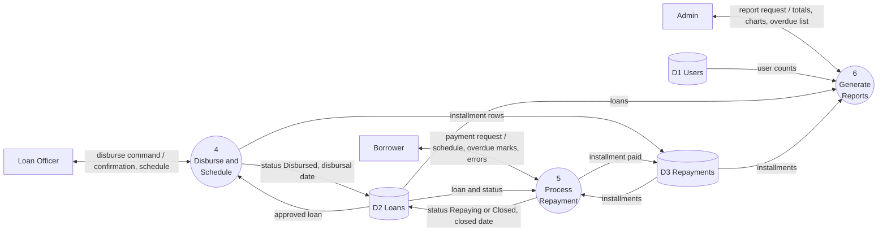

**Level 1 flow list (the single source of truth for both sheets).** Use this table to draw the diagram in any other tool.

| # | From | To | Data |
|--:|---|---|---|
| 1 | Borrower | P1 | registration details, credentials |
| 2 | P1 | Borrower | login result, confirmations |
| 3 | Loan Officer | P1 | credentials |
| 4 | P1 | Loan Officer | login result |
| 5 | Admin | P1 | officer details, activate or deactivate request, new settings |
| 6 | P1 | Admin | user list, confirmations |
| 7 | P1 | D1 | new user, `is_active` change |
| 8 | D1 | P1 | user record, password hash |
| 9 | P1 | D5 | new settings |
| 10 | Borrower | P2 | application (amount, tenure, purpose, document), cancel request |
| 11 | P2 | Borrower | EMI quote, error messages, loan id |
| 12 | D5 | P2 | limits and rate |
| 13 | D1 | P2 | monthly income |
| 14 | D2 | P2 | the borrower's existing loans |
| 15 | P2 | D2 | new loan, or status Cancelled |
| 16 | P2 | D4 | document record and file |
| 17 | Loan Officer | P3 | pick up, approve, reject with remarks |
| 18 | P3 | Loan Officer | application queue and details, confirmations |
| 19 | D2 | P3 | applications |
| 20 | D1 | P3 | borrower details |
| 21 | D4 | P3 | document |
| 22 | P3 | D2 | officer id, status, review date, remarks |
| 23 | Loan Officer | P4 | disburse command |
| 24 | P4 | Loan Officer | confirmation, schedule |
| 25 | D2 | P4 | approved loan |
| 26 | P4 | D2 | status Disbursed, disbursal date |
| 27 | P4 | D3 | installment rows |
| 28 | Borrower | P5 | payment request |
| 29 | P5 | Borrower | schedule, overdue marks, confirmations, errors |
| 30 | D3 | P5 | installments |
| 31 | D2 | P5 | loan and status |
| 32 | P5 | D3 | installment paid |
| 33 | P5 | D2 | status Repaying or Closed, closed date |
| 34 | Admin | P6 | report request |
| 35 | P6 | Admin | totals, charts, overdue list |
| 36 | D1 | P6 | user counts |
| 37 | D2 | P6 | loans |
| 38 | D3 | P6 | installments |

**Consistency with Level 0:** the flows between entities and processes (rows 1 to 6, 10, 11, 17, 18, 23, 24, 28, 29, 34, 35)
are the detailed form of the six Level 0 flows (for example rows 10 and 11 together are part of the Level 0 flows
"loan application with document" and "loan status, EMI quote"). Stores never exchange data with entities directly.

**Mapping to code:** P1 = `app/routes/auth.py` and the user and settings functions in `app/routes/admin.py`; P2 =
`borrower.apply`, `borrower.cancel`; P3 = `officer.py` (`pick_up_loan`, `approve_loan`, `reject_loan`); P4 =
`disburse_loan`; P5 = `borrower.pay`, `pay_installment`; P6 = `admin.reports` and `admin_totals`.

---

### 14.6 Data flow diagrams, Level 2

**Slides:** 14 (use one slide per diagram, or show 2 and 5, which carry the most rules).

#### Level 2: Process 2 "Apply for or Cancel Loan" (apply path)

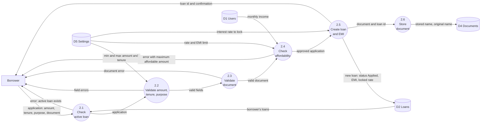

Order of checks in the code (`check_application`, `loan_service.py:158`): active loan, then amount, tenure and purpose, then
document, then affordability only if amount and tenure are valid. All errors are returned together as one dictionary.

#### Level 2: Process 3 "Review Loan"

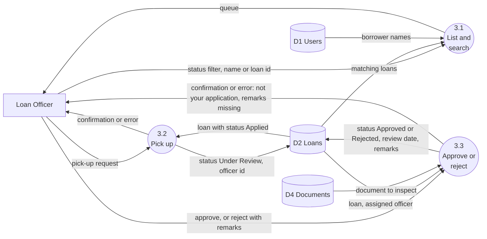

#### Level 2: Process 4 "Disburse and Schedule"

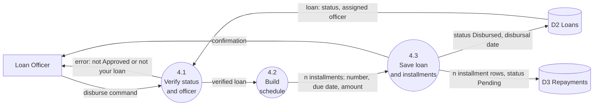

Process 4.3 is one database commit: the status change and every installment row are saved together or not at all.

#### Level 2: Process 5 "Process Repayment"

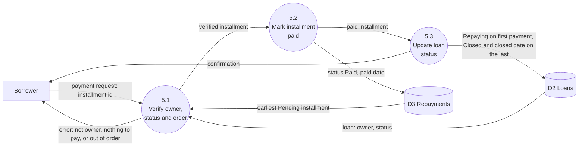

---

### 14.7 Use case diagrams

**Purpose:** actors and what they can do. **Slide:** 15. Derived from the permission matrix (`CLAUDE.md` section 4) and the
22 routes. One diagram per actor keeps each one readable on a slide; the actors **Loan Officer** and **Admin** share
the use cases *Login and logout*, *View dashboard* and *View document*, and the borrower diagram also shows the secondary
actor **System**.

#### UC-1. Borrower (and the System as a secondary actor)

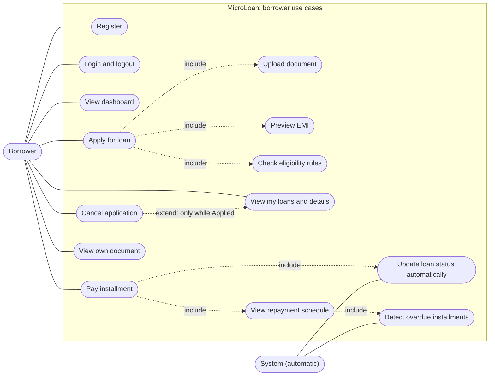

#### UC-2. Loan officer

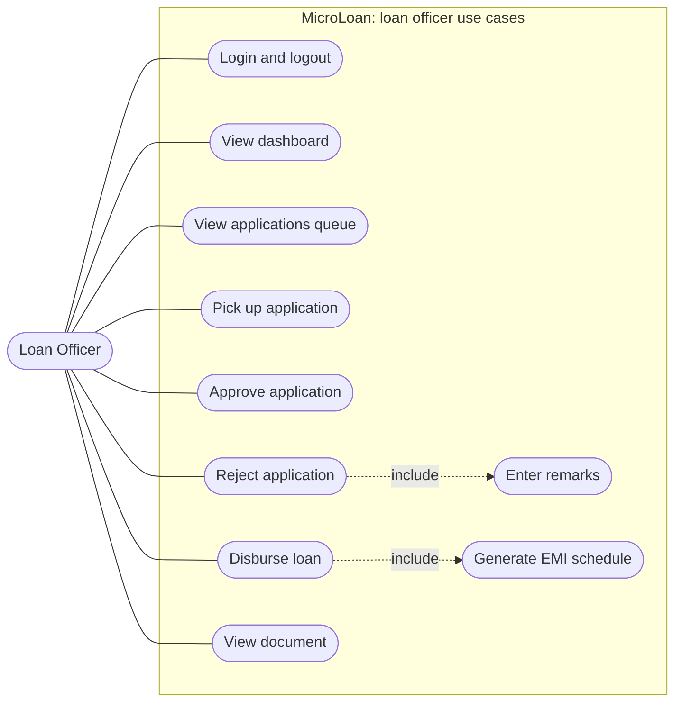

#### UC-3. Admin

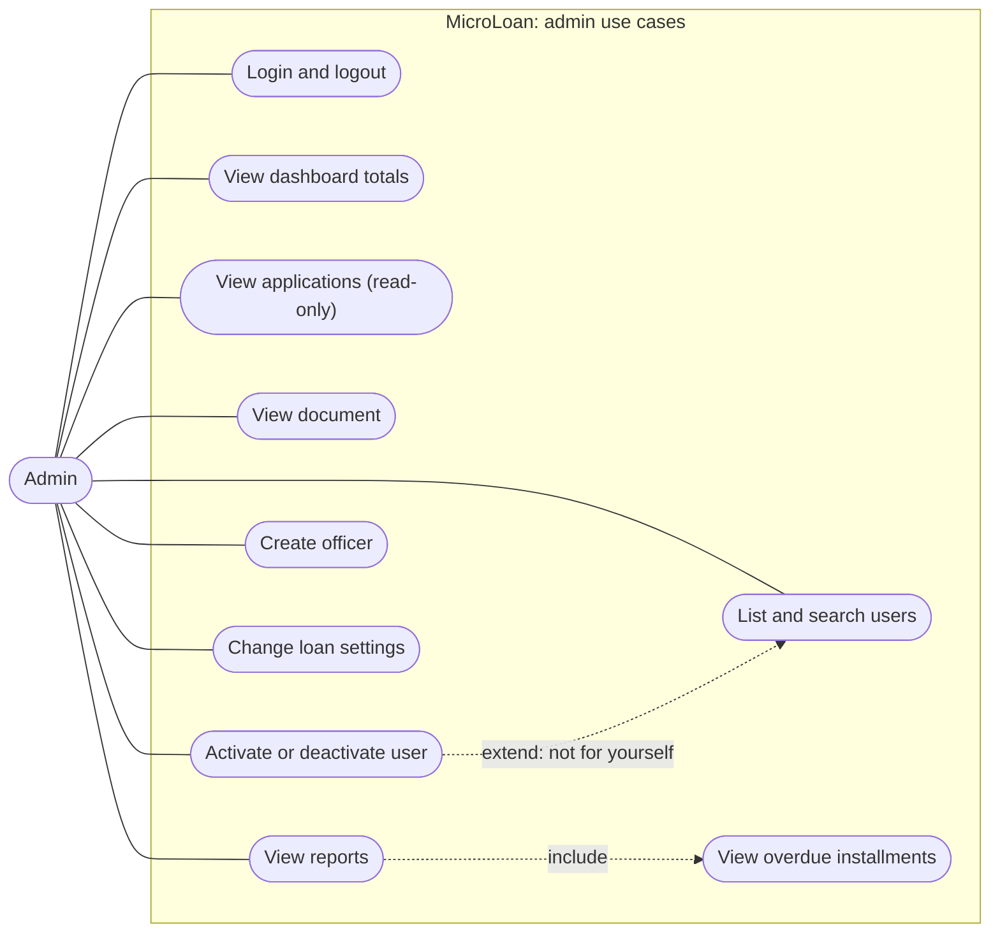

**Notes that keep it accurate:**

- The admin can open the applications list and details but only to **read** (routes 13 and 14 allow admin; the action route 15 does not).
- "View document" is allowed for the owning borrower, any officer, and the admin.
- "Officer acts on own reviews only" is a rule on Approve, Reject and Disburse (rule R11); any officer may *Pick up*.
- "Update loan status automatically" and "Detect overdue installments" are done by code during payment and page
  rendering, not by a background job. The **System** actor is a modelling choice to show them.
- Officers cannot apply, cancel or pay; borrowers cannot open any `/officer` or `/admin` page (403).

---

### 14.8 Entity relationship diagram (ERD)

**Purpose:** the database structure. **Slides:** 18 and 19.

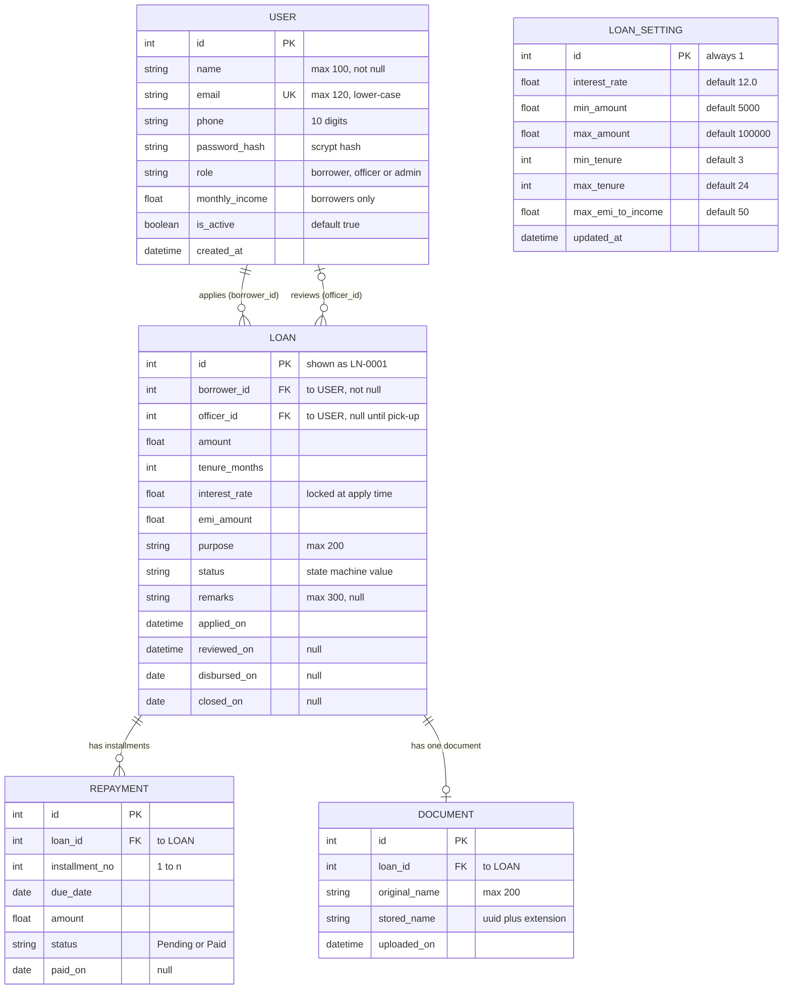

**Cardinality notes:** a user can be a borrower of many loans and an officer of many loans (two separate foreign keys on
`loan`). `officer_id` is optional. A loan has zero or more repayments (none until disbursal) and at most one document (rule
enforced in code, not by a database constraint). `LOAN_SETTING` is deliberately unrelated: it holds one global row.
Overdue is **not** a column.

---

### 14.9 Class diagrams

**Purpose:** the classes (database models) and the service modules around them. **Slide:** 20. The class diagram is split in
two so that each stays readable: 14.9a shows the **domain classes** and their associations, 14.9b shows the **service layer**.
The services are Python **modules** with functions, not classes; they are drawn as classes (with the word "module")
because the course blueprint uses `LoanService` and `EMICalculator` as class names in its design documents.

#### 14.9a Domain classes (models)

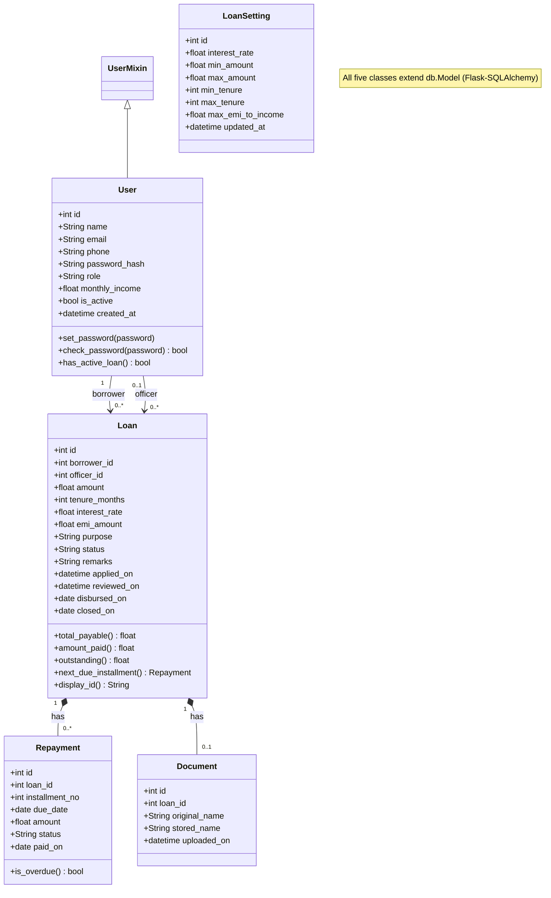

**Reading the diagram:** `Loan` is the central class. `Repayment` and `Document` belong to a loan (composition: the ORM
cascade deletes them with the loan, although no feature deletes loans). `User` appears twice towards `Loan` because of two
roles (borrower and officer, the officer side being optional). `User` also inherits Flask-Login's `UserMixin` so the user
can be remembered in the session. `LoanSetting` has no relationships: it holds one global row.

#### 14.9b Service layer and its dependencies

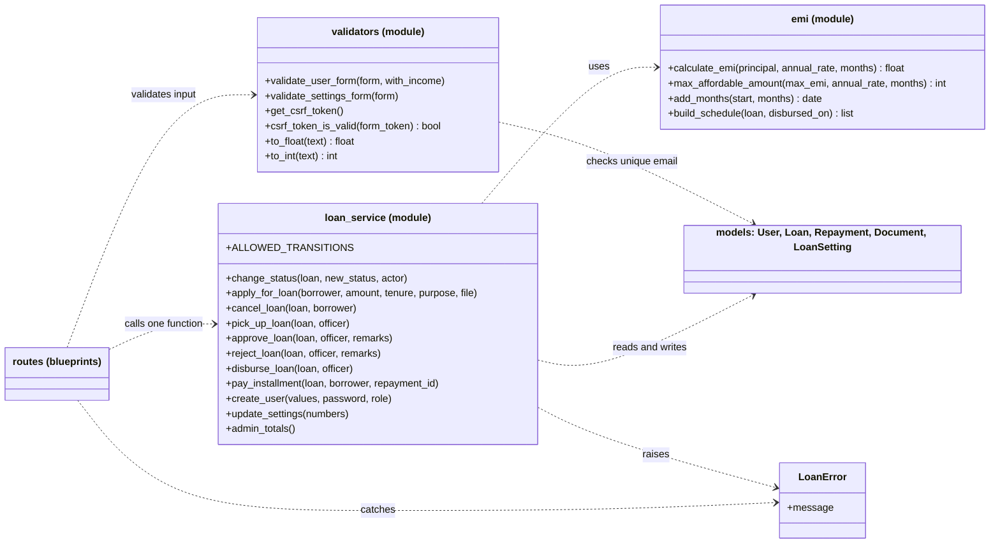

**Reading the diagram:** routes depend on `validators` and `loan_service`; only `loan_service` changes loans (through
`change_status`) and only it knows the business rules; `emi` is pure arithmetic with no database access.

---

### 14.10 Sequence diagrams

#### S1. Login and authentication (slide 16)

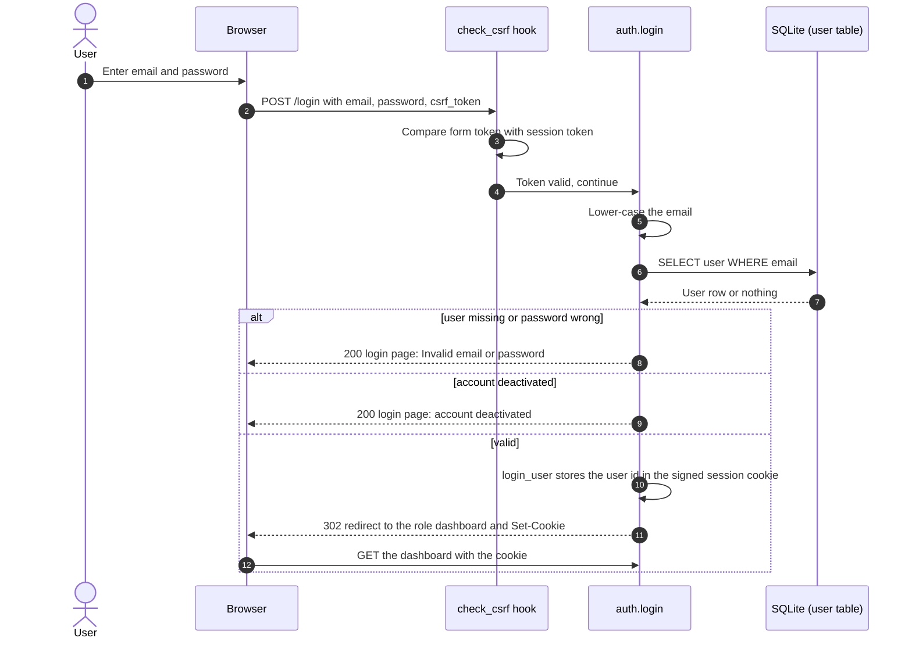

#### S2. Apply for a loan (main workflow; slide 16)

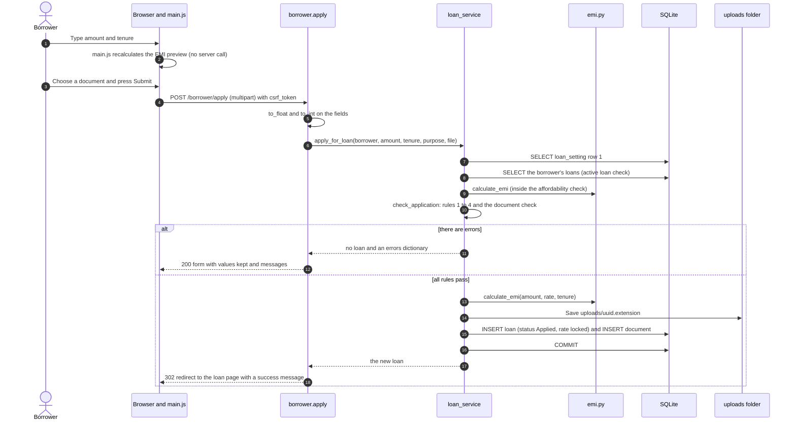

#### S3. Officer review and disbursal (slide 16)

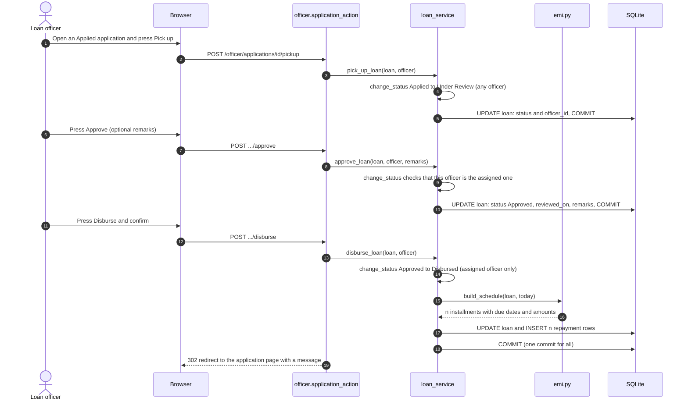

If any rule fails, `change_status` raises `LoanError`; the route catches it and flashes the message; nothing is saved.

#### S4. Pay an installment (slide 16)

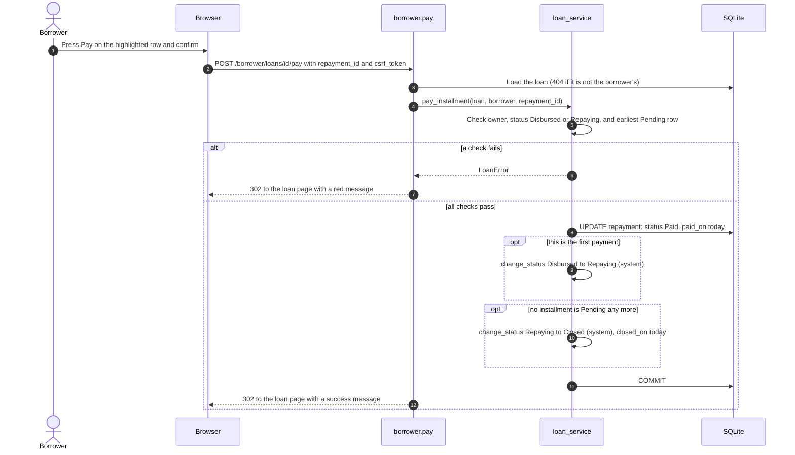

#### S5. Admin changes the loan settings (slide 16 or 21)

```mermaid
sequenceDiagram
  autonumber
  actor A as Admin
  participant B as Browser
  participant R as admin.settings
  participant V as validators
  participant S as loan_service
  participant DB as SQLite
  A->>B: Edit values and press Save settings
  B->>R: POST /admin/settings with six fields and csrf_token
  R->>V: validate_settings_form(form)
  alt invalid
    V-->>R: errors
    R-->>B: 200 form with messages
  else valid
    R->>S: update_settings(numbers)
    S->>DB: UPDATE loan_setting row 1 and updated_at, COMMIT
    R-->>B: 302 redirect to settings with a success message
  end
  Note over S,DB: Existing loans keep their own interest_rate. New applications, the apply page and the landing page read the new values.
```

#### S6. View a document (slide 21)

```mermaid
sequenceDiagram
  autonumber
  actor U as User (borrower, officer or admin)
  participant B as Browser
  participant R as main.view_document
  participant DB as SQLite
  participant FS as uploads folder
  U->>B: Click View document
  B->>R: GET /documents/id with the session cookie
  R->>R: role_required: logged in as borrower, officer or admin
  R->>DB: SELECT document and its loan
  alt a borrower who does not own the loan
    R-->>B: 404 page
  else allowed
    R->>FS: send_from_directory(uploads, stored_name)
    FS-->>B: The file (named with the original name)
  end
```

---

### 14.11 Activity diagrams

All five are laid out left to right so they fit a landscape slide. A1 is the overview; A2 to A5 are the detailed
activities that A1 refers to (the labels in brackets).

#### A1. Complete borrower journey, overview (slide 17)

```mermaid
flowchart LR
  Start(["Start"]) --> Access["Register or log in (A2)"]
  Access --> Active{"Active loan?"}
  Active -- "No" --> Apply["Apply for a loan (A3)"]
  Active -- "Yes" --> Track["Track status on the loan page"]
  Apply --> Applied(["Applied"])
  Applied --> Cancel{"Cancel?"}
  Cancel -- "Yes" --> Cancelled(["Cancelled"])
  Cancel -- "No" --> Review["Officer review (A4)"]
  Review --> Decide{"Officer decision"}
  Decide -- "Reject" --> Rejected(["Rejected"])
  Decide -- "Approve" --> Disb["Disburse: schedule created (A4)"]
  Disb --> Pay["Pay installments (A5)"]
  Track --> Pay
  Pay --> Closed(["Closed: can apply again"])
```

#### A2. Login and registration (slide 17)

```mermaid
flowchart LR
  S(["Start"]) --> Auth{"Already logged in?"}
  Auth -- "Yes" --> GoDash["Go to the role dashboard"]
  Auth -- "No" --> Which{"Login or register?"}
  Which -- "Register" --> RF["Submit registration form"]
  RF --> V1{"All rules pass?"}
  V1 -- "No" --> RErr["Show field errors, keep values"]
  V1 -- "Yes" --> Create["Hash password, create borrower, log in"]
  Create --> GoB["Borrower dashboard"]
  Which -- "Login" --> LF["Submit email and password"]
  LF --> Find{"User found and password matches?"}
  Find -- "No" --> Bad["Show: Invalid email or password"]
  Find -- "Yes" --> Act{"Account active?"}
  Act -- "No" --> Deact["Show: account deactivated"]
  Act -- "Yes" --> Do["login_user, then redirect by role"]
```

#### A3. Apply-for-loan decision flow (slide 17)

All checks except rule R3 run even if an earlier one failed, so every message appears together; the affordability check (R4)
runs only when the amount and the tenure are themselves valid.

```mermaid
flowchart LR
  S(["Submit application"]) --> R3{"R3: active loan?"}
  R3 -- "Yes" --> Blocked["Blocked: active loan exists"]
  R3 -- "No" --> R1{"R1: amount in limits?"}
  R1 -- "Yes" --> R2{"R2: tenure in limits?"}
  R2 -- "Yes" --> P{"Purpose given?"}
  P -- "Yes" --> D{"R10: document valid?"}
  D -- "Yes" --> R4{"R4: EMI within income limit?"}
  R4 -- "Yes" --> Save["Compute EMI, lock rate, save file, insert loan and document, commit"]
  Save --> Done(["Loan created: status Applied"])
  R1 -- "No" --> Err["Record the message; the other checks still run"]
  R2 -- "No" --> Err
  P -- "No" --> Err
  D -- "No" --> Err
  R4 -- "No" --> Err
  Err --> Show(["Show the form again with all messages"])
```

#### A4. Officer review and disbursal (slide 17)

```mermaid
flowchart LR
  S(["Officer opens an application"]) --> St{"Status?"}
  St -- "Applied" --> PU["Pick up: Under Review, officer id set"]
  St -- "Under Review" --> Mine{"Assigned to me?"}
  St -- "Approved" --> Mine2{"Assigned to me?"}
  St -- "Other" --> RO["Read only"]
  Mine -- "No" --> Lock["Refused by the server"]
  Mine2 -- "No" --> Lock
  Mine -- "Yes" --> Dec{"Decision"}
  Dec -- "Approve" --> Ap["Approved: date and remarks saved"]
  Dec -- "Reject" --> Rm{"Remarks entered?"}
  Rm -- "No" --> Err["Refused: remarks required"]
  Rm -- "Yes" --> Rj["Rejected: date and remarks saved"]
  Mine2 -- "Yes" --> Di["Disburse: n installments, one commit"]
```

#### A5. Pay an installment (slide 17)

```mermaid
flowchart LR
  S(["Press Pay and confirm"]) --> O{"Own loan?"}
  O -- "No" --> N["404 page"]
  O -- "Yes" --> St{"Disbursed or Repaying?"}
  St -- "No" --> E1["Error: nothing to pay"]
  St -- "Yes" --> Or{"Earliest Pending installment?"}
  Or -- "No" --> E2["Error: pay in order"]
  Or -- "Yes" --> Pd["Mark Paid, paid date today"]
  Pd --> F{"First payment?"}
  F -- "Yes" --> Rp["Status: Repaying"]
  F -- "No" --> L{"Any Pending left?"}
  Rp --> L
  L -- "Yes" --> Cm["Commit"]
  L -- "No" --> Cl["Status: Closed, closed date"]
  Cl --> Cm
  Cm --> Msg(["Success message"])
```

---

### 14.12 State diagrams (loan lifecycle and installment)

**Purpose:** the heart of the business logic (`ALLOWED_TRANSITIONS`). **Slide:** 11 or 17.

```mermaid
stateDiagram-v2
  state "Under Review" as UnderReview
  [*] --> Applied : borrower submits an application
  Applied --> Cancelled : borrower cancels (owner only)
  Applied --> UnderReview : any officer picks it up
  UnderReview --> Approved : assigned officer approves
  UnderReview --> Rejected : assigned officer rejects (remarks required)
  Approved --> Disbursed : assigned officer disburses, schedule is built
  Disbursed --> Repaying : first installment paid (system)
  Repaying --> Closed : last installment paid (system)
  Cancelled --> [*]
  Rejected --> [*]
  Closed --> [*]
```

```mermaid
stateDiagram-v2
  [*] --> Pending : created at disbursal
  Pending --> Paid : borrower pays the earliest Pending installment
  Paid --> [*]
  note right of Pending
    Overdue is not a state.
    It is computed: Pending and due date before today.
  end note
```

---

### 14.13 Swimlane diagrams (added after the first audit)

**Purpose:** show who does what. Each vertical lane is one actor (Borrower, System, Loan Officer, Admin); time runs downwards; an
arrow that crosses a lane border is a hand-over. **Slide:** 17a. Exported PNG and SVG files are in `docs/diagrams/`
(`05_swimlane_loan_lifecycle`, `05b_swimlane_pay_installment`); the explanation, step by step, is in `docs/02_diagrams.md`
section 6. The dotted arrows are the optional admin reassignment.

#### Full loan lifecycle (apply, review, reassign, disburse, repay, close)

```mermaid
%%{init: {"flowchart": {"rankSpacing": 22, "nodeSpacing": 18}}}%%
flowchart TB
  subgraph ADM["Admin"]
    direction TB
    ADM_g0[" "]:::ghost
    ADM_g1[" "]:::ghost
    ADM_g2[" "]:::ghost
    ADM_g3[" "]:::ghost
    ADM_g4[" "]:::ghost
    ADM_g5[" "]:::ghost
    ADM_g6[" "]:::ghost
    A1["Reassign to another<br/>active officer<br/>(Under Review or Approved,<br/>status unchanged)"]
    ADM_g8[" "]:::ghost
    ADM_g9[" "]:::ghost
    ADM_g10[" "]:::ghost
    ADM_g11[" "]:::ghost
    ADM_g12[" "]:::ghost
    ADM_g13[" "]:::ghost
    ADM_g14[" "]:::ghost
    ADM_g15[" "]:::ghost
    ADM_g16[" "]:::ghost
    ADM_g17[" "]:::ghost
  end
  subgraph OFF["Loan Officer"]
    direction TB
    OFF_g0[" "]:::ghost
    OFF_g1[" "]:::ghost
    OFF_g2[" "]:::ghost
    OFF_g3[" "]:::ghost
    OFF_g4[" "]:::ghost
    O1["Pick up<br/>the application"]
    OFF_g6[" "]:::ghost
    OFF_g7[" "]:::ghost
    O2["Review the details<br/>and the document"]
    O3{"Decision"}
    OFF_g10[" "]:::ghost
    OFF_g11[" "]:::ghost
    O4["Disburse<br/>(confirm)"]
    OFF_g13[" "]:::ghost
    OFF_g14[" "]:::ghost
    OFF_g15[" "]:::ghost
    OFF_g16[" "]:::ghost
    OFF_g17[" "]:::ghost
  end
  subgraph SYS["System"]
    direction TB
    SYS_g0[" "]:::ghost
    SYS_g1[" "]:::ghost
    S2{"R1 to R4 and R10<br/>all pass?"}
    S3["Save the loan:<br/>status Applied,<br/>EMI and rate locked"]
    SYS_g4[" "]:::ghost
    S4(["Status: Cancelled"])
    S5["Status: Under Review,<br/>officer saved"]
    SYS_g7[" "]:::ghost
    SYS_g8[" "]:::ghost
    SYS_g9[" "]:::ghost
    S6(["Status: Rejected,<br/>remarks saved"])
    S7["Status: Approved,<br/>review date saved"]
    SYS_g12[" "]:::ghost
    S8["Build n installments,<br/>status Disbursed<br/>(one commit)"]
    SYS_g14[" "]:::ghost
    S9["Mark it Paid;<br/>first payment:<br/>status Repaying"]
    S10{"Any installment<br/>still Pending?"}
    S11(["Status: Closed,<br/>closed date saved"])
  end
  subgraph BOR["Borrower"]
    direction TB
    BOR_g0[" "]:::ghost
    B1["Register or log in,<br/>fill in the application,<br/>submit it"]
    BOR_g2[" "]:::ghost
    B1b(["Correct the form<br/>and submit again"])
    B2{"Cancel before<br/>pick-up?"}
    BOR_g5[" "]:::ghost
    BOR_g6[" "]:::ghost
    BOR_g7[" "]:::ghost
    BOR_g8[" "]:::ghost
    BOR_g9[" "]:::ghost
    BOR_g10[" "]:::ghost
    BOR_g11[" "]:::ghost
    BOR_g12[" "]:::ghost
    BOR_g13[" "]:::ghost
    B5["Pay the earliest<br/>pending installment"]
    BOR_g15[" "]:::ghost
    BOR_g16[" "]:::ghost
    B5r(["Pay the next one<br/>(repeat until<br/>none is left)"])
  end
  BOR_g0 ~~~ B1
  B1 ~~~ BOR_g2
  BOR_g2 ~~~ B1b
  B1b ~~~ B2
  B2 ~~~ BOR_g5
  BOR_g5 ~~~ BOR_g6
  BOR_g6 ~~~ BOR_g7
  BOR_g7 ~~~ BOR_g8
  BOR_g8 ~~~ BOR_g9
  BOR_g9 ~~~ BOR_g10
  BOR_g10 ~~~ BOR_g11
  BOR_g11 ~~~ BOR_g12
  BOR_g12 ~~~ BOR_g13
  BOR_g13 ~~~ B5
  B5 ~~~ BOR_g15
  BOR_g15 ~~~ BOR_g16
  BOR_g16 ~~~ B5r
  SYS_g0 ~~~ SYS_g1
  SYS_g1 ~~~ S2
  S3 ~~~ SYS_g4
  SYS_g4 ~~~ S4
  S4 ~~~ S5
  S5 ~~~ SYS_g7
  SYS_g7 ~~~ SYS_g8
  SYS_g8 ~~~ SYS_g9
  SYS_g9 ~~~ S6
  S6 ~~~ S7
  S7 ~~~ SYS_g12
  SYS_g12 ~~~ S8
  S8 ~~~ SYS_g14
  SYS_g14 ~~~ S9
  OFF_g0 ~~~ OFF_g1
  OFF_g1 ~~~ OFF_g2
  OFF_g2 ~~~ OFF_g3
  OFF_g3 ~~~ OFF_g4
  OFF_g4 ~~~ O1
  O1 ~~~ OFF_g6
  OFF_g6 ~~~ OFF_g7
  OFF_g7 ~~~ O2
  O3 ~~~ OFF_g10
  OFF_g10 ~~~ OFF_g11
  OFF_g11 ~~~ O4
  O4 ~~~ OFF_g13
  OFF_g13 ~~~ OFF_g14
  OFF_g14 ~~~ OFF_g15
  OFF_g15 ~~~ OFF_g16
  OFF_g16 ~~~ OFF_g17
  ADM_g0 ~~~ ADM_g1
  ADM_g1 ~~~ ADM_g2
  ADM_g2 ~~~ ADM_g3
  ADM_g3 ~~~ ADM_g4
  ADM_g4 ~~~ ADM_g5
  ADM_g5 ~~~ ADM_g6
  ADM_g6 ~~~ A1
  A1 ~~~ ADM_g8
  ADM_g8 ~~~ ADM_g9
  ADM_g9 ~~~ ADM_g10
  ADM_g10 ~~~ ADM_g11
  ADM_g11 ~~~ ADM_g12
  ADM_g12 ~~~ ADM_g13
  ADM_g13 ~~~ ADM_g14
  ADM_g14 ~~~ ADM_g15
  ADM_g15 ~~~ ADM_g16
  ADM_g16 ~~~ ADM_g17
  B1 --> S2
  S2 -->|"No: errors shown"| B1b
  S2 -->|"Yes"| S3
  S3 --> B2
  B2 -->|"Yes"| S4
  B2 -->|"No"| O1
  O1 --> S5
  S5 --> O2
  S5 -.->|"officer unavailable"| A1
  A1 -.->|"new officer"| O2
  O2 --> O3
  O3 -->|"Reject (remarks)"| S6
  O3 -->|"Approve"| S7
  S7 --> O4
  O4 --> S8
  S8 --> B5
  B5 --> S9
  S9 --> S10
  S10 -->|"Yes"| B5r
  S10 -->|"No"| S11
  classDef ghost fill:none,stroke:none,color:none;
  style BOR fill:#E8F0FE,stroke:#9AA7BD,stroke-width:1px
  style SYS fill:#F4F6FA,stroke:#9AA7BD,stroke-width:1px
  style OFF fill:#FFF6D6,stroke:#9AA7BD,stroke-width:1px
  style ADM fill:#EAF5EC,stroke:#9AA7BD,stroke-width:1px
```

#### Pay an installment (Borrower and System)

```mermaid
%%{init: {"flowchart": {"rankSpacing": 22, "nodeSpacing": 18}}}%%
flowchart TB
  subgraph SYS["System"]
    direction TB
    SYS_g0[" "]:::ghost
    SYS_g1[" "]:::ghost
    S1{"Is it the<br/>borrower's loan?"}
    S2{"Status Disbursed<br/>or Repaying?"}
    S3{"Earliest Pending<br/>installment?"}
    S4["Mark it Paid,<br/>paid date = today"]
    S5{"First payment?"}
    S6["Status: Repaying"]
    S7{"Any installment<br/>still Pending?"}
    S8["Status: Closed,<br/>closed date saved"]
    S9["One commit<br/>(rollback on error)"]
    SYS_g11[" "]:::ghost
  end
  subgraph BOR["Borrower"]
    direction TB
    BOR_g0[" "]:::ghost
    B1["Press Pay on the<br/>highlighted row and<br/>confirm the dialog"]
    BOR_g2[" "]:::ghost
    B2(["404 page"])
    B3(["Message:<br/>nothing to pay"])
    B4(["Message:<br/>pay in order"])
    BOR_g6[" "]:::ghost
    BOR_g7[" "]:::ghost
    BOR_g8[" "]:::ghost
    BOR_g9[" "]:::ghost
    BOR_g10[" "]:::ghost
    B5(["Success message and<br/>the updated schedule"])
  end
  BOR_g0 ~~~ B1
  B1 ~~~ BOR_g2
  BOR_g2 ~~~ B2
  B2 ~~~ B3
  B3 ~~~ B4
  B4 ~~~ BOR_g6
  BOR_g6 ~~~ BOR_g7
  BOR_g7 ~~~ BOR_g8
  BOR_g8 ~~~ BOR_g9
  BOR_g9 ~~~ BOR_g10
  BOR_g10 ~~~ B5
  SYS_g0 ~~~ SYS_g1
  SYS_g1 ~~~ S1
  S9 ~~~ SYS_g11
  B1 --> S1
  S1 -->|"No"| B2
  S1 -->|"Yes"| S2
  S2 -->|"No"| B3
  S2 -->|"Yes"| S3
  S3 -->|"No"| B4
  S3 -->|"Yes"| S4
  S4 --> S5
  S5 -->|"Yes"| S6
  S5 -->|"No"| S7
  S6 --> S7
  S7 -->|"No"| S8
  S7 -->|"Yes"| S9
  S8 --> S9
  S9 --> B5
  classDef ghost fill:none,stroke:none,color:none;
  style BOR fill:#E8F0FE,stroke:#9AA7BD,stroke-width:1px
  style SYS fill:#F4F6FA,stroke:#9AA7BD,stroke-width:1px
```

Both diagrams use one subgraph per lane. Invisible helper nodes keep every lane in the same row grid so the lanes line up
(Mermaid has no native swimlane).

---

### 14.14 CRC cards (added after the first audit)

**Slide:** 20a. Same cards as `docs/02_diagrams.md` section 4. The method names are the real ones in the code.

**Purpose.** One card per class: what it knows and does (**Responsibilities**) and which other classes it works with
(**Collaborators**). The method names are the real ones in the code. The first five are the database models
(`app/models.py`); `LoanService` is the module `app/services/loan_service.py` and `EMICalculator` is the module
`app/services/emi.py` (see the notation notes at the top).

#### User (model, `app/models.py:13`)

| Responsibilities | Collaborators |
|---|---|
| Know who a person is: `name`, `email` (unique, lower case), `phone`, `role` (borrower, officer or admin), `monthly_income` (borrowers only), `is_active`, `created_at` | `Loan` (as borrower and as reviewing officer) |
| Store the password only as a hash: `set_password()` | `werkzeug.security` (scrypt hashing) |
| Check a password at login: `check_password()` | `auth.login` route |
| Tell whether the borrower already has a loan in Applied, Under Review, Approved, Disbursed or Repaying: `has_active_loan()` | `Loan`, `LoanService.check_application`, `macros.apply_button` |
| Be loadable from the session and be blocked when deactivated: `load_user()` | Flask-Login (`UserMixin`), `LoanService.toggle_user_active` |

#### Loan (model, `app/models.py:43`)

| Responsibilities | Collaborators |
|---|---|
| Hold one application: `amount`, `tenure_months`, `interest_rate` (locked at apply time), `emi_amount`, `purpose`, `status`, `remarks`, `applied_on`, `reviewed_on`, `disbursed_on`, `closed_on` | `LoanSetting` (the rate is copied from it), `EMICalculator` (the EMI is calculated by it) |
| Know its borrower (`borrower_id`) and its reviewing officer (`officer_id`, set at pick-up, changed only by an admin reassignment) | `User` |
| Total up the money: `total_payable()`, `amount_paid()`, `outstanding()` | `Repayment` |
| Find the installment to pay next: `next_due_installment()` | `Repayment`, `LoanService.pay_installment` |
| Show a friendly id such as LN-0006: `display_id()` | Templates |
| Have its status changed only through the state machine | `LoanService.change_status` |

#### Repayment (model, `app/models.py:92`)

| Responsibilities | Collaborators |
|---|---|
| Represent one EMI installment: `installment_no`, `due_date`, `amount`, `status` (Pending or Paid), `paid_on` | `Loan` (owner) |
| Say whether it is overdue (Pending and due date before today); computed, never stored: `is_overdue()` | `macros.schedule_table`, `LoanService.overdue_installments` |
| Be created in a batch when a loan is disbursed | `EMICalculator.build_schedule`, `LoanService.disburse_loan` |
| Be marked Paid in order | `LoanService.pay_installment` |

#### Document (model, `app/models.py:108`)

| Responsibilities | Collaborators |
|---|---|
| Link one supporting file to a loan: `original_name` (for display), `stored_name` (uuid plus extension), `uploaded_on` | `Loan` (exactly one per application, by code rule) |
| Point to a file kept outside `static/` in `uploads/` | `uploads/` folder, `main.view_document` (the only way to download it) |
| Be created only after the file passed the checks | `LoanService.check_document`, `LoanService.apply_for_loan` |

#### LoanSetting (model, `app/models.py:118`)

| Responsibilities | Collaborators |
|---|---|
| Hold the one global settings row (id 1): `interest_rate`, `min_amount`, `max_amount`, `min_tenure`, `max_tenure`, `max_emi_to_income`, `updated_at` | `LoanService.get_settings`, `LoanService.update_settings` |
| Provide the limits used to validate every application | `LoanService.check_application`, `check_affordability` |
| Provide the rate that is copied into a new loan (old loans keep their own) | `Loan` |
| Be edited and validated by the admin | `admin.settings` route, `validators.validate_settings_form` |
| Supply the live limits and sample EMI on the landing and apply pages | `main.index`, `borrower.apply` |

#### LoanService (module `loan_service`, `app/services/loan_service.py`)

| Responsibilities | Collaborators |
|---|---|
| Keep every business rule and status change in one place; routes only call it | All route blueprints, `LoanError` |
| Enforce the state machine: `ALLOWED_TRANSITIONS`, `change_status(loan, new_status, actor)` | `Loan` |
| Validate and create an application: `check_application()`, `check_document()`, `check_affordability()`, `apply_for_loan()`, `cancel_loan()` | `EMICalculator`, `LoanSetting`, `User`, `Document`, `validators.has_too_many_decimals` |
| Move a loan through review and payout: `pick_up_loan()`, `approve_loan()`, `reject_loan()`, `disburse_loan()` | `Loan`, `Repayment`, `EMICalculator.build_schedule` |
| Hand a loan to another officer: `reassign_loan()`, `active_officers()`, `pending_loan_count()` | `User`, `Loan` |
| Take payments in order and update the status: `pay_installment()` | `Repayment`, `Loan` |
| Manage accounts and settings: `create_user()`, `toggle_user_active()`, `update_settings()` | `User`, `LoanSetting` |
| Prepare dashboard and report numbers: `borrower_summary()`, `officer_summary()`, `admin_totals()`, `disbursed_per_month()`, `overdue_installments()`, `percent_shares()` | `Loan`, `Repayment`, `User` |
| Commit once per action and roll back on any error | `db.session` (Flask-SQLAlchemy) |

#### EMICalculator (module `emi`, `app/services/emi.py`)

| Responsibilities | Collaborators |
|---|---|
| Calculate the EMI with the reducing-balance formula, rounded to 2 decimals (rate 0 gives P / n): `calculate_emi()` | `LoanService.check_application`, `apply_for_loan`, `main.js` (same formula for the live preview) |
| Work out the largest amount a borrower can afford: `max_affordable_amount()` | `LoanService.check_affordability` |
| Add months safely (31 Jan + 1 month = 28 Feb): `add_months()` | `build_schedule` |
| Build the installment list at disbursal, last one adjusted so the total is exactly EMI x n: `build_schedule()` | `LoanService.disburse_loan`, `Repayment` |
| Do pure arithmetic with no database access | (none) |

---

### 14.15 Diagrams updated after the first audit

Sections 14.4 to 14.12 describe the code at the time of the documentation commit. Since then the admin can reassign an
application (`reassign_loan`), logout became a POST, and uploads and amounts are checked more strictly. The maintained, complete set (use case with the generalised *Signed-in user* actor, activity, class, state, DFD level 0 to 2 including
process 3.4 *Reassign officer*, and five sequence diagrams) is in `docs/02_diagrams.md`. The new sequence diagram is shown here.

#### S7. Admin reassigns an application (slide 16 or 21)

```mermaid
sequenceDiagram
  autonumber
  actor A as Admin
  participant B as Browser
  participant H as check_csrf hook
  participant R as officer.reassign_application
  participant S as loan_service
  participant DB as SQLite
  A->>B: Open an Under Review or Approved application
  B->>R: GET /officer/applications/id
  R->>S: active_officers(exclude the current officer)
  R-->>B: Page with the Reassign to dropdown
  A->>B: Choose an officer, press Reassign, confirm the dialog
  B->>H: POST /officer/applications/id/reassign with officer_id and csrf_token
  H->>R: token valid, role_required admin passes (an officer or borrower gets 403)
  R->>DB: Load the loan (404 if missing) and the chosen officer
  R->>S: reassign_loan(loan, new_officer, admin)
  S->>S: Checks: admin, status, active officer, not the current one
  alt a check fails
    S-->>R: LoanError
    R-->>B: 302 to the application page with a red message
  else all checks pass
    S->>DB: UPDATE loan SET officer_id, COMMIT (rollback on error)
    R-->>B: 302 to the application page: reassigned from the old to the new officer
  end
  Note over R,S: Status unchanged. New officer owns the loan (R11),<br/>the old officer is refused.
```

Reassignment is **not** a state-machine transition: only `officer_id` changes and the status stays Under Review or Approved.

---

### 14.16 Where each diagram goes in the presentation

| Diagram | Section | Slide(s) |
|---|---|---|
| System architecture | 14.1 | 8 |
| Component diagram | 14.2 | 20 |
| Deployment diagram | 14.3 | 8 or 21 |
| DFD Level 0 | 14.4 | 12 |
| DFD Level 1 (two sheets and the flow list) | 14.5 | 13 |
| DFD Level 2 (processes 2, 3, 4, 5) | 14.6 | 14 |
| Use case diagrams (UC-1 borrower, UC-2 officer, UC-3 admin) | 14.7 | 15 |
| ER diagram | 14.8 | 18, 19 |
| Class diagrams (14.9a domain classes, 14.9b service layer) | 14.9 | 20 |
| Sequence diagrams S1 to S6 | 14.10 | 16 (S1, S2 and S3 at least), 21 (S4, S5, S6) |
| Activity diagrams A1 to A5 | 14.11 | 17 |
| State diagrams | 14.12 | 11 |
| Swimlane diagrams | 14.13 | 17a |
| CRC cards | 14.14 | 20a |
| Reassignment sequence S7 | 14.15 | 16 or 21 |
| Wireframes and prototype screenshots | `docs/03_wireframes_and_prototype.md` | 10a |

---

## 15. PowerPoint plan, slide by slide

The structure follows the 27 slides requested, plus four slides added after the first audit and the assignment
checklist: **9a Requirements**, **10a Wireframes and prototype**, **17a Swimlane diagram** and **20a CRC cards** (31 slides in
all; the letters keep the numbers of the original 27 unchanged). It fits this project without changes; the live demo is folded into slide 11
(and can be given its own slide if time allows). For each slide: bullets, visual, concepts to explain, speaker notes, and
source references. Placeholders in square brackets (team names, guide name) are **Not in the repository**.

**Screenshot capture list** (run `python seed.py`, then `python run.py`; use the demo logins in Appendix D):

| Screenshot | URL | Log in as |
|---|---|---|
| Landing page | `/` | (logged out) |
| Login | `/login` | (logged out) |
| Borrower dashboard (overdue alert, progress) | `/borrower/dashboard` | aman@example.com |
| Apply form with the live EMI preview filled in | `/borrower/apply` | a borrower with no loan (register a new one) |
| Loan details with step tracker and schedule | `/borrower/loans/2` | aman@example.com |
| Closed loan with success banner | `/borrower/loans/1` | sneha@example.com |
| Officer review page | `/officer/applications/6` | officer1@microloan.com |
| Officer queue | `/officer/applications` | officer1@microloan.com |
| Admin dashboard, reports, settings | `/admin/dashboard`, `/admin/reports`, `/admin/settings` | admin@microloan.com |
| A phone-width view of the loan page | `/borrower/loans/2` at 390 px width | aman@example.com |

(Loan ids 1 to 7 follow the seed order; ids and dates are relative to the day the seed was run.)

Ready-made screenshots of the real pages at 1360 px and 390 px, taken from a temporary copy of the app with the seeded demo
accounts, are in `docs/prototype/` (listed in `docs/README.md`). The grey wireframes are in `docs/wireframes/`.

---

### Slide 1. Title slide

- **Bullets:** *MicroLoan: Micro-Loan Management System*; Software Engineering project; NMIMS Hyderabad, B.Tech CS & Data Science; [team members]; [guide]; [date].
- **Visual:** the landing page hero screenshot with the yellow-and-blue theme.
- **Concepts:** none.
- **Speaker notes:** "This is a web application that manages the whole life of a small loan, from application to the last repayment, for three kinds of users."
- **Source:** `README.md`, `app/templates/main/index.html`.

### Slide 2. Introduction

- **Bullets:** A Flask web application; three roles (borrower, loan officer, admin); simulated payments; 22 pages and actions; SQLite database; runs locally.
- **Visual:** three role icons around a loan icon, or the landing page "How it works" section.
- **Concepts:** *Micro-loan* = a small loan (here ₹5,000 to ₹1,00,000 by default). *EMI* = equated monthly installment.
- **Speaker notes:** Introduce the three roles and say that no real money moves; the Pay button simulates payment.
- **Source:** `CLAUDE.md` sections 1 and 4; `app/routes/*.py`.

### Slide 3. Problem statement

- **Bullets:** Small loans are often managed on paper or spreadsheets; rules are applied inconsistently; borrowers cannot see status; EMI arithmetic is error-prone; late payments are noticed late.
- **Visual:** simple "before" picture: forms, calculator, notebook.
- **Concepts:** Business rule consistency; transparency.
- **Speaker notes:** Frame the need. Say clearly that this framing is the team's, not something found in the code. **[Not Verified in the repository]**
- **Source:** `CLAUDE.md` section 1 (goals).

### Slide 4. Project objectives

- **Bullets:** End-to-end demo (apply, review, approve, disburse, repay, close); simple, explainable code; design diagrams that match the code; clean consistent interface; enforce all loan rules on the server.
- **Visual:** a four-item checklist.
- **Concepts:** Server-side validation; state machine.
- **Speaker notes:** Mention that the goals are in priority order in the blueprint.
- **Source:** `CLAUDE.md` section 1.

### Slide 5. Existing system and limitations

- **Bullets:** Manual or spreadsheet process; no shared status; manual due-date tracking; no record of who decided and why.
- **Visual:** a two-column table "manual process / limitation".
- **Concepts:** none.
- **Speaker notes:** Present as a typical situation and confirm with your guide. **[Not Verified: the repository has no existing-system study.]**
- **Source:** Section 1.7 of this document.

### Slide 6. Proposed system

- **Bullets:** One web system for all three roles; fixed loan lifecycle; automatic EMI schedule; rules enforced centrally; admin-controlled limits; reports with charts.
- **Visual:** the loan lifecycle chips from the landing page (Applied, Under Review, Approved, Disbursed, Repaying, Closed, plus Rejected and Cancelled).
- **Concepts:** *Role-based access*, *state machine* (a fixed set of allowed status changes).
- **Speaker notes:** "Every loan moves through the same visible stages, and the system refuses any other move."
- **Source:** `loan_service.py:24` (`ALLOWED_TRANSITIONS`); section 8 of this document.

### Slide 7. Technology stack

- **Bullets:** Python 3.13 and Flask 3.1 (Blueprints); Flask-SQLAlchemy 3.1 with SQLite; Flask-Login 0.6 and Werkzeug scrypt hashing; Jinja2 templates; Bootstrap 5.3 and Bootstrap Icons; Chart.js 4.4; plain JavaScript; Git.
- **Visual:** a layered logo or table (language, framework, database, UI, charts).
- **Concepts:** *ORM* (database rows as Python objects); *template engine* (HTML with placeholders filled by the server).
- **Speaker notes:** Stress the deliberate small stack: four direct Python dependencies and no JavaScript framework.
- **Source:** `requirements.txt`; section 2.

### Slide 8. System architecture

- **Bullets:** Server-rendered monolith; layers: templates, routes (controllers), services (business rules), models, SQLite; cross-cutting: login, role check, CSRF hook, error pages; runs on one computer.
- **Visual:** diagram 14.1 (and 14.3 deployment as a small inset).
- **Concepts:** *MVC-like layering*; *request lifecycle*; *thin controllers*.
- **Speaker notes:** Walk the numbered request path 1 to 5. Say that routes only call one service function, and all rules and status changes live in `loan_service.py`.
- **Source:** `app/__init__.py:17`; `app/routes/`; `app/services/loan_service.py`; section 3.

### Slide 9. Major modules

- **Bullets:** Accounts and authentication; loan application; officer review; disbursal and schedule; repayment; documents; admin (users, settings, reports).
- **Visual:** a table: module, file, key functions.

| Module | Files | Key functions |
|---|---|---|
| Accounts and auth | `routes/auth.py`, `utils/validators.py` | `register`, `login`, `validate_user_form` |
| Loan application | `routes/borrower.py`, `loan_service.py`, `emi.py` | `apply_for_loan`, `check_application`, `calculate_emi` |
| Officer review | `routes/officer.py`, `loan_service.py` | `pick_up_loan`, `approve_loan`, `reject_loan`, `change_status` |
| Disbursal and schedule | `loan_service.py`, `emi.py` | `disburse_loan`, `build_schedule` |
| Repayment | `routes/borrower.py`, `loan_service.py` | `pay_installment`, `Repayment.is_overdue` |
| Documents | `loan_service.py`, `routes/main.py` | `check_document`, `view_document` |
| Admin | `routes/admin.py`, `loan_service.py` | `toggle_user_active`, `update_settings`, `admin_totals` |

- **Concepts:** *Separation of concerns*.
- **Speaker notes:** One sentence per module; point to the file names so the examiner can open them.
- **Source:** section 6.

### Slide 9a. Requirements (SRS)

- **Bullets:** 58 functional requirements in 8 modules (FR-01 to FR-58); 16 non-functional requirements, each with a number that can be checked (for example every page in under 2 seconds, 384 status combinations tried); the 11 business rules R1 to R11; a traceability matrix from requirement to route, diagram and test.
- **Visual:** one module table of the SRS (for example 4.3 Review, disbursal and reassignment) and a short part of the traceability matrix.
- **Concepts:** *Functional vs non-functional requirement*, *acceptance criterion*, *traceability*, *MoSCoW priority*.
- **Speaker notes:** Show one requirement (FR-30, admin reassignment) and follow it to its route, its diagram and its test.
- **Source:** `docs/01_SRS_requirements.md`.

### Slide 10. Website user interface

- **Bullets:** One consistent theme (blue for structure, yellow for the one next action); same status colours everywhere; step tracker and progress bar; responsive (phones get a vertical tracker and card-style schedule rows); accessible (text contrast, focus ring).
- **Visual:** four screenshots: landing, borrower dashboard, loan details, officer review (plus one phone view).
- **Concepts:** *Laws of UX* used: Von Restorff (one yellow button), Hick (at most five menu items), Fitts (44 px buttons), Goal-Gradient (progress bar), Zeigarnik (step tracker), Peak-End (repaid banner).
- **Speaker notes:** Do not read the list; show two screens and point at the yellow button and the tracker.
- **Source:** `app/static/css/style.css`; `app/templates/macros.html`; `CLAUDE.md` section 9a.

### Slide 10a. Wireframes and prototype

- **Bullets:** Grey wireframes with numbered elements for 11 pages (plus two phone layouts) fix the structure first; the prototype is the real running page at 1360 px and 390 px; the differences (colour, tracker, badges) are explained with the Laws of UX.
- **Visual:** a wireframe next to its prototype screenshot (apply page or loan details); navigation map of one role.
- **Concepts:** *Low-fidelity wireframe*, *prototype*, *navigation map*, *Laws of UX*.
- **Speaker notes:** Point at element 8 of the apply wireframe (the one primary button) and show it as the yellow button in the prototype.
- **Source:** `docs/03_wireframes_and_prototype.md`; `docs/wireframes/`; `docs/prototype/`.

### Slide 11. Functional workflow

- **Bullets:** Register, apply, officer picks up, approves, disburses (12 installments created), borrower pays, loan becomes Repaying, then Closed; reject and cancel branches.
- **Visual:** state diagram (14.12) beside the numbered table in section 10.1.
- **Concepts:** *Status transition*; *who may do what*; *one commit per action*.
- **Speaker notes:** This is the best place for the **live demo** (about 4 minutes): register, apply ₹50,000 for 12 months (EMI ₹4,442.44), log in as officer1 to pick up, approve and disburse, log in as the borrower to pay installment 1, then show the admin report.
- **Source:** `loan_service.py:24-32, 39-54`; section 10.1.

### Slide 12. Data Flow Diagram, Level 0

- **Bullets:** One process (the system) and three external entities; inbound and outbound data of each entity.
- **Visual:** diagram 14.4.
- **Concepts:** *Context diagram*, *external entity*, *data flow*.
- **Speaker notes:** Explain that the context diagram hides everything inside the system. Name two flows per entity.
- **Source:** section 11.3.

### Slide 13. Data Flow Diagram, Level 1

- **Bullets:** Six processes (accounts and settings, apply or cancel, review, disburse and schedule, repayment, reports); five data stores D1 to D5.
- **Visual:** the two sheets of diagram 14.5 (one slide each, or sheet 1 first and sheet 2 as the next slide).
- **Concepts:** *Decomposition*; *data store*; consistency with Level 0.
- **Speaker notes:** Pick one path, for example Borrower, Process 2, D2 and D4, to show how the data moves.
- **Source:** section 14.5 and its mapping to code.

### Slide 14. Data Flow Diagram, Level 2

- **Bullets:** Process 2 (apply) refined into six steps; Process 5 (repayment) into three; optionally 3 and 4.
- **Visual:** the two Level 2 diagrams in 14.6 (process 2 and process 5), others in backup slides.
- **Concepts:** *Balancing* (same inputs and outputs as the parent).
- **Speaker notes:** For process 2 name the order of checks: active loan, fields, document, affordability. For process 5: owner, status, order, then mark paid, then update status.
- **Source:** `check_application` (`loan_service.py:158`); `pay_installment` (`:302`).

### Slide 15. Use case diagram

- **Bullets:** Four actors (borrower, officer, admin, system); about 30 use cases in three diagrams; *include* and *extend* relations; admin is read-only on applications.
- **Visual:** diagrams UC-1, UC-2 and UC-3 of 14.7 (one slide, three small diagrams, or three short slides).
- **Concepts:** *Actor*, *use case*, *include*, *extend*.
- **Speaker notes:** Say that the permission matrix was implemented in code at three layers: role decorator, ownership check, state machine.
- **Source:** `CLAUDE.md` section 4; `app/utils/decorators.py:10`.

### Slide 16. Sequence diagram

- **Bullets:** Login; apply for a loan; officer review and disbursal; (backup: pay, settings, document view).
- **Visual:** S2 (apply) large; S1 and S3 smaller or on a second slide.
- **Concepts:** *Lifeline*, *message*, *alt fragment* (alternative paths), *commit*.
- **Speaker notes:** In S2 point out that the browser previews the EMI itself, and the server checks everything again.
- **Source:** `borrower.py:33`; `loan_service.py:194`.

### Slide 17. Activity diagram

- **Bullets:** Complete borrower journey; apply decision flow (rules R3, R1, R2, document, R4); officer and payment flows as backup.
- **Visual:** A1 and A3.
- **Concepts:** *Decision node*, *guard*, *activity*.
- **Speaker notes:** Note that all errors of the apply form are collected and shown together.
- **Source:** `check_application`; section 14.11.

### Slide 17a. Swimlane diagram

- **Bullets:** Four lanes: Borrower, System, Loan Officer, Admin; from application to Closed in one picture; the admin's reassignment as a dotted detour; a smaller swimlane for paying an installment.
- **Visual:** `05_swimlane_loan_lifecycle` (tall; give it a full slide) and `05b_swimlane_pay_installment` as a backup.
- **Concepts:** *Swimlane*, *hand-over between actors*, *decision node*.
- **Speaker notes:** Follow one loan down the diagram and say who acts in each lane; stress that the System lane holds every status change.
- **Source:** section 14.13; `docs/02_diagrams.md` section 6.

### Slide 18. ER diagram

- **Bullets:** Five tables; one user table with a role column; `loan` has two links to `user`; installments and the document hang off the loan; settings is a single row.
- **Visual:** diagram 14.8.
- **Concepts:** *Primary key*, *foreign key*, *cardinality*, *optional relationship*.
- **Speaker notes:** Explain why `officer_id` is nullable (empty until pick-up).
- **Source:** `app/models.py`.

### Slide 19. Database design

- **Bullets:** SQLite file; created by `create_all`; money stored as FLOAT rounded to 2 decimals; unique email; the one-document rule is enforced in code; foreign-key enforcement in SQLite is not switched on; the rate is copied into each loan.
- **Visual:** the column tables from section 7.2 (one slide per two tables, or a compact grid).
- **Concepts:** *Normalisation* (installments in their own table), *data snapshot* (rate locked on the loan).
- **Speaker notes:** Be honest about the limits (floats, no migrations); they appear again on slide 24.
- **Source:** `app/models.py`; section 7.

### Slide 20. Class and component diagram

- **Bullets:** Models: `User`, `Loan`, `Repayment`, `Document`, `LoanSetting`; services as modules; components: routes, services, utils, models, templates.
- **Visual:** class diagram 14.9a (domain classes) and the component diagram 14.2; 14.9b (service layer) as a backup or a second slide.
- **Concepts:** *Association*, *composition*, *inheritance* (models inherit `db.Model`).
- **Speaker notes:** The blueprint names `LoanService` and `EMICalculator`; in code they are modules with functions.
- **Source:** `app/models.py`; `app/services/`.

### Slide 20a. CRC cards

- **Bullets:** One card per class: `User`, `Loan`, `Repayment`, `Document`, `LoanSetting`, plus the two service modules `LoanService` and `EMICalculator`; each lists responsibilities and collaborators with the real method names.
- **Visual:** two or three of the cards (`Loan`, `LoanService`, `EMICalculator`) as two-column tables.
- **Concepts:** *Responsibility*, *collaborator*, *single place for the rules*.
- **Speaker notes:** `Loan` knows its data but never changes its own status; only `LoanService.change_status` does.
- **Source:** section 14.14; `docs/02_diagrams.md` section 4.

### Slide 21. Backend and "API" working

- **Bullets:** 22 HTTP routes in 5 blueprints; no JSON API (pages are rendered on the server); every POST passes the CSRF hook and a role check; Post/Redirect/Get; one service call per route.
- **Visual:** the route table from 6.3 (condensed) and the request-life steps (3.5).
- **Concepts:** *Blueprint*, *decorator*, *flash message*, *HTTP status codes* (302, 403, 404, 413, 500).
- **Speaker notes:** Pick `POST /borrower/loans/<id>/pay` and walk the nine steps of section 3.5.
- **Source:** section 6.3; `app/routes/`.

### Slide 22. Security and validation

- **Bullets:** scrypt password hashing; role checks and ownership checks (404); CSRF token on every POST; server-side validation of every field; upload whitelist, size limit, uuid names, stored outside `static/`; Jinja auto-escaping; ORM against SQL injection.
- **Visual:** the security table from section 12 (condensed).
- **Concepts:** *Hashing and salting*, *CSRF*, *XSS*, *least privilege*.
- **Speaker notes:** Mention what is not done: rate limiting, HTTPS, content scanning of uploads.
- **Source:** section 12; `validators.py`; `decorators.py`.

### Slide 23. Testing and results

- **Bullets:** A pytest suite in `tests/`: **1,371 tests** in 17 modules (1370 pass, 1 known gap marked as an expected failure), about 65 seconds on a temporary database. It tries all **384** (from, to, actor) status combinations (397 tests in that module), 108 route-by-role checks, rules R1 to R11, CSRF on all 11 POST routes, and a failed commit for every service function. A mutation check: 14 of 14 deliberate breakages were caught. Earlier build-time checks (27, 52, 43, 29, 90, 61, 89, 146) are included.
- **Visual:** the module table of section 16.5, plus the transition test summary.
- **Concepts:** *Black-box testing through HTTP*; *exhaustive transition testing*; *mutation check*.
- **Speaker notes:** Run `python -m pytest` live (it takes about a minute). Be open about what is not tested automatically: the browser JavaScript and the visual layout (checked by screenshots), and mention the one known gap shown as an expected failure and the two pages wider than a 390 px phone screen found during the screenshots.
- **Source:** `tests/`; `PROGRESS.md`; section 16 of this document.

### Slide 24. Advantages and limitations

- **Bullets (advantages):** all rules in one place; impossible status moves; automatic schedule; clear UI; no heavy dependencies. **(Limitations):** local only; float money; no email, no password reset, no pagination, no rate limiting; two pages wider than a phone screen; needs internet for CDN files.
- **Visual:** two columns.
- **Concepts:** *Trade-offs*.
- **Speaker notes:** Limitations that are deliberate (out of scope) versus missing: separate them.
- **Source:** section 17.

### Slide 25. Future enhancements (all **Suggested**, not implemented)

- **Bullets:** `Decimal` money; pagination; password reset by email and 2FA; real payment gateway (simulated now); partial and prepayments; late fees; deployment with a production server and HTTPS.
- **Visual:** a roadmap strip.
- **Concepts:** *Incremental improvement*.
- **Speaker notes:** Say which ones the blueprint excludes by design.
- **Source:** section 17.3; `CLAUDE.md` section 1 (out of scope).

### Slide 26. Conclusion

- **Bullets:** the full loan life cycle works end to end; business rules and state machine are enforced on the server; diagrams match the code; the project meets its four goals.
- **Visual:** the lifecycle chips again, or a green tick list.
- **Concepts:** none.
- **Speaker notes:** Thank the guide; offer to demo again.
- **Source:** `PROGRESS.md` (final audit).

### Slide 27. Questions and answers

- **Bullets:** "Questions?" and the repository folder name.
- **Visual:** the landing page again.
- **Speaker notes:** Use section 19 (20 prepared questions) as a revision list.
- **Source:** section 19.

---

## 16. Testing and results

### 16.1 What exists inside the repository

| Item | Status |
|---|---|
| Automated test suite (pytest) | **Yes.** `tests/` holds **1,371 tests in 17 modules**: 1370 pass and 1 is a documented known gap marked as an expected failure. Run it with `pip install -r requirements-dev.txt` and `python -m pytest` (pytest is a development-only dependency, not in `requirements.txt`) **[Verified: run on 23 Oct 2026, about 65 seconds]** |
| Safety of the tests | Every test builds the app on a temporary copy of a freshly seeded database with a temporary upload folder; a fixture refuses to run against `instance/microloan.db` or `uploads/` **[Verified by reading `tests/conftest.py`]** |
| Do the tests catch mistakes? | A mutation check on a **copy** of the project broke the application in 14 deliberate ways (for example a forbidden status move allowed, CSRF switched off, upload content not checked, logout accepting GET) and the suite caught all 14 **[Verified]** |
| Self-test of the EMI maths | **Yes.** `python app/services/emi.py` prints the EMI for ₹50,000, 12%, 12 months (expected 4442.44), a 0% case, the month-end rule and the schedule total (`emi.py:51-62`) |
| Seed script as a manual test fixture | **Yes.** `python seed.py` loads a loan in every status except Disbursed |
| Build log with the recorded checks | **Yes.** `PROGRESS.md` (plan, checks and decisions for every phase) |

### 16.2 Checks run during the build

Before the suite existed, scripts that were kept outside the repository checked each phase with the Flask test client against a
temporary database. The counts below are those recorded in `PROGRESS.md` and are kept here as history; the checks are now part of
`tests/` (and many more were added). The old scripts themselves are not in the repository.

| Stage | What it covered | Checks passed |
|---|---|---|
| Phase 2 (authentication) | Registration rules, duplicate email, login, wrong password, role redirects, 403, CSRF, deactivated user, 404 | 27 / 27 |
| Phase 4 (apply) | Amount and tenure limits, affordability message, document type and size, one active loan, ownership (404), cancel rules, `inr` and date filters, rate locking | 52 / 52 |
| Phase 5 (officer) | Pick up, approve, reject (remarks), disburse (12 rows, due dates, exact total), officer 2 blocked on officer 1's loan, admin read-only | 43 / 43 |
| Phase 6 (repay) | Pay in order, Repaying then Closed, no Pay button when closed, re-apply after closing, overdue badge | 29 / 29 |
| Phase 7 (admin and seed) | Seed contents, admin pages, access control, user filter and search, deactivate, create officer, settings validation, rate locking, chart data | 90 / 90 |
| Phase 8 (polish) | Crawl of every page for every role (status, title, no template errors), 403/404/500 pages | 61 / 61 (62 after the UI redesign) |
| Phase 9 (final audit) | Demo script, permission matrix, **all 384 (from, to, actor) transition combinations**, rules R1 to R11, non-functional requirements, a failed-commit rollback test | 89 / 89 |
| UI redesign | One yellow action per page, active menu link, balanced HTML, step tracker states, live settings on the landing page, contrast of 30 colour pairs | 146 / 146 |

Additional checks done by hand: screenshots of 16 pages at desktop width and 4 at phone width were reviewed in headless
Edge; the page-render time of every page was below 2 seconds with the seed data (server-side, test client).

### 16.3 Notable results to quote (from the build-time checks, repeated by the suite)

- **State machine:** 384 combinations tried; exactly the 7 allowed transitions (8 actor cases) succeeded; a rejected
  attempt never changed the status.
- **CSRF:** a logged-in user posting **without** the token to every POST route, in all three roles, changed nothing in the
  database; the same post with a token worked (control case).
- **Rounding:** 2,000 random loans: the schedule always added up to EMI times n to the paisa.
- **Rollback:** a forced failure during disbursal and during payment left no half-saved rows.
- **Access control:** every non-public route sent an anonymous user to the login page.

### 16.4 How this document itself was checked

- The route table (6.3) and the database tables (7.2) were produced by reading the live application object
  (`app.url_map` and the SQLAlchemy models), and function line numbers by parsing the source with Python's `ast` module.
- Workflow descriptions were written after reading `loan_service.py`, the five route files, `validators.py`,
  `decorators.py`, `emi.py`, `config.py` and `app/__init__.py` in full.
- Every Mermaid block in section 14 was extracted and rendered in a browser: all **32** blocks rendered with no errors in both Mermaid 10.9.3 and Mermaid 11.4.0 (in headless Edge), and the rendered images were looked at for layout. Four diagram types (DFD Level 1, use cases, class diagram, activity diagrams) looked cluttered or too tall on the first render, so they were reworked and split into several smaller diagrams; that is why section 14 has two DFD Level 1 sheets, three use case diagrams, two class diagrams and compact left-to-right activity diagrams.

### 16.5 What the pytest suite covers, and what it does not

| Module (`tests/`) | Tests | What it checks (requirements) |
|---|--:|---|
| `test_emi.py` | 239 | EMI formula, rounding, affordability, month ends, schedule totals to the paisa (FR-15, FR-34, NFR-13) |
| `test_state_machine.py` | 397 | all 384 (from, to, actor) combinations, the 7 transitions, rule R11, a full lifecycle (FR-29, NFR-09) |
| `test_ui.py` | 119 | apply button states, one yellow action per page, badges, money and date formats, confirm dialogs, empty states, menus, contrast (FR-21, FR-39, FR-53 to FR-55, NFR-08, NFR-14) |
| `test_permissions.py` | 108 | every route against every role, ownership, wrong HTTP methods (FR-08, FR-09, FR-33, NFR-02, NFR-03) |
| `test_security.py` | 73 | CSRF on all 11 POST routes, rollback when a commit fails, 500/404 pages, XSS escaping, hostile search text (FR-56, NFR-04, NFR-10) |
| `test_rules.py` | 58 | R1 to R4 and R6 through the apply form (FR-10 to FR-18, FR-44) |
| `test_officer_flow.py` | 57 | list, filter, search, detail, pick up, approve, reject, disburse, dashboard (FR-22 to FR-28, FR-47) |
| `test_admin.py` | 56 | users list and search, activate and deactivate, create officer, settings validation (FR-40 to FR-45) |
| `test_auth.py` | 51 | register, login, logout as POST, duplicate emails, deactivation, password hashing, cookie flags (FR-01 to FR-07, NFR-01, NFR-06) |
| `test_reassignment.py` | 43 | admin reassignment, who may do it, the form, the deactivation warning (FR-30 to FR-32) |
| `test_uploads.py` | 38 | file type, content, size, safe storage, protected viewing (FR-17, FR-52, NFR-05) |
| `test_architecture.py` | 36 | no commits or status changes in routes, docstrings, libraries, secrets (NFR-11) |
| `test_repayment.py` | 28 | pay in order, Repaying, automatic Closed, overdue, the pay button, totals (FR-35 to FR-38) |
| `test_performance.py` | 22 | every page under 2 seconds (NFR-07) |
| `test_seed.py` | 21 | the demo accounts, loans in every status, one overdue installment (FR-45, FR-57) |
| `test_reports.py` | 21 | totals, shares that add up to 100.0, bar chart months, overdue table (FR-48 to FR-51) |
| `test_demo_flow.py` | 4 | the demo script of CLAUDE.md section 13, end to end, plus close, cancel and reject journeys |
| **Total** | **1,371** | 1370 pass, 1 expected failure (a documented known gap) |

**How it is built.** `tests/conftest.py` seeds one database per session with the functions of `seed.py` and gives every test its own copy, its own upload folder and a logged-in client for each demo role (the session is set directly, which keeps the suite fast; the real login route is tested in `test_auth.py`). Business rules are tested through the pages (what a user sees) and through the service functions (what the database holds).

**Not covered by automated tests (checked by hand):** the browser JavaScript (the live EMI preview and the charts), the visual layout (screenshots in `docs/prototype/`), the width of the pages on a phone, truly simultaneous requests, and any deployment.

**Known gap kept visible:** one test (`test_decorative_icons_are_hidden_from_screen_readers`) is marked as an expected failure because the shield icon in the utility bar of `base.html` lacks `aria-hidden="true"`; it turns into an error as soon as the attribute is added, as a reminder to remove the marker.

---

## 17. Advantages, limitations and future work

### 17.1 Advantages **[Verified]**

| Advantage | Evidence |
|---|---|
| All business rules in one module | `loan_service.py`; routes only validate input, call one function, and respond |
| Invalid status changes are impossible | `ALLOWED_TRANSITIONS` plus `change_status`, tested on all 384 combinations |
| One commit per action, with rollback | Every write function in `loan_service.py` |
| Rules enforced on the server, not only on screen | Typed URLs and forged forms are refused |
| Exact money arithmetic for schedules | Last installment absorbs rounding |
| Rate locked per loan | `interest_rate` copied at apply time |
| Small, explainable code base | About 1,400 lines of Python, four direct dependencies, a docstring on every function |
| Clear and accessible UI | Consistent badges, step tracker, contrast checked, phone layout |
| Demo-ready | Seed script and a documented demo script |

### 17.2 Limitations **[Verified]** (each can be shown in the code)

| Limitation | Detail |
|---|---|
| Runs locally only | No deployment, no HTTPS, development server with `debug=True` (`run.py`) |
| Needs internet for styling and charts | Bootstrap, Icons and Chart.js come from a CDN |
| Money stored as floating-point numbers | `Float` columns, rounded to 2 decimals in code; a `Decimal` type would be safer |
| No database migrations | Tables come from `create_all()`; schema changes need a reset |
| Naive date and time | Server local time, no time zones |
| SQLite foreign keys not enforced | No `PRAGMA foreign_keys=ON` in the code |
| "One document per loan" is a code rule, not a database constraint | `Document.loan_id` is not unique |
| No history of status changes | Only the current status, `officer_id`, `reviewed_on`, `remarks` and dates are stored; there is no audit table |
| Monthly income may have more than 2 decimals | Only the loan amount and the amount limits are checked for 2 decimals |
| No rate limiting or account lockout | Not in the code |
| No pagination | Lists load all matching rows |
| One decorative icon is not hidden from screen readers | The shield icon in the utility bar of `base.html` has no `aria-hidden="true"`; a strict expected-failure test records it (one attribute fixes it) |
| The tests do not run the browser | The JavaScript (live EMI preview, charts) and the visual layout are checked by hand and with screenshots (section 16.5) |
| Two pages are wider than a 390 px phone screen | The Officer dashboard (594 px) and My loans (655 px): a visually hidden label inside the scrolling table is absolutely positioned and widens the page. Found while taking the prototype screenshots; not fixed (one CSS line would fix it) |
| Tested on Windows only | Portability to Mac and Linux is claimed in the blueprint but was **Not Verified** |

### 17.3 Future enhancements (all **Suggested**, none implemented)

| Idea | Why |
|---|---|
| Use `Decimal` or integer paise for money | Exact arithmetic |
| Status-history table | Audit trail of who changed what and when |
| Pagination and indexes on lists | Performance with many loans |
| Email notifications, password reset, 2FA | Out of scope of the course project; common real-world needs |
| Real payment gateway | Payments are simulated now |
| Partial payment, prepayment, late fees | Excluded by the blueprint |
| Deploy with a production server (for example Gunicorn or Waitress), HTTPS, a real `SECRET_KEY` | Real use |
| Login rate limit and account lockout | Security hardening (cookie flags and upload content checks are done) |
| Database unique constraint on `document.loan_id`, `PRAGMA foreign_keys=ON` | Integrity inside the database |


### 17.4 Issues fixed after the first audit

The final audit of the build found six small issues (and the review of the live site two more). All are fixed and have
automated checks in `tests/` (see section 16):

| Issue | Fix |
|---|---|
| More than 2 decimal places accepted for money | `has_too_many_decimals` in the apply form and in the amount limits of the settings |
| Uploads checked by extension and size only | The first bytes must match PDF, PNG or JPEG (`check_document`) |
| A deactivated officer's loans were stuck | Admin reassignment (`reassign_loan`) and a warning with the count on deactivation |
| Duplicate email could give a 500 page | `create_user` catches `IntegrityError` and returns the form error |
| Session cookie without `SameSite` | `SESSION_COOKIE_SAMESITE = "Lax"` and `SESSION_COOKIE_HTTPONLY = True` |
| `GET /logout` changed state | Logout is POST only with the CSRF token |
| My loans Apply button looked enabled but led to a blocked page | One shared `apply_button` macro: disabled with the same helper text as the dashboard |
| Pie chart table shares did not add up to 100 % | `percent_shares`: one decimal, the largest status takes the rounding |

---

## 18. Glossary

| Term | Meaning in this project |
|---|---|
| **Application factory** | The function `create_app()` that builds and configures the Flask app |
| **Blueprint** | A group of related routes (here: main, auth, borrower, officer, admin) registered on the app |
| **Business rule** | A condition the system must enforce, for example "one active loan at a time" |
| **Commit / rollback** | Saving all pending database changes together / undoing them if something fails |
| **Context diagram** | Level 0 DFD: the system as one process with its external entities |
| **Controller (route)** | Code that receives a request and decides the response; kept thin here |
| **CRUD** | Create, Read, Update, Delete: the four basic data operations |
| **CSRF** | Cross-Site Request Forgery: a trick that makes a logged-in user's browser send an unwanted request; stopped here with a secret token in each form |
| **Data store** | A place where data rests (tables, uploads folder); D1 to D5 in the DFDs |
| **DFD** | Data Flow Diagram: processes, stores, entities and the data between them |
| **Decorator** | A Python wrapper placed above a function, for example `@role_required("officer")` |
| **EMI** | Equated Monthly Installment: the fixed monthly payment of a loan |
| **ERD** | Entity Relationship Diagram: tables, columns and relationships |
| **Flash message** | A one-time message stored in the session and shown on the next page |
| **Foreign key** | A column that points to the primary key of another table (`loan.borrower_id` to `user.id`) |
| **Hashing (scrypt)** | A one-way scrambling of a password with a random salt; the original cannot be recovered |
| **HTTP status 302 / 403 / 404 / 413 / 500** | Redirect / forbidden / not found / request too large / server error |
| **Jinja2** | The template language that fills HTML pages with data |
| **Jinja filter** | A formatter used in a template, such as `inr` or `date` |
| **Loan officer** | The staff role that reviews, approves, rejects and disburses |
| **Middleware / hook** | Code that runs around every request (here `check_csrf`) |
| **Model** | A Python class that maps to a database table |
| **ORM** | Object-Relational Mapper: SQLAlchemy lets code use classes instead of SQL |
| **Overdue** | A Pending installment whose due date has passed (computed, not stored) |
| **Post/Redirect/Get** | After a successful form post the server redirects to a page, so a refresh does not repeat the action |
| **Primary key** | The unique id column of a table |
| **Reducing balance** | Interest is computed on the remaining principal, which gives the EMI formula |
| **Role** | `borrower`, `officer` or `admin`; decides what a user may do |
| **Service layer** | `loan_service.py` and `emi.py`: where rules and calculations live |
| **Session cookie** | A signed cookie that remembers who is logged in |
| **SQLite** | A database stored in one file, with no separate server |
| **State machine** | A fixed set of statuses and the only allowed moves between them |
| **Template inheritance** | Pages extend `base.html` and fill its blocks |
| **Use case** | One goal an actor can achieve with the system |
| **uuid** | A random unique identifier used to name uploaded files |
| **Werkzeug** | The library under Flask that provides hashing, the dev server and file-name cleaning |

---

## 19. Twenty likely viva and presentation questions, with model answers

**1. What does your project do?**
It manages small loans end to end. Borrowers register and apply, loan officers review, approve or reject and disburse,
borrowers repay through a generated EMI schedule, and admins manage users, loan limits and reports. Payments are simulated.

**2. Why did you choose Flask and SQLite?**
Flask is small and easy to explain line by line; SQLite needs no database server and keeps everything in one file, which
suits a local demo. The trade-off is that SQLite and the Flask development server are not meant for heavy production use.

**3. Explain the architecture.**
It is a server-rendered monolith with layers: Jinja templates (view), blueprints (thin controllers), `loan_service.py` and
`emi.py` (business rules), SQLAlchemy models, and SQLite. A route validates input, calls one service function, and renders or
redirects.

**4. What happens when a user clicks Pay?**
The browser posts the form with a CSRF token. The `check_csrf` hook verifies it, `role_required` checks the role,
`get_own_loan_or_404` checks ownership, and `pay_installment` checks that this is the earliest Pending installment. It marks
the row Paid, moves the loan to Repaying or Closed, and commits once. The route redirects back to the loan page.

**5. How are passwords stored?**
Only as a salted scrypt hash from Werkzeug (`generate_password_hash`); the plain password is never stored, shown or logged.
Login compares with `check_password_hash`.

**6. How do you prevent CSRF?**
Each session gets a random token (`secrets.token_hex`). Every POST form includes it as a hidden field, and a `before_request`
hook rejects any POST whose token does not match, using a constant-time comparison.

**7. How are roles enforced?**
Three layers: `@role_required` on routes (login redirect or 403), ownership checks that return 404, and the state machine
which re-checks the actor. So hiding a button is never the only protection.

**8. What is the loan state machine and why one function?**
`ALLOWED_TRANSITIONS` lists the only legal (from, to) pairs and who may do each. `change_status` checks the table, the
actor's role, the borrower's ownership, and the assigned officer. Having one function means no route can set a status in a
different way, so illegal moves are impossible.

**9. Explain the EMI formula and the rounding.**
EMI = P·r·(1+r)^n / ((1+r)^n − 1) with r = annual rate / 12 / 100; at 0% it is P/n. The EMI is rounded to 2 decimals, and
the last installment is total minus the others, so the schedule sums exactly to EMI × n. Example: ₹50,000, 12 months, 12%
gives ₹4,442.44.

**10. Why is the interest rate copied into each loan?**
So that a later change of the admin settings affects only new loans. `apply_for_loan` copies `settings.interest_rate`
into `loan.interest_rate`.

**11. How does overdue detection work?**
`Repayment.is_overdue()` is true when the status is Pending and the due date is before today. It is computed whenever a page
is built, so there is no stored flag or background job.

**12. How is rule 11 (only the assigned officer) enforced?**
In `change_status`: for officer actions on any status other than Applied, `loan.officer_id` must equal the acting officer's id.
Any other officer gets a clear error even if they type the URL.

**13. What if the database commit fails?**
Each write function wraps the commit in `try/except` and calls `db.session.rollback()`. For a new application the uploaded
file is also deleted. Nothing is half-saved, and the 500 handler also rolls back.

**14. How do you secure uploaded documents?**
Only PDF, JPG and PNG, at most 2 MB, one per application; the stored name is a random uuid; files live in `uploads/`, outside
`static/`; and they can be fetched only through `/documents/<id>`, which checks the role and the owner. A limitation: the file
content itself is not scanned.

**15. How does the live EMI preview work and why repeat the checks on the server?**
`main.js` uses the same formula and reads the limits from `data-*` attributes on the form, so it updates instantly. The
browser can be bypassed, so the server repeats every check in `check_application`.

**16. Why are state-changing actions POST requests, and what is Post/Redirect/Get?**
POST requests change data and carry the CSRF token, so a link cannot trigger them. After a successful POST the server
redirects to a GET page, so refreshing does not repeat the action. Logout is a POST too (a small form in the navbar), so a
link cannot log anyone out.

**17. Explain your database design.**
Five tables. `user` holds all roles. `loan` links to `user` twice (borrower and optional officer). `repayment` has one row per
installment of a loan. `document` stores one file record per loan. `loan_setting` is a single global row. Installments are
in their own table because a loan has many of them.

**18. What happens if two officers press "Pick up" at the same time?**
There is no row locking or version column. In normal use the second request sees the status already changed and is refused
with "cannot move from Under Review to Under Review". Truly simultaneous requests were **not tested** (**Not Verified**).

**19. What are the limitations of your project?**
Local only with a development server; floating-point money; no migrations; no password
reset, email or rate limiting; no history table of status changes. Several are
out of scope by design (see `CLAUDE.md` section 1).

**20. How did you test it?**
A pytest suite in `tests/` (1,371 tests) runs on a temporary database with the Flask test client. It tries all 384 state-transition
combinations, every route against every role, the business rules R1 to R11, CSRF on all 11 POST routes and a failed commit for every
service function. A mutation check showed that it catches 14 of 14 deliberate breakages. The layout and the browser JavaScript are
checked by hand with screenshots.

---

## 20. Final checklist: does the presentation match the website?

Tick each item before presenting.

**Facts and numbers**

- [ ] Slides say **three roles**, **five tables**, **22 routes**, **eight statuses** (Applied, Under Review, Approved, Disbursed, Repaying, Closed, Rejected, Cancelled).
- [ ] Default limits quoted as ₹5,000 to ₹1,00,000, 3 to 24 months, 12% a year, EMI limit 50% of income, and described as **admin-changeable**.
- [ ] The example EMI is ₹4,442.44 for ₹50,000, 12 months, 12% (total ₹53,309.28).
- [ ] The slide on "API" says there is **no JSON API**; it speaks of HTTP routes.
- [ ] The database is described as **SQLite**, created with `create_all`, with **no migrations**.
- [ ] Passwords: **scrypt** hash, never plain text.
- [ ] The deployment slide says **local only**; no cloud, no HTTPS.
- [ ] Payments are described as **simulated**.

**Diagrams**

- [ ] The ERD has exactly: `user`, `loan`, `repayment`, `document`, `loan_setting`; `loan` has `borrower_id` and `officer_id` to `user`; `loan_setting` has no relationships.
- [ ] The state diagram has exactly 7 transitions and 3 final states (Cancelled, Rejected, Closed).
- [ ] DFD Level 1 has 6 processes and 5 stores (D1 Users, D2 Loans, D3 Repayments, D4 Documents, D5 Settings); Level 2 refines one parent and keeps its flows (balanced).
- [ ] The same three external entities appear in Levels 0, 1 and 2.
- [ ] The use case diagram shows the admin as **read-only** on applications, and the officer acting only on own reviews.
- [ ] Sequence diagrams show the CSRF hook before the route on every POST.
- [ ] The class diagram shows `LoanService` and `EMICalculator` as **modules**, with the note.
- [ ] No diagram contains a feature, table or route that is not in Appendix B or section 6.3.

**Honesty**

- [ ] Anything from the "Not Verified" list (Appendix F) is either left out or marked as such on the slide.
- [ ] Future enhancements are labelled **future**, never shown as built.
- [ ] The "existing system" slide is labelled as the team's framing.
- [ ] The testing slide quotes the real counts of the pytest suite; run `python -m pytest` again before the presentation.
- [ ] Screenshots were taken from the current version of the site (yellow-and-blue theme).

**Delivery**

- [ ] Each diagram is exported from Mermaid as SVG or PNG at high resolution (Appendix E).
- [ ] The live demo accounts and seed were tried on the presentation computer, including the internet connection for the CDN files.
- [ ] Every slide's speaker notes were read once against the source references.

---

## Appendix A. Function index (file, line, name)

Line numbers from the working tree on 23 Oct 2026.

| File | Functions and classes (line) |
|---|---|
| `app/__init__.py` | `create_app` (17), `register_csrf` (64), `check_csrf` (71), `register_error_handlers` (80), `forbidden` (84), `not_found` (89), `too_large` (94), `server_error` (100) |
| `app/models.py` | `User` (13) with `set_password` (30), `check_password` (34), `has_active_loan` (38); `Loan` (43) with `total_payable` (68), `amount_paid` (72), `outstanding` (76), `next_due_installment` (80), `display_id` (87); `Repayment` (92) with `is_overdue` (103); `Document` (108); `LoanSetting` (118); `load_user` (132) |
| `app/routes/main.py` | `index` (14), `view_document` (22) |
| `app/routes/auth.py` | `register` (14), `login` (32), `logout` (54) |
| `app/routes/borrower.py` | `get_own_loan_or_404` (15), `dashboard` (25), `apply` (33), `loans` (56), `loan_detail` (64), `pay` (72), `cancel` (87) |
| `app/routes/officer.py` | `dashboard` (20), `applications` (28), `application_detail` (41), `application_action` (69) |
| `app/routes/admin.py` | `dashboard` (26), `users` (33), `new_officer` (44), `toggle_user` (59), `settings` (79), `reports` (97) |
| `app/services/loan_service.py` | See the table in section 6.4 |
| `app/services/emi.py` | `calculate_emi` (7), `max_affordable_amount` (16), `add_months` (27), `build_schedule` (36) |
| `app/utils/decorators.py` | `role_required` (10), `dashboard_url` (26) |
| `app/utils/validators.py` | `get_csrf_token` (20), `csrf_token_is_valid` (27), `to_float` (36), `to_int` (54), `validate_settings_form` (67), `validate_user_form` (109) |
| `app/utils/formatters.py` | `inr` (4), `inr_short` (21), `format_date` (27) |
| `config.py` | `Config` (10) |
| `seed.py` | `confirm_reset` (20), `reset_database` (26), `seed_users` (33), `make_loan` (45), `add_schedule` (54), `seed_loans` (64), `print_summary` (109), `main` (122) |
| `app/static/js/main.js` | `calculateEmi` (3), `maxAffordableAmount` (10), `formatInr` (17), submit listener (24), pageshow listener (35), DOMContentLoaded listener (44) |

## Appendix B. Complete list of what exists (use to check diagrams)

- **Tables (5):** `user`, `loan`, `repayment`, `document`, `loan_setting`.
- **Roles (3):** `borrower`, `officer`, `admin`.
- **Loan statuses (8):** Applied, Under Review, Approved, Disbursed, Repaying, Closed, Rejected, Cancelled.
- **Installment statuses (2):** Pending, Paid (Overdue is computed).
- **Routes (22):** the table in section 6.3.
- **Blueprints (5):** main, auth, borrower, officer, admin.
- **Templates (20):** the table in section 5.1.
- **Macros (8):** `csrf_field`, `input_field`, `status_badge`, `breadcrumb`, `empty_state`, `progress_bar`, `loan_stepper`, `schedule_table` (plus `nav_item` in `base.html`).
- **Filters (3) and one global:** `inr`, `inr_short`, `date`; `csrf_token()`.
- **Error pages:** 403, 404, 500, plus a handler for 413 that redirects with a message.
- **External services:** none (the browser loads three libraries from a CDN).

## Appendix C. Setup, seed and run (Windows PowerShell)

```powershell
python -m venv venv
.\venv\Scripts\Activate.ps1          # if blocked: Set-ExecutionPolicy -Scope CurrentUser RemoteSigned
pip install -r requirements.txt
copy .env.example .env                # then put your own SECRET_KEY in .env
python seed.py                        # asks y/n, then RESETS the database and loads demo data
python run.py                         # open http://127.0.0.1:5000
python app/services/emi.py            # optional: EMI self-test
```

`seed.py` is the **only** place that deletes data. It never touches the `uploads/` folder.

## Appendix D. Seed data and demo logins

| Role | Name | Email | Password | Monthly income |
|---|---|---|---|---|
| Admin | Admin User | admin@microloan.com | Admin@123 | n/a |
| Officer | Priya Sharma | officer1@microloan.com | Officer@123 | n/a |
| Officer | Rahul Verma | officer2@microloan.com | Officer@123 | n/a |
| Borrower | Aman Gupta | aman@example.com | Borrower@123 | ₹45,000 |
| Borrower | Sneha Iyer | sneha@example.com | Borrower@123 | ₹60,000 |
| Borrower | Rohan Das | rohan@example.com | Borrower@123 | ₹30,000 |
| Borrower | Kavya Reddy | kavya@example.com | Borrower@123 | ₹80,000 |

| Loan | Borrower | Amount | Months | Status | Notes |
|---|---|---|---|---|---|
| LN-0001 | Sneha | ₹20,000 | 4 | Closed | disbursed 5 months before the seed date; all 4 installments paid; officer Priya |
| LN-0002 | Aman | ₹30,000 | 6 | Repaying | 3 paid; installment 4 overdue; EMI ₹5,176.45; officer Rahul |
| LN-0003 | Rohan | ₹40,000 | 12 | Rejected | with remarks; officer Priya |
| LN-0004 | Kavya | ₹15,000 | 6 | Cancelled | no officer |
| LN-0005 | Kavya | ₹60,000 | 12 | Approved | officer Rahul, ready to disburse |
| LN-0006 | Sneha | ₹25,000 | 9 | Under Review | officer Priya |
| LN-0007 | Rohan | ₹35,000 | 12 | Applied | unassigned |

All seeded loans use 12%. Dates are relative to the day `seed.py` is run. No seeded loan has an uploaded document. The
*Disbursed* status is not seeded because each borrower may hold only one active loan (four borrowers fill four active slots:
Applied, Under Review, Approved, Repaying); the demo creates a Disbursed loan live.

## Appendix E. Turning the diagrams into slides

1. Open https://mermaid.live, paste one diagram, check it renders.
2. Export as **SVG** (best for PowerPoint: Insert, Pictures) or **PNG** at 2x scale.
3. For the DFDs and the use case diagram, either keep the Mermaid look or redraw with the notation table in section 14.0
   in draw.io or PowerPoint shapes.
4. Keep one diagram per slide; for the Level 1 DFD use a full-width slide.
5. Use the colour palette of the website (blue `#0B3FA0`, navy `#081B44`, yellow `#FFC629`) for consistency.

## Appendix F. Consolidated list of things marked "Not Verified"

| # | Item | Why it cannot be confirmed |
|--:|---|---|
| 1 | Analysis of an "existing system" | Not in the repository |
| 2 | Team member names, guide name, date for the title slide | Not in the repository |
| 3 | Any production deployment, HTTPS, hosting provider | The project is local only |
| 4 | Behaviour under truly simultaneous requests (for example two officers picking up the same loan at once) | Not tested; no locking in the code |
| 5 | The build-time test scripts of phases 2 to 9 | Replaced by the pytest suite; the old scripts are not in the repository |
| 6 | Browsers other than Edge; operating systems other than Windows | Only Edge on Windows was used |
| 7 | Performance with large data volumes | Only seed-size data was measured |
| 8 | SQLite behaviour with foreign-key enforcement switched on | The code never switches it on |
| 9 | Rendering of the Mermaid diagrams in PowerPoint-specific tools | Rendered and checked in a browser only |
| 10 | Whether the `.claude/` plugin folder or `PROMPTS.md` should be part of the submission | Both are ignored by git and are not part of the application |
