# MicroLoan: UML and system diagrams

Part of the software engineering documentation. Read together with [01_SRS_requirements.md](01_SRS_requirements.md)
(requirements, FR-xx and NFR-xx) and [03_wireframes_and_prototype.md](03_wireframes_and_prototype.md) (screens).

Every diagram below is written in **Mermaid** (the source is in this file, so it can be edited and re-rendered). Each one
was rendered in headless Edge with Mermaid 10.9.3 and exported to `docs/diagrams/` as a **PNG** (2x resolution, for
slides and Word) and an **SVG** (scalable, for zoom and print). The file name is given under each heading.

All diagrams describe the code as it is now (22 routes, 5 tables, 8 loan statuses), including the changes made after the
first audit: admin reassignment of officers, logout as POST, and the stricter amount and upload checks.

## Contents

| # | Diagram | File in `docs/diagrams/` | Section |
|--:|---|---|---|
| 1 | Use case: all actors at a glance | `01_use_case_overview` | 1 |
| 1a | Use case: borrower and System | `01a_use_case_borrower` | 1 |
| 1b | Use case: loan officer | `01b_use_case_officer` | 1 |
| 1c | Use case: admin | `01c_use_case_admin` | 1 |
| 2 | Activity: apply for a loan | `02_activity_apply_for_loan` | 2 |
| 2b | Activity: review, reassign and disburse | `02b_activity_review_disburse_reassign` | 2 |
| 3 | Class diagram: domain classes | `03_class_domain` | 3 |
| 3b | Class diagram: service layer | `03b_class_services` | 3 |
| 4 | State diagram: loan lifecycle | `04_state_loan` | 5 |
| 4b | State diagram: installment | `04b_state_repayment` | 5 |
| 5 | **Swimlane: full loan lifecycle** (Borrower, System, Loan Officer, Admin) | `05_swimlane_loan_lifecycle` | 6 |
| 5b | **Swimlane: pay an installment** (Borrower, System) | `05b_swimlane_pay_installment` | 6 |
| 6 | DFD level 0 (context) | `06_dfd_level0` | 7 |
| 6b, 6c | DFD level 1 (two sheets) | `06b_dfd_level1_sheet1`, `06c_dfd_level1_sheet2` | 7 |
| 6d to 6g | DFD level 2 (processes 2, 3, 4, 5) | `06d_dfd_level2_apply` ... `06g_dfd_level2_repayment` | 7 |
| 7 | Sequence: login and logout | `07_sequence_login_logout` | 8 |
| 7b | Sequence: apply for a loan | `07b_sequence_apply` | 8 |
| 7c | Sequence: review and disburse | `07c_sequence_review_disburse` | 8 |
| 7d | Sequence: pay an installment | `07d_sequence_pay` | 8 |
| 7e | Sequence: admin reassigns an application | `07e_sequence_reassign` | 8 |
| - | **CRC cards** (tables, not images) | in this file | 4 |

**Notation notes.** Mermaid has no native use case or swimlane diagram, so both are drawn with its flowchart syntax
(ovals for use cases, one subgraph per lane for the swimlanes). The service layer (`loan_service`, `emi`) is made of Python
modules with functions, not classes; they are drawn as classes because the course blueprint uses the names `LoanService`
and `EMICalculator`.

---

## 1. Use case diagrams

**Purpose.** Show who uses the system and what each actor can do. The use cases are the rows of the permission matrix
(`CLAUDE.md` section 4) and the 22 routes. **Requirements:** every use case maps to FR numbers in the traceability
table of the SRS. Three actors are people (**Borrower**, **Loan Officer**, **Admin**); the fourth, **System**, is a
secondary actor that performs the automatic steps.

### Diagram 1: Overview (all four actors)

<!-- diagram: 01_use_case_overview -->
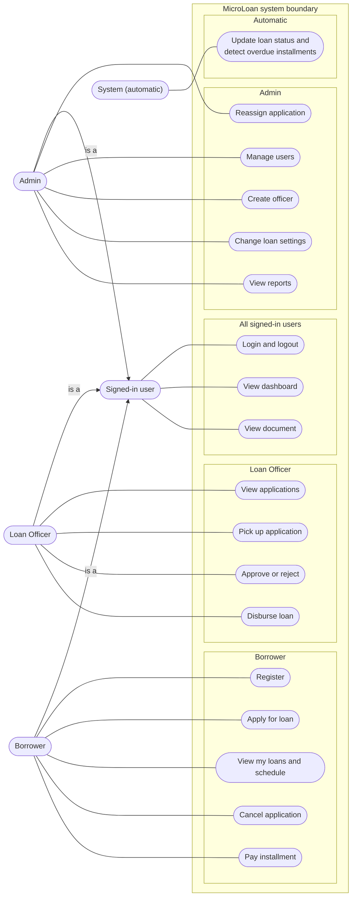

**Reading it.** Lines join an actor to the use cases that actor performs. **Signed-in user** is a generalised actor: Borrower,
Loan Officer and Admin each *are a* signed-in user, so the three shared use cases (*Login and logout*, *View dashboard*,
*View document*) are drawn once instead of three times. Everything else belongs to one role. The admin can also open the
applications list and details read-only (not drawn here; see 1c). Officers cannot apply, cancel or pay; borrowers cannot open
any `/officer` or `/admin` page (403). The next three diagrams show the include and extend relationships for each actor.

### Diagram 1a: Borrower (and System)

<!-- diagram: 01a_use_case_borrower -->
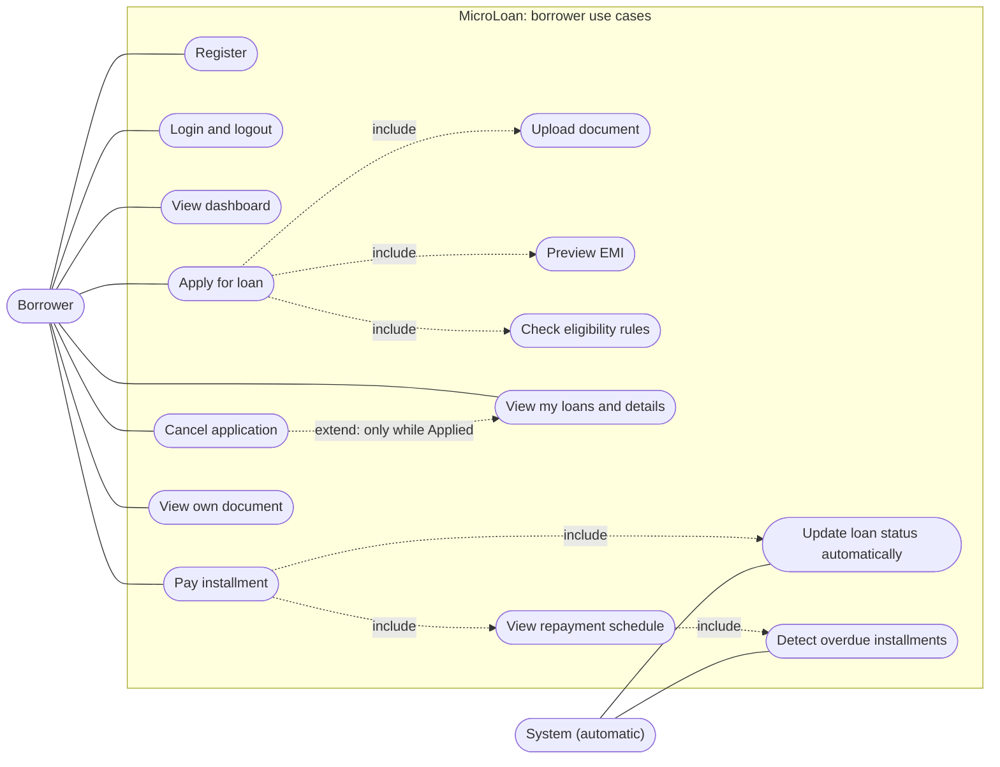

### Diagram 1b: Loan officer

<!-- diagram: 01b_use_case_officer -->
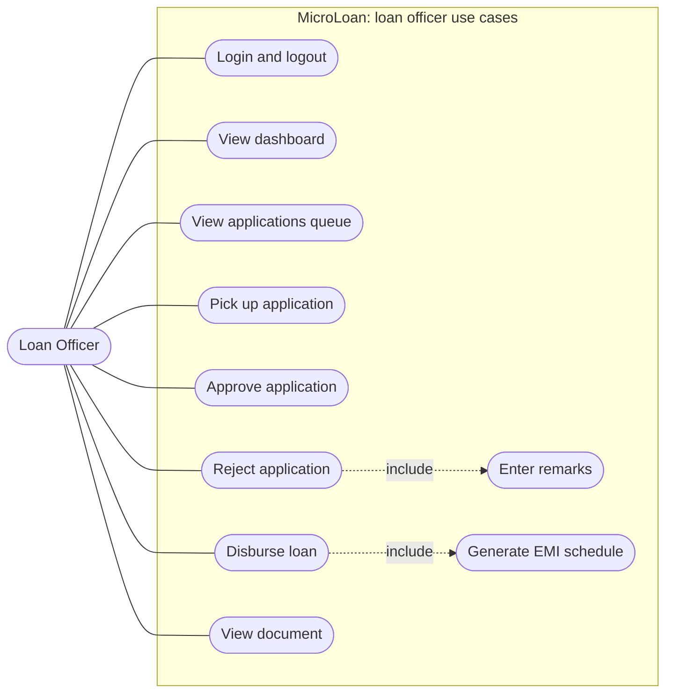

### Diagram 1c: Admin

<!-- diagram: 01c_use_case_admin -->
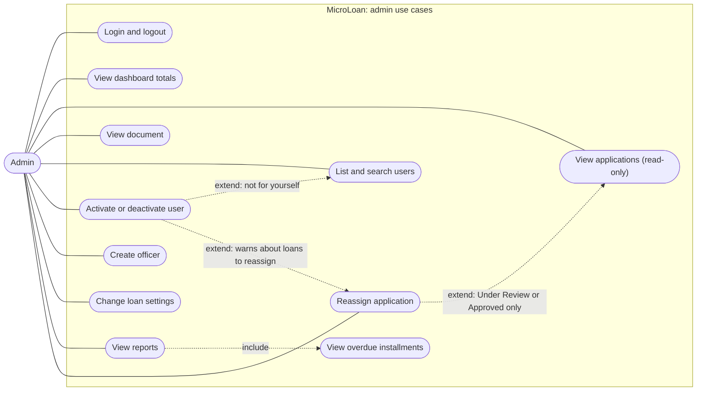

**Notes that keep these accurate.**

- The admin opens the applications list and details to **read**; the action route (`/officer/applications/<id>/<action>`)
  is officer-only. The one admin action on an application is the separate `reassign` route.
- *View document* is allowed for the owning borrower, any officer and the admin.
- "Update loan status automatically" and "Detect overdue installments" happen in code while a payment is processed or a
  page is drawn, not in a background job. The **System** actor is a modelling choice that makes them visible.
- Rule R11: only the officer who picked up an application can approve, reject or disburse it; any officer may *Pick up*.

---

## 2. Activity diagrams

**Purpose.** Show the step-by-step flow with its decisions. Drawn left to right.

### Diagram 2: Apply for a loan

**Requirements:** FR-10 to FR-18. All checks except R3 run even when an earlier one failed, so every message appears
together; the affordability check (R4) runs only when the amount and the tenure are themselves valid
(`check_application`, `loan_service.py:158`).

<!-- diagram: 02_activity_apply_for_loan -->
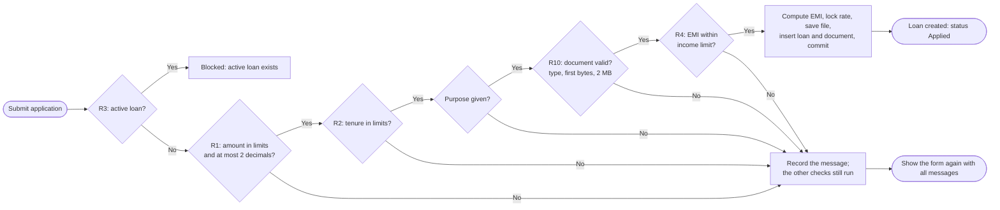

**Reading it.** Diamonds are decisions, rounded boxes are start and end. A "No" at R1, R2, purpose, document or R4 does not
stop the checks: the message is recorded and the form is shown once with every message and the values kept.

### Diagram 2b: Review, reassign and disburse

**Requirements:** FR-24 to FR-33.

<!-- diagram: 02b_activity_review_disburse_reassign -->
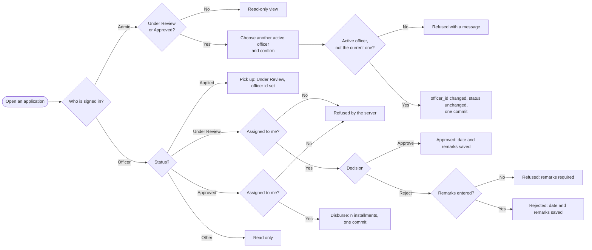

**Reading it.** The top branch is the admin: read-only unless the loan is Under Review or Approved, when the admin may hand it
to another active officer. The lower branch is the officer: the server refuses any decision on a loan that is not theirs
(R11). Reassignment changes only the officer, so the loan continues in the same state with its new owner.

---

## 3. Class diagrams

**Purpose.** The classes (database models) and the service modules around them. Split in two so each stays readable.

### Diagram 3: Domain classes (models)

<!-- diagram: 03_class_domain -->
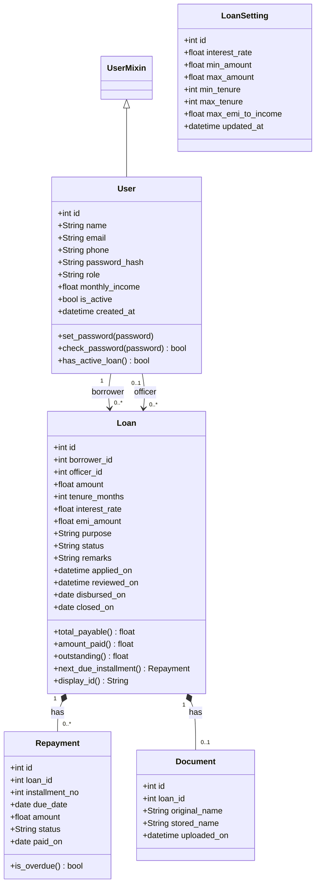

**Reading it.** `Loan` is the central class. `Repayment` and `Document` belong to one loan (composition). `User` appears twice
towards `Loan` for its two roles: borrower, and the optional reviewing officer (the officer can change through admin
reassignment). `User` inherits Flask-Login's `UserMixin`. `LoanSetting` has no relationships: it holds one global row (id 1).
All five classes extend `db.Model` (Flask-SQLAlchemy). Source: `app/models.py`.

### Diagram 3b: Service layer and its dependencies

<!-- diagram: 03b_class_services -->
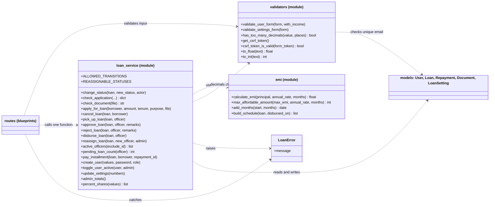

**Reading it.** Routes depend on `validators` and `loan_service`. Only `loan_service` changes loans (status through
`change_status`, owner through `reassign_loan`) and only it knows the business rules. `emi` is pure arithmetic with no
database access. Sources: `app/services/loan_service.py`, `app/services/emi.py`, `app/utils/validators.py`.

---

## 4. CRC cards (Class, Responsibility, Collaborator)

**Purpose.** One card per class: what it knows and does (**Responsibilities**) and which other classes it works with
(**Collaborators**). The method names are the real ones in the code. The first five are the database models
(`app/models.py`); `LoanService` is the module `app/services/loan_service.py` and `EMICalculator` is the module
`app/services/emi.py` (see the notation notes at the top).

### User (model, `app/models.py:13`)

| Responsibilities | Collaborators |
|---|---|
| Know who a person is: `name`, `email` (unique, lower case), `phone`, `role` (borrower, officer or admin), `monthly_income` (borrowers only), `is_active`, `created_at` | `Loan` (as borrower and as reviewing officer) |
| Store the password only as a hash: `set_password()` | `werkzeug.security` (scrypt hashing) |
| Check a password at login: `check_password()` | `auth.login` route |
| Tell whether the borrower already has a loan in Applied, Under Review, Approved, Disbursed or Repaying: `has_active_loan()` | `Loan`, `LoanService.check_application`, `macros.apply_button` |
| Be loadable from the session and be blocked when deactivated: `load_user()` | Flask-Login (`UserMixin`), `LoanService.toggle_user_active` |

### Loan (model, `app/models.py:43`)

| Responsibilities | Collaborators |
|---|---|
| Hold one application: `amount`, `tenure_months`, `interest_rate` (locked at apply time), `emi_amount`, `purpose`, `status`, `remarks`, `applied_on`, `reviewed_on`, `disbursed_on`, `closed_on` | `LoanSetting` (the rate is copied from it), `EMICalculator` (the EMI is calculated by it) |
| Know its borrower (`borrower_id`) and its reviewing officer (`officer_id`, set at pick-up, changed only by an admin reassignment) | `User` |
| Total up the money: `total_payable()`, `amount_paid()`, `outstanding()` | `Repayment` |
| Find the installment to pay next: `next_due_installment()` | `Repayment`, `LoanService.pay_installment` |
| Show a friendly id such as LN-0006: `display_id()` | Templates |
| Have its status changed only through the state machine | `LoanService.change_status` |

### Repayment (model, `app/models.py:92`)

| Responsibilities | Collaborators |
|---|---|
| Represent one EMI installment: `installment_no`, `due_date`, `amount`, `status` (Pending or Paid), `paid_on` | `Loan` (owner) |
| Say whether it is overdue (Pending and due date before today); computed, never stored: `is_overdue()` | `macros.schedule_table`, `LoanService.overdue_installments` |
| Be created in a batch when a loan is disbursed | `EMICalculator.build_schedule`, `LoanService.disburse_loan` |
| Be marked Paid in order | `LoanService.pay_installment` |

### Document (model, `app/models.py:108`)

| Responsibilities | Collaborators |
|---|---|
| Link one supporting file to a loan: `original_name` (for display), `stored_name` (uuid plus extension), `uploaded_on` | `Loan` (exactly one per application, by code rule) |
| Point to a file kept outside `static/` in `uploads/` | `uploads/` folder, `main.view_document` (the only way to download it) |
| Be created only after the file passed the checks | `LoanService.check_document`, `LoanService.apply_for_loan` |

### LoanSetting (model, `app/models.py:118`)

| Responsibilities | Collaborators |
|---|---|
| Hold the one global settings row (id 1): `interest_rate`, `min_amount`, `max_amount`, `min_tenure`, `max_tenure`, `max_emi_to_income`, `updated_at` | `LoanService.get_settings`, `LoanService.update_settings` |
| Provide the limits used to validate every application | `LoanService.check_application`, `check_affordability` |
| Provide the rate that is copied into a new loan (old loans keep their own) | `Loan` |
| Be edited and validated by the admin | `admin.settings` route, `validators.validate_settings_form` |
| Supply the live limits and sample EMI on the landing and apply pages | `main.index`, `borrower.apply` |

### LoanService (module `loan_service`, `app/services/loan_service.py`)

| Responsibilities | Collaborators |
|---|---|
| Keep every business rule and status change in one place; routes only call it | All route blueprints, `LoanError` |
| Enforce the state machine: `ALLOWED_TRANSITIONS`, `change_status(loan, new_status, actor)` | `Loan` |
| Validate and create an application: `check_application()`, `check_document()`, `check_affordability()`, `apply_for_loan()`, `cancel_loan()` | `EMICalculator`, `LoanSetting`, `User`, `Document`, `validators.has_too_many_decimals` |
| Move a loan through review and payout: `pick_up_loan()`, `approve_loan()`, `reject_loan()`, `disburse_loan()` | `Loan`, `Repayment`, `EMICalculator.build_schedule` |
| Hand a loan to another officer: `reassign_loan()`, `active_officers()`, `pending_loan_count()` | `User`, `Loan` |
| Take payments in order and update the status: `pay_installment()` | `Repayment`, `Loan` |
| Manage accounts and settings: `create_user()`, `toggle_user_active()`, `update_settings()` | `User`, `LoanSetting` |
| Prepare dashboard and report numbers: `borrower_summary()`, `officer_summary()`, `admin_totals()`, `disbursed_per_month()`, `overdue_installments()`, `percent_shares()` | `Loan`, `Repayment`, `User` |
| Commit once per action and roll back on any error | `db.session` (Flask-SQLAlchemy) |

### EMICalculator (module `emi`, `app/services/emi.py`)

| Responsibilities | Collaborators |
|---|---|
| Calculate the EMI with the reducing-balance formula, rounded to 2 decimals (rate 0 gives P / n): `calculate_emi()` | `LoanService.check_application`, `apply_for_loan`, `main.js` (same formula for the live preview) |
| Work out the largest amount a borrower can afford: `max_affordable_amount()` | `LoanService.check_affordability` |
| Add months safely (31 Jan + 1 month = 28 Feb): `add_months()` | `build_schedule` |
| Build the installment list at disbursal, last one adjusted so the total is exactly EMI x n: `build_schedule()` | `LoanService.disburse_loan`, `Repayment` |
| Do pure arithmetic with no database access | (none) |

---

## 5. State diagrams

**Purpose.** The heart of the business logic: the allowed status changes of a loan (`ALLOWED_TRANSITIONS`) and of an
installment. **Requirements:** FR-19, FR-24 to FR-29, FR-36, FR-37.

### Diagram 4: Loan lifecycle

<!-- diagram: 04_state_loan -->
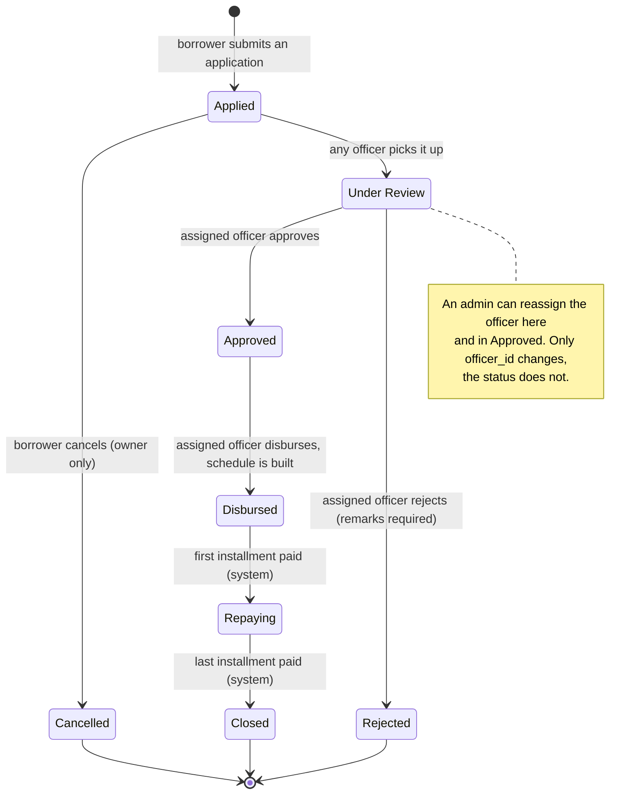

**Reading it.** Eight states and seven transitions; the three final states are **Cancelled, Rejected and Closed**. Every other
combination (for example Applied to Approved) is impossible: `change_status` checks the table and raises `LoanError`
otherwise. Reassignment is **not** a transition (the status stays the same), which is why it appears as a note and
not as an arrow.

### Diagram 4b: Installment

<!-- diagram: 04b_state_repayment -->
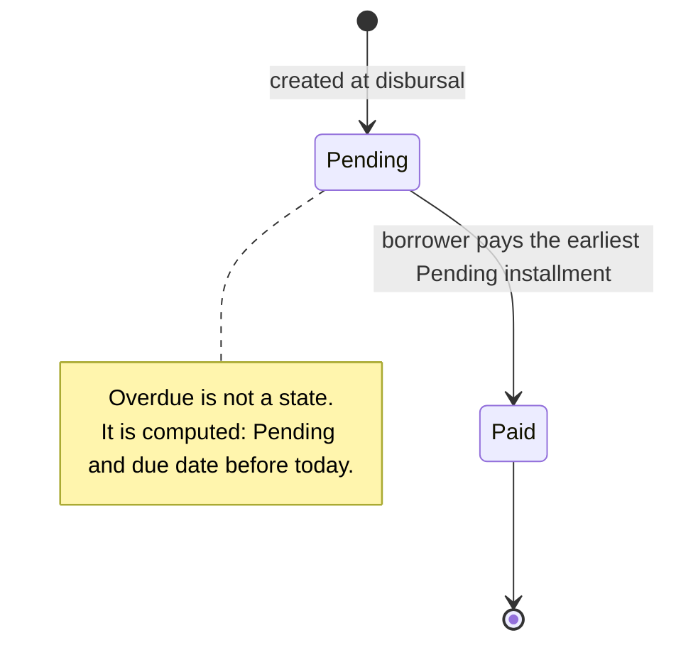

---

## 6. Swimlane diagrams

**Purpose.** Show **who does what** in a process. Each vertical lane is one actor; time runs downwards; an arrow that crosses
a lane border is a hand-over. Lanes run left to right: **Borrower | System | Loan Officer | Admin**. Rounded boxes are
end points, diamonds are decisions, the dotted arrows are the optional admin detour.

### Diagram 5: Full loan lifecycle (apply, review, reassign, disburse, repay, close)

**Requirements:** FR-10 to FR-37. **Related:** state diagram 4, sequence diagrams 7b, 7c, 7d, 7e.

<!-- diagram: 05_swimlane_loan_lifecycle -->
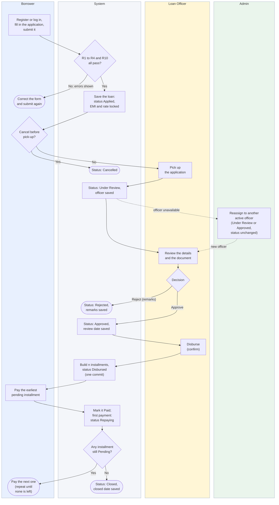

**Reading it, step by step.**

1. **Borrower** registers or logs in, fills in the application (amount, tenure, purpose, one document) and submits it.
2. **System** checks rules R1 to R4 and R10 (`check_application`). If any fails, the errors are shown together and the
   borrower corrects the form. If all pass, the loan is saved with status **Applied**, the EMI calculated and the
   interest rate locked.
3. **Borrower** may cancel while the loan is still Applied; the **System** then sets **Cancelled** (final).
4. **Loan Officer** picks the application up; the **System** sets **Under Review** and saves the officer.
5. **Admin** (dotted detour): if that officer is unavailable, for example deactivated, the admin reassigns the loan to
   another active officer. The status does not change (`reassign_loan`). The same detour is possible while the loan is
   Approved and waiting for payout.
6. **Loan Officer** reviews the details and the document, then decides. **Reject** (remarks required) makes the **System**
   set **Rejected** (final). **Approve** makes the **System** set **Approved**.
7. **Loan Officer** disburses (after a confirm dialog). The **System** builds the *n* installments and sets **Disbursed**
   in one commit.
8. **Borrower** pays the earliest pending installment. The **System** marks it Paid (the first payment also sets
   **Repaying**), then asks whether any installment is still Pending: if yes the borrower pays the next one, if no the
   **System** sets **Closed** with the closed date (final), and the borrower may apply again.

The smaller diagram below zooms into step 8.

### Diagram 5b: Pay an installment

**Requirements:** FR-35 to FR-38, FR-54.

<!-- diagram: 05b_swimlane_pay_installment -->
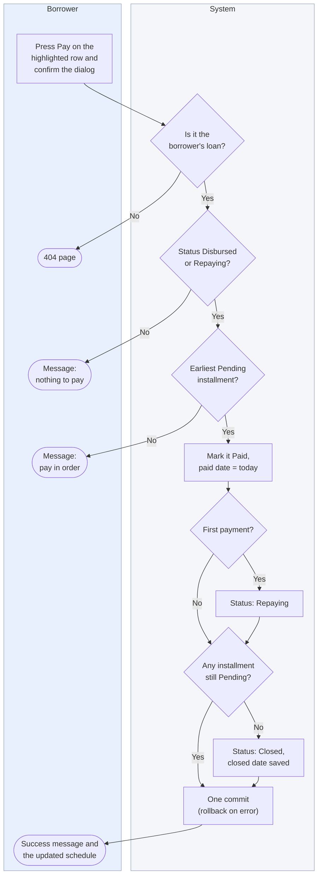

**Reading it.** The borrower's only action is pressing Pay. The **System** then runs the checks of `pay_installment` in
this order: it is the borrower's own loan (otherwise 404), the loan is Disbursed or Repaying, and the installment is the
earliest Pending one (rule R8). After the row is marked Paid it sets Repaying on the first payment and Closed when no
installment is left, and saves everything with one commit (rollback on error). The three left-hand end points are the
refusals the borrower can see.

---

## 7. Data flow diagrams (DFD)

**Purpose.** Show how data moves between the outside world, the processes and the stores. Notation: rectangle = external
entity, circle = process, cylinder = data store, arrow = data flow. **Stores:** D1 Users, D2 Loans, D3 Repayments,
D4 Documents, D5 Settings.

### Diagram 6: Level 0 (context)

<!-- diagram: 06_dfd_level0 -->
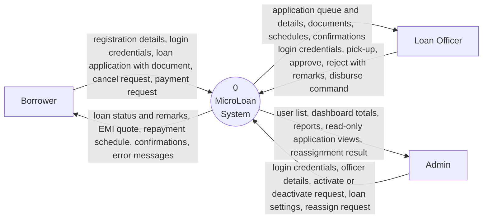

**Elements:** three external entities and one process. The CDN that delivers Bootstrap and Chart.js is a delivery dependency
of the browser, not a party that exchanges business data, so it is not an entity.

### Diagram 6b and 6c: Level 1 (two sheets)

Level 1 splits the system into its six processes and five stores. It is drawn on **two sheets** because one sheet with all
the flows is unreadable; stores are repeated where they are used. A double-headed arrow between an entity and a process is
two flows (request in, response out, written "in / out"). An arrow from a process to a store is a **write**; from a store
to a process is a **read**.

**Sheet 1: processes 1, 2 and 3 (accounts and settings, apply or cancel, review and reassign)**

<!-- diagram: 06b_dfd_level1_sheet1 -->
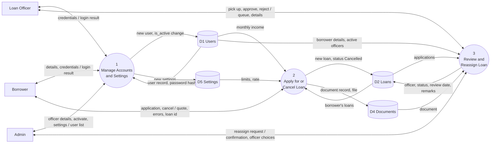

**Sheet 2: processes 4, 5 and 6 (disburse and schedule, repayment, reports)**

<!-- diagram: 06c_dfd_level1_sheet2 -->
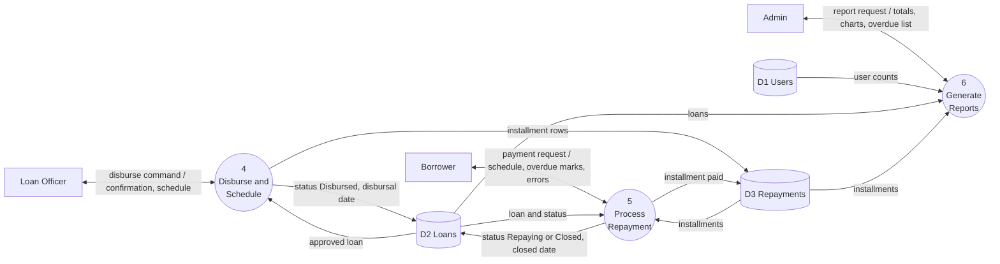

**Level 1 flow list** (the single source for both sheets, useful when redrawing in another tool).

| # | From | To | Data |
|--:|---|---|---|
| 1 | Borrower | P1 | registration details, credentials |
| 2 | P1 | Borrower | login result, confirmations |
| 3 | Loan Officer | P1 | credentials |
| 4 | P1 | Loan Officer | login result |
| 5 | Admin | P1 | officer details, activate or deactivate request, new settings |
| 6 | P1 | Admin | user list, confirmations |
| 7 | P1 | D1 | new user, `is_active` change |
| 8 | D1 | P1 | user record, password hash |
| 9 | P1 | D5 | new settings |
| 10 | Borrower | P2 | application (amount, tenure, purpose, document), cancel request |
| 11 | P2 | Borrower | EMI quote, error messages, loan id |
| 12 | D5 | P2 | limits and rate |
| 13 | D1 | P2 | monthly income |
| 14 | D2 | P2 | the borrower's existing loans |
| 15 | P2 | D2 | new loan, or status Cancelled |
| 16 | P2 | D4 | document record and file |
| 17 | Loan Officer | P3 | pick up, approve, reject with remarks |
| 18 | P3 | Loan Officer | application queue and details, confirmations |
| 19 | D2 | P3 | applications |
| 20 | D1 | P3 | borrower details, active officers |
| 21 | D4 | P3 | document |
| 22 | P3 | D2 | officer id, status, review date, remarks |
| 23 | Loan Officer | P4 | disburse command |
| 24 | P4 | Loan Officer | confirmation, schedule |
| 25 | D2 | P4 | approved loan |
| 26 | P4 | D2 | status Disbursed, disbursal date |
| 27 | P4 | D3 | installment rows |
| 28 | Borrower | P5 | payment request |
| 29 | P5 | Borrower | schedule, overdue marks, confirmations, errors |
| 30 | D3 | P5 | installments |
| 31 | D2 | P5 | loan and status |
| 32 | P5 | D3 | installment paid |
| 33 | P5 | D2 | status Repaying or Closed, closed date |
| 34 | Admin | P6 | report request |
| 35 | P6 | Admin | totals, charts, overdue list |
| 36 | D1 | P6 | user counts |
| 37 | D2 | P6 | loans |
| 38 | D3 | P6 | installments |
| 39 | Admin | P3 | reassign request: loan id, new officer |
| 40 | P3 | Admin | confirmation or error, officer choices |

**Consistency with level 0:** the flows between entities and processes (rows 1 to 6, 10, 11, 17, 18, 23, 24, 28, 29, 34, 35, 39,
40) are the detailed form of the six level 0 flows. Stores never exchange data with entities directly.
**Mapping to code:** P1 = `auth.py` and the user and settings functions of `admin.py`; P2 = `borrower.apply`, `borrower.cancel`;
P3 = `officer.py` (`pick_up_loan`, `approve_loan`, `reject_loan`, `reassign_loan`); P4 = `disburse_loan`; P5 = `borrower.pay`,
`pay_installment`; P6 = `admin.reports` and `admin_totals`.

### Diagram 6d: Level 2: process 2 "Apply for or Cancel Loan"

<!-- diagram: 06d_dfd_level2_apply -->
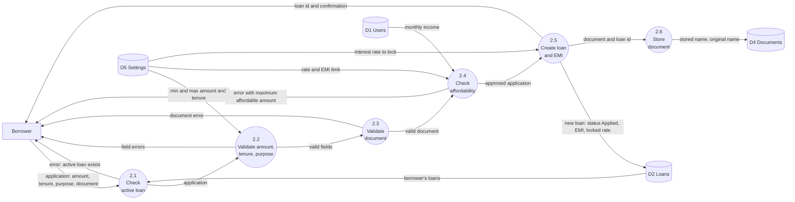

2.2 also rejects an amount with more than 2 decimal places; 2.3 checks the type, the first bytes of the file and the 2 MB
size. Order in the code (`check_application`): active loan, amount, tenure and purpose, document, then affordability only if
amount and tenure are valid. All errors come back together.

### Diagram 6e: Level 2: process 3 "Review and Reassign Loan"

<!-- diagram: 06e_dfd_level2_review -->
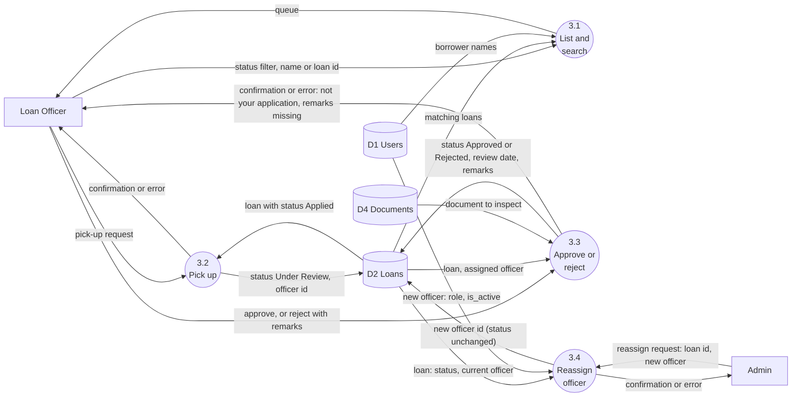

### Diagram 6f: Level 2: process 4 "Disburse and Schedule"

<!-- diagram: 06f_dfd_level2_disburse -->
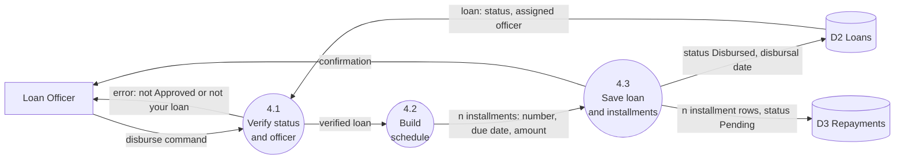

Process 4.3 is one database commit: the status change and every installment row are saved together or not at all.

### Diagram 6g: Level 2: process 5 "Process Repayment"

<!-- diagram: 06g_dfd_level2_repayment -->
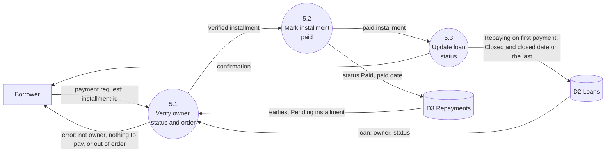

---

## 8. Sequence diagrams

**Purpose.** Show the order of messages between the browser, the route, the service and the database for one scenario.
All POST requests first pass the `check_csrf` hook (token comparison) and then the role decorator.

### Diagram 7: Login and logout

**Requirements:** FR-04 to FR-07.

<!-- diagram: 07_sequence_login_logout -->
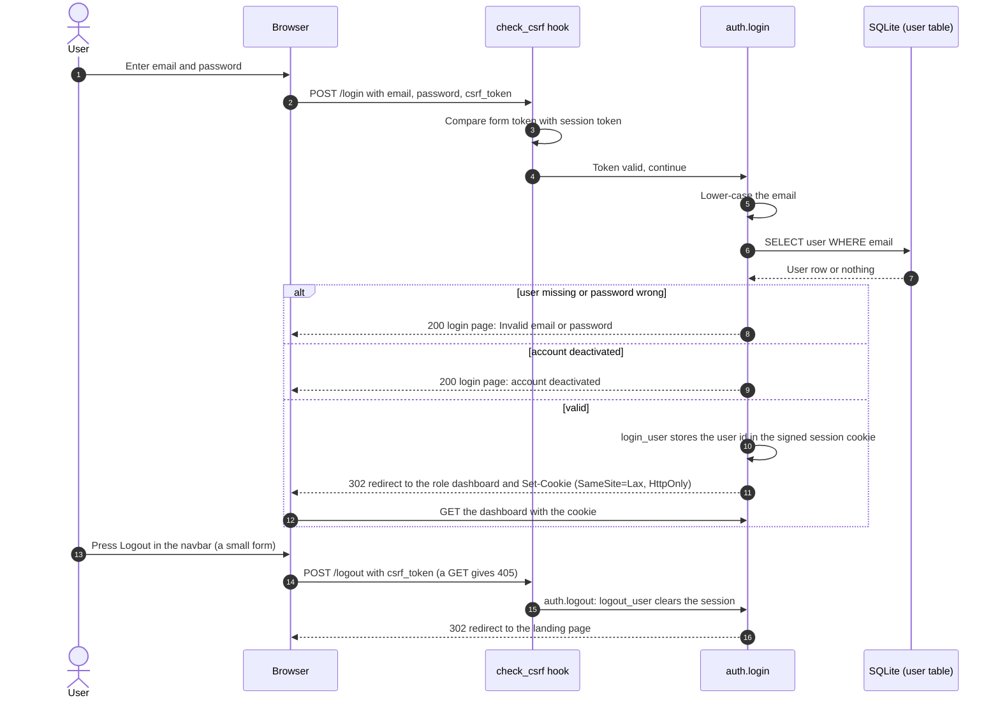

### Diagram 7b: Apply for a loan

**Requirements:** FR-10 to FR-18, FR-21.

<!-- diagram: 07b_sequence_apply -->
```mermaid
sequenceDiagram
  autonumber
  actor U as Borrower
  participant B as Browser and main.js
  participant R as borrower.apply
  participant S as loan_service
  participant E as emi.py
  participant DB as SQLite
  participant FS as uploads folder
  U->>B: Type amount and tenure
  B->>B: main.js recalculates the EMI preview (no server call)
  U->>B: Choose a document and press Submit
  B->>R: POST /borrower/apply (multipart) with csrf_token
  R->>R: to_float and to_int on the fields
  R->>S: apply_for_loan(borrower, amount, tenure, purpose, file)
  S->>DB: SELECT loan_setting row 1
  S->>DB: SELECT the borrower's loans (active loan check)
  S->>S: check_application: rules 1 to 4, at most 2 decimals, document type, first bytes and size
  S->>E: calculate_emi (inside the affordability check)
  alt there are errors
    S-->>R: no loan and an errors dictionary
    R-->>B: 200 form with values kept and messages
  else all rules pass
    S->>E: calculate_emi(amount, rate, tenure)
    S->>FS: Save uploads/uuid.extension
    S->>DB: INSERT loan (status Applied, rate locked) and INSERT document
    S->>DB: COMMIT
    S-->>R: the new loan
    R-->>B: 302 redirect to the loan page with a success message
  end
```

### Diagram 7c: Officer review and disbursal

**Requirements:** FR-24 to FR-29, FR-34.

<!-- diagram: 07c_sequence_review_disburse -->
```mermaid
sequenceDiagram
  autonumber
  actor O as Loan officer
  participant B as Browser
  participant R as officer.application_action
  participant S as loan_service
  participant E as emi.py
  participant DB as SQLite
  O->>B: Open an Applied application and press Pick up
  B->>R: POST /officer/applications/id/pickup
  R->>S: pick_up_loan(loan, officer)
  S->>S: change_status Applied to Under Review (any officer)
  S->>DB: UPDATE loan: status and officer_id, COMMIT
  O->>B: Press Approve (optional remarks)
  B->>R: POST .../approve
  R->>S: approve_loan(loan, officer, remarks)
  S->>S: change_status checks that this officer is the assigned one
  S->>DB: UPDATE loan: status Approved, reviewed_on, remarks, COMMIT
  O->>B: Press Disburse and confirm
  B->>R: POST .../disburse
  R->>S: disburse_loan(loan, officer)
  S->>S: change_status Approved to Disbursed (assigned officer only)
  S->>E: build_schedule(loan, today)
  E-->>S: n installments with due dates and amounts
  S->>DB: UPDATE loan and INSERT n repayment rows
  S->>DB: COMMIT (one commit for all)
  R-->>B: 302 redirect to the application page with a message
```

If any rule fails, `change_status` raises `LoanError`; the route catches it and flashes the message; nothing is saved.

### Diagram 7d: Pay an installment

**Requirements:** FR-35 to FR-37.

<!-- diagram: 07d_sequence_pay -->
```mermaid
sequenceDiagram
  autonumber
  actor U as Borrower
  participant B as Browser
  participant R as borrower.pay
  participant S as loan_service
  participant DB as SQLite
  U->>B: Press Pay on the highlighted row and confirm
  B->>R: POST /borrower/loans/id/pay with repayment_id and csrf_token
  R->>DB: Load the loan (404 if it is not the borrower's)
  R->>S: pay_installment(loan, borrower, repayment_id)
  S->>S: Check owner, status Disbursed or Repaying, and earliest Pending row
  alt a check fails
    S-->>R: LoanError
    R-->>B: 302 to the loan page with a red message
  else all checks pass
    S->>DB: UPDATE repayment: status Paid, paid_on today
    opt this is the first payment
      S->>S: change_status Disbursed to Repaying (system)
    end
    opt no installment is Pending any more
      S->>S: change_status Repaying to Closed (system), closed_on today
    end
    S->>DB: COMMIT
    R-->>B: 302 to the loan page with a success message
  end
```

### Diagram 7e: Admin reassigns an application

**Requirements:** FR-30, FR-31, FR-32.

<!-- diagram: 07e_sequence_reassign -->
```mermaid
sequenceDiagram
  autonumber
  actor A as Admin
  participant B as Browser
  participant H as check_csrf hook
  participant R as officer.reassign_application
  participant S as loan_service
  participant DB as SQLite
  A->>B: Open an Under Review or Approved application
  B->>R: GET /officer/applications/id
  R->>S: active_officers(exclude the current officer)
  R-->>B: Page with the Reassign to dropdown
  A->>B: Choose an officer, press Reassign, confirm the dialog
  B->>H: POST /officer/applications/id/reassign with officer_id and csrf_token
  H->>R: token valid, role_required admin passes (an officer or borrower gets 403)
  R->>DB: Load the loan (404 if missing) and the chosen officer
  R->>S: reassign_loan(loan, new_officer, admin)
  S->>S: Checks: admin, status, active officer, not the current one
  alt a check fails
    S-->>R: LoanError
    R-->>B: 302 to the application page with a red message
  else all checks pass
    S->>DB: UPDATE loan SET officer_id, COMMIT (rollback on error)
    R-->>B: 302 to the application page: reassigned from the old to the new officer
  end
  Note over R,S: Status unchanged. New officer owns the loan (R11),<br/>the old officer is refused.
```

---

## 9. Where each diagram is used

| Assignment item | Diagram(s) | Section |
|---|---|---|
| Use case diagram | 1, 1a, 1b, 1c | 1 |
| Activity diagram | 2, 2b | 2 |
| Class diagram | 3, 3b | 3 |
| CRC cards | seven cards | 4 |
| State diagram | 4, 4b | 5 |
| Swimlane diagram | 5, 5b | 6 |
| Data flow diagrams (level 0, 1, 2) | 6, 6b, 6c, 6d to 6g | 7 |
| Sequence diagrams | 7 to 7e | 8 |

If a feature changes, update these diagrams: a new status or transition changes 4, 5, 2b and 7c; a new rule changes 2, 5 and 6d; a
new role action changes 1 to 1c, 5 and 6 (DFD); a new table or field changes 3 and 6 (DFD).
